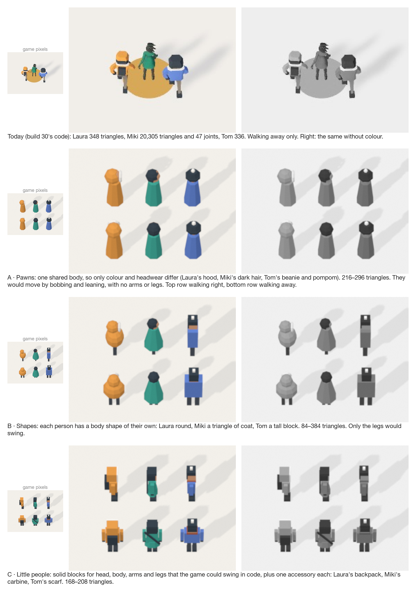

# Party pawns

The mock-up sheet from which the maintainer chose the party's look on 25 November 2026: **“A · Pawns”**. In play the party is only about 18 points tall on the phone, so three simple approaches were built from primitive shapes and rendered at game scale. The maintainer then confirmed the pawn as mocked up, with one skin tone for all three and Snow for the white fur ([issue #142](https://github.com/RonildoBraga/lauder/issues/142)). The party's [models](../../blender/assets/miki/README.md) follow it.

- **Top:** the party as it was then, from a Simulator capture of the code of TestFlight build 30 (draft [PR #154](https://github.com/RonildoBraga/lauder/pull/154)), for comparison.
- **A · Pawns, chosen:** one shared body, so only colour and headwear tell the three apart. The sheet's white fur became Snow.
- **B · Shapes** and **C · Little people:** not chosen.
- Each approach shows the figures at the game's own pixel size on the left and enlarged in the middle, then without colour on the right. In each, the top row walks right and the bottom row walks away from the camera.

**Source:** Rendered for Lauder with Claude's assistance on 25 November 2026, in Blender 5.3 (EEVEE) from primitive shapes, with camera B (offset `[0, 56, 44]`, 22° lens) and the bridge's lights. No third-party assets were used. The repository's [MIT licence](../../LICENSE) applies.
