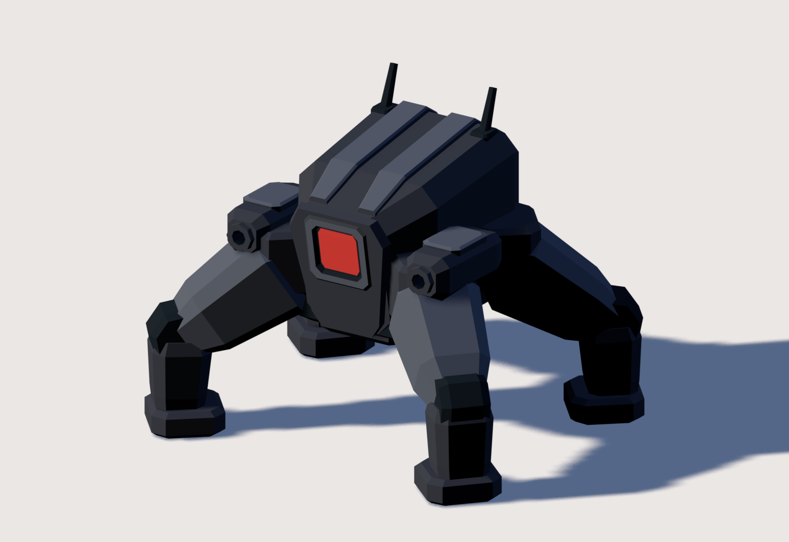

# C finish study

**Status:** Generated on 23 November 2026, then selected as direction for an assigned Blender finish pass. The sensor socket and stepped armour are now modelled separately; the actual mesh awaits visual review, with its own completed source/Simulator verification recorded separately. This PNG remains an approximate concept reference, not a model export, runtime result or TestFlight build.

| Actual Blender model | AI finish proposal |
|---|---|
|  |  |

The actual render was the edit target at source commit `2df4b45be850b3a1aaff8a103547e502b83a9bd8`. The relative image above follows the current model; this [immutable input revision](https://github.com/RonildoBraga/lauder/blob/2df4b45be850b3a1aaff8a103547e502b83a9bd8/blender/assets/spider-bot-heavy/preview.png) preserves the image used for generation.

## Proposed changes and review

- Frame the red square sensor in a protected, chamfered socket, giving it a recessed-housing treatment while retaining a prominent visible red area.
- Give the existing roof, shoulder and small cannon plates clearer stepped thickness, broad joins and a consistent chamfer treatment.
- Preserve the accepted long body, plain leg surfaces, feet, smaller paired guns, charcoal finish and mirrored construction as design constraints. Snow and wear remain deferred.

The first generated candidate made the red lens too small and added thin leg strips. A correction enlarged the red area and restored broad plain leg surfaces. Only the corrected candidate is retained; both [exact prompts and input roles](prompts.md) are recorded.

The maintainer authorised modelling the sensor housing and armour construction using this study as a visual guide. Review the current [Blender model and its validation](../../../blender/assets/spider-bot-heavy/README.md) separately. AI imagery does not verify dimensions, symmetry, mesh topology, material values, camera-B readability or phone performance, and approval to model the direction does not approve every generated detail or the resulting mesh.

## Provenance and storage

Generated by Codex with the built-in image-generation tool, using two opaque-background edit calls. The edit target is Lauder's actual C Blender render, not a downloaded third-party mesh. Proposed changes are the sensor socket and stepped/chamfered armour construction.

This reference-derived PNG is shared under [Creative Commons Attribution 4.0 International](https://creativecommons.org/licenses/by/4.0/), retaining the [source chain and attribution](../attribution.md) through the C model and concept studies to **Low-poly Spider Bot (Rigged)** by **rznn7**, from the [creator's asset page](https://rznn7.itch.io/low-poly-spider-bot). No creator endorsement is implied. This file-level notice does not change the licence of project code, documentation or unrelated artwork.

| File | Dimensions | Size in bytes | Storage policy |
|---|---|---:|---|
| `robot-finish-v1.png` | 1512 × 1040 | 1,323,494 | Explicit-path Git LFS |

The PNG exceeds 1 MiB and requires an explicit-path rule under the [repository storage policy](../../../CONTRIBUTING.md#git-lfs-and-cloning).
