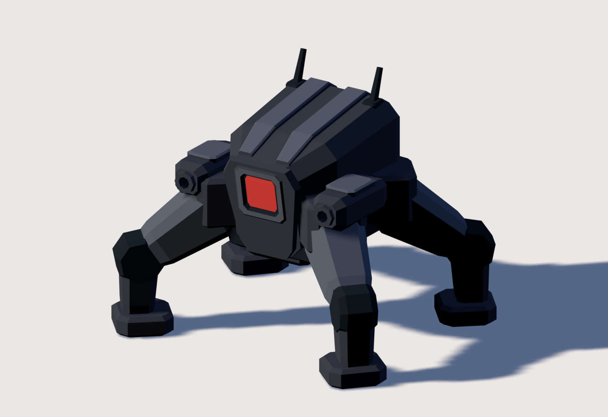

# spider-bot-heavy

**Status:** The original C form and motion were accepted, integrated and delivered in TestFlight build 29. The maintainer subsequently assigned body, colour/cannon and [modelled finish](../../../art/robot/finish-study/README.md) refinements, then requested thinner legs. This source and its four PNG previews now show the assigned narrower upper-leg armour and shins, retaining the recessed sensor and stepped plates. The current full check, fresh authoring audits and rendered first-fight check pass (35/35); visual review remains pending. The armour revision at `1695503` passed the full check and rendered first-fight (35/35), before this leg reduction. This refinement is not merged or released. A remains a possible later different-weapon variant, outside this task. Camera B remains approved.



- **Source:** New geometry and rigid-part motion authored for Lauder by Codex in Blender on 23 November 2026, following the selected [C — Heavy walker](../../../art/robot/bulk-studies/c-heavy-walker.png), its [exact prompt](../../../art/robot/bulk-studies/prompts.md) and the later [finish-study direction](../../../art/robot/finish-study/README.md). This retains the [reference chain](../../../art/robot/attribution.md) to **Low-poly Spider Bot (Rigged)** by **rznn7**, from the [creator's asset page](https://rznn7.itch.io/low-poly-spider-bot). No creator model, rig, animation or texture was downloaded or imported. No endorsement is implied.
- **Licence:** This reference-derived model, its runtime USDZ export, authored motion and rendered previews are shared under [Creative Commons Attribution 4.0 International](https://creativecommons.org/licenses/by/4.0/), with credit to rznn7 and the Lauder concept studies. Changes include new faceted geometry, a connected torso, substantial hip housings and legs, twin guns, square sensor, linked components and new walking, turning, bracing and recoil motion. This file-level notice does not replace the repository's licence for code or unrelated assets.

The earlier [spider-bot](../spider-bot/README.md) remains a rejected historical study. C is now registered as spawned and exported into the app as `spider-bot-heavy.usdz`, replacing the first human shooter. Its loaded joint hierarchy is posed from actual runtime movement and firing state. The later human knife attacker and recruitment scenes remain. The [encounter record](../../../docs/encounters/bridge-spider-bot.md) owns the prototype attack and supply-case/bypass rules.

## Reusable components and symmetry

The self-contained `spider-bot-heavy` collection uses metres, stands on z = 0 at its centred origin and faces Blender −y. Its **41 mesh Objects share 17 unique Mesh datablocks**, with **2,556 evaluated triangles and five materials**. Reuse is an authoring property, not measured runtime instancing or draw calls.

The first refinement added a tapered face, sloping roof panels, integrated cannon housings with recessed bores, and stouter knees, lower legs and feet. The accepted body pass extends the rear shell by **0.20 m**, raises its roof peak by **0.13 m** and narrows the face by **14%**. Antenna meshes are reseated **0.14 m rearward and 0.12 m upward**. The later cannon reduction scaled the housing, top plate and barrel to **88% of their former dimensions**, moving both muzzle markers from local y **−0.66 to −0.5808 m** (game z **−0.94 to −0.8608 m**). The later finish pass retained that body and reduced cannon bodies/barrels. The current leg reduction preserves those parts, joint/foot geometry and the rig. The six shared leg-component meshes still have four users each.

The finish pass at `1695503` added a closed sensor pocket: a **5 cm** broad frame, lip **16 mm** proud of the former face plane and floor **21 mm** deep. The **10 mm** thick red pane sits with its front **12 mm** behind that original plane, or **28 mm** behind the raised lip, retaining its full front outline. Roof plates are **60 mm** thick instead of 24 mm, with their lower edges seated and tops raised 36 mm; the paired cannon top plates gain 22 mm in mesh z. That pass changed four mesh datablocks—mask, sensor, roof ridge and cannon top plate—and added 64 triangles, preserving its other 13 meshes, object transforms, actions, muzzle markers and material colours. Shoulder construction reads through the cannon plates; leg/socket covers were preserved.

The current leg pass changes only the shared upper-leg and shin meshes. Upper-leg transverse XY factors are **1.00 / 0.85 / 0.80 / 0.80** at local z **0 / 0.1717 / 0.7676 / 1.01 m**: the hip edge stays seated, the main bulge narrows 15% and the knee end narrows 20%. Shin XY dimensions narrow **20%** throughout. All z coordinates, link lengths, stance, joint/foot geometry, the other 15 meshes, object transforms, parents, actions, muzzles and material colours are unchanged. No further slimming is assigned.

All four legs use the same six shared meshes: socket armour, hip hinge, upper armour, knee hinge, lower link and foot. Editing a component's Mesh in Edit Mode updates its four instances. Moving or posing an Object affects that instance only. Neutral left/right geometry mirrors across x = 0, including material assignments. Proper rotations place each assembly; object scales stay positive and unit. Independently posed legs during a step do not alter this shared geometry.

```text
root
  front-left connector          Also front-right, rear-left, rear-right
    socket mesh                 Shared socket Mesh
    hip pivot
      hip mesh                  Shared hip Mesh
      upper pivot
        upper armour mesh       Shared upper Mesh
        knee pivot
          knee mesh             Shared knee Mesh
          lower pivot
            lower mesh          Shared lower Mesh
            ankle pivot
              foot mesh         Shared foot Mesh; stays level
  gun-left recoil               Matching gun-right recoil
    housing, top plate, barrel   Shared corresponding Mesh data
    muzzle-left                 Moves with its barrel
```

Connectors sit at `(±0.58, ±0.42, 1.28)` m. Joint pivots meet at their link endpoints; the upper/lower links measure **1.01 / 0.57 m**. Opening the knees slightly gives the shape room to step: current neutral vertex bounds are about **3.02 × 2.56 × 2.47 m**, versus the static study's 2.83 × 2.51 × 2.35 m. Intake's conservative transformed-box bounds are slightly larger. These are provisional authoring dimensions, not approved collision or clearance measurements.

To attach another assembly, select its connector and descendants, duplicate with linked data and place the new connector. Preserve the hierarchy, joint-local origins and unit scales. Make mesh data single-user only for a deliberate new component. Paired roof ridges, antennae, mounts and gun parts also share data. Each gun's separate recoil root carries its housing, plate, barrel and muzzle marker together, providing an attachment point for later variants without building those variants now.

There are no textures, lights, cameras, armatures, constraints, shape keys or runtime solvers in the source. Its five matte Principled materials use armour and face `#30343E`, slate `#4B5260`, joints `#151D24` and red sensor `#C83C38`, converted from sRGB to scene-linear, with roughness 1, metallic 0 and emission 0. The earlier concepts and historical movie retain their burgundy face and pale sensor; they do not show this assigned finish.

## Motion studies

The scene is **30 fps**, with a **120 Hz transform bake** and linear interpolation, saved at neutral **frame 1**. The refinement preserves these accepted transform keys; the retained movie below shows the earlier mesh. Timeline markers identify separate takes:

| Frames | Study | Review intent |
|---|---|---|
| 2–242 | Walk, 8 s | Start, advance 1.55 m one leg at a time, then settle |
| 244–484 | Turn left, 8 s | Step through 90° while stance feet keep position and yaw |
| 486–726 | Turn right, 8 s | Mirror the left turn's placement, cadence and range |
| 728–908 | Brace and fire, 6 s | Step wider, lower the body, alternate recoil, fire both, recover |

Frames 243, 485, 727 and 909 reset to neutral between independent takes. These are editorial resets, not continuous movement or seamless loops. Each take starts and stops cleanly; travel and turning end in a neutral stance at their new position or heading.

Walking uses a four-beat crawl with at least three feet supporting the body. Feet lift 12 cm, travel and plant before taking load. During turns each stance foot keeps its world-space position and yaw until its next step. A two-link solve was used during authoring, then baked into ordinary object-transform keys; the hierarchy keeps joint endpoints connected and foot pivots compensate for leg pitch.

Firing plants all four feet before recoil starts. Both guns use matching stroke/recovery curves; their alternating timing is an authoring candidate. This authoring take contains no muzzle flash, projectile, aim line, damage, warning or ammunition logic. Runtime firing is implemented separately as described below; balance remains provisional.

## Review and validation

The retained [30-second motion reel](motion-preview.mp4) is a **historical accepted-rig reference showing the earlier 2,428-triangle form and colours**, not the current refinement. It presents separate labelled shots: walk at 0–8 s, turn left at 8–16 s, turn right at 16–24 s, brace/fire/recover at 24–30 s. It is H.264, 960 × 720, 24 fps, with 720 decoded frames. The current [hero preview](preview.png), [side profile](side-preview.png) and [view beside Miki](scale-preview.png) show the actual narrower legs, recessed sensor and stepped armour geometry. The [camera B study](camera-b-preview.png) uses the approved offset `[0, 56, 44]` with the existing **15.4° combat lens**, Miki 8 m from the guard, a 3 m camera lean and target height 0.95 m. The normal lens remains 22°. These PNGs are Blender studies, not Simulator screenshots.

They use the bridge's two suns and an authoring exposure of +0.7. Ground, Miki, lights and cameras exist only in unsaved render copies. Public PNG metadata is removed without changing pixels. The Blender source and movie use Git LFS; PNGs below 1 MiB use ordinary Git under the [storage policy](../../../CONTRIBUTING.md#git-lfs-and-cloning).

**Historical motion-study checks, before this refinement:** `./scripts/check` passed contracts, 51 Blender tests, sound fingerprints, Swift formatting, the shared app build and hosted Simulator tests. Independent saved-file inspection sampled 7,204 poses at 240 Hz, including half-key subframes: stance drift stayed below 0.029 mm, stance yaw drift below 0.000060°, foot tilt below 0.0053° and sole penetration below 0.012 mm. Joint gaps were zero; link-length error was below 0.00000023 m. Neutral geometry/material symmetry error was below 0.00000029 m and mirrored-turn error below 0.0000036 m. Shared-data identity, positive unit scales, topology, part contact, materials, muzzle placement, intake and privacy checks passed. Sampled rendered poses were inspected; all 720 movie frames decoded successfully. Prior static checks remain historical in the [prototype plan](../../../docs/prototype-plan.md#concept-c-proportion-study).

**Authoring checks:** Saved-file audits at `0148131` checked mesh closure, volumes, symmetry and preserved rig data; `2df4b45` checked 88% cannon scaling, muzzle tips and materials. The finish audit at `1695503` confirmed its 13 protected meshes and rig/material data; 75 sampled rays from face-normal, hero and camera-B directions hit the red pane, four rim rays hit slate, with no hidden front cap. Those are historical revision checks.

A fresh audit of the narrower legs samples **7,265 changed-skin poses**, with minimum armour clearance **77.8 mm**. All **96 joint/boot contact checks** retain intersection; link-cap centres stay within **0.000274 mm** of their intended endpoints. The 15 protected meshes, all object/parent transforms, rig/actions, material colours and every z coordinate match the preceding revision. The older dense sole proof remains applicable **only to the feet**, whose meshes, rig and keys are identical: penetration below 0.012 mm, stance-height error below 0.029 mm and tilt below 0.0053°. These are authoring checks, not phone-performance or visual-acceptance evidence.

The maintainer accepted this source motion and assigned bridge integration. The [first-tower record](../../../docs/encounters/bridge-spider-bot.md) describes the initial gameplay choices and remaining balance questions.

| File | Size in bytes | Storage |
|---|---:|---|
| `spider-bot-heavy.blend` | 1,722,366 | Git LFS |
| `motion-preview.mp4` | 1,274,401 | Git LFS |
| `preview.png` | 378,654 | Ordinary Git |
| `scale-preview.png` | 467,847 | Ordinary Git |
| `camera-b-preview.png` | 117,441 | Ordinary Git |
| `side-preview.png` | 273,179 | Ordinary Git |

## Runtime integration

The [runtime USDZ](../../../apple/sources/content/models/spider-bot-heavy.usdz) retains this model's CC BY 4.0 credit and changes. `RobotModelGeometry.swift` is generated alongside it, with both outputs fingerprinted against this Blender source. The output keeps the named leg pivots, gun mounts and muzzle markers; other models retain their existing export path. Runtime stepping follows actual translation and turning, rather than the authoring timeline's travel or reset frames. A remains a later variation, not an extra runtime model.

For the original form shipped in build 29, the standard check, loaded-model joint/muzzle tests and rendered first-fight (35/35), retry (15/15) and full opening (56/56) passed. Runtime gait uses a 1° stop-turn-advance gate and earlier stepping so tested patrol/combat feet remain reachable, with independent FK/stance errors below 0.002 mm. The first refinement at `3d5d810`, body pass at `0148131` and charcoal/smaller-cannon revision at `2df4b45` each passed the full check and rendered first-fight (35/35), with no failures or companion warnings. The recessed-sensor/armour revision at `1695503` also passed the full check and rendered first-fight (35/35), with six emitted shots, zero failures or companion warnings and frozen source/runtime fingerprints; its generated measurements matched `2df4b45`. The current narrower-leg source and export pass the full check, including the real-USDZ joint/muzzle tests; a fresh rendered first-fight check passes (35/35), with six emitted shots, zero failures or companion warnings and recorded recovery, defeat and Restart. Source/runtime fingerprints match through verification. Its generated body radius changes **1.298624 → 1.219415 m**. Navigation radius **2.067892 m**, half-height **1.234272 m** and all other generated measurements, including muzzles, remain unchanged. See the [runtime verification](../../../docs/prototype-plan.md#c-body-proportions--awaiting-visual-review). No new TestFlight delivery is claimed. The authoring audits above are not measurements of runtime gait or physical-phone performance.
