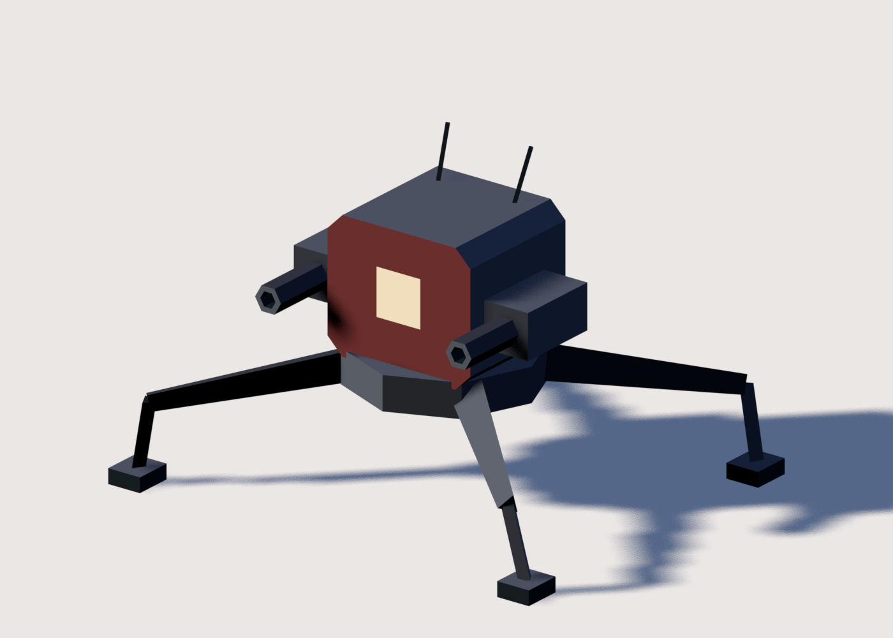

# spider-bot

A low-poly Blender model and authoring-only motion study of the selected dark armed [spider-bot concept](../../../art/robot/README.md). This source is not registered as a spawned model, exported into the app or placed in the playable encounter. The current human encounter and its gameplay remain separate.

The preview renders the actual model with the bridge's two suns and a review exposure of +0.7. It is a close authoring view, not an in-game screenshot or a new lighting setting for the bridge.

- **Source:** New geometry and object-transform motion authored for Lauder with Codex in Blender on 23 November 2026, following the project's [v3 robot studies](../../../art/robot/README.md). Those studies adapt the public preview of **Low-poly Spider Bot (Rigged)** by **rznn7**, from the [creator's asset page](https://rznn7.itch.io/low-poly-spider-bot). Preserve the full [concept attribution and changes](../../../art/robot/attribution.md). No original Blender, FBX, texture or rig file was downloaded or imported, and no creator endorsement is implied.
- **Licence:** This reference-derived model, its source motion study and `preview.png` are shared under [Creative Commons Attribution 4.0 International](https://creativecommons.org/licenses/by/4.0/), preserving credit to rznn7 and the project concept studies. Changes include new faceted geometry, a four-leg interpretation, a dark five-colour palette, two hollow-barrel gun pods, named muzzle markers and a rigid-part motion study. This file-level licence does not replace the repository's licence for code or unrelated assets.
- **Authoring status:** First model and motion pass built and inspected in Blender. Intake reports zero problems. The neutral mesh's vertex extents are **2.12 × 1.72 × 1.41 m**, with **298 triangles, 17 rigid mesh parts and five materials**. Intake's conservative rotated-part bounds report a length of 1.76 m. The source is about 161 KB, stored with Git LFS; the PNG preview is about 283 KB and stays in ordinary Git. Runtime compatibility and phone performance remain unverified.

## Source structure

The `spider-bot` collection uses metres, is centred over its origin and faces Blender −y. A root Empty holds a shallow chassis, an upright chamfered head, two gun pods, eight rigid leg segments and four separate flat feet. The head's pale square sensor is a flat front-facing plate; the two thin antennae are part of the head mesh. The two leaf muzzle Empties mark the actual barrel tips.

Upper leg plates taper from a nominal 18 cm triangular-section diameter at the hip to 10 cm at the knee. Their 82 cm upper and 32 cm lower segments are initial model proportions, with knees lowered after checking the silhouette from camera B. Separate feet keep their soles level while the leg segments turn.

Five matte, untextured Principled materials use these sRGB values, converted to scene-linear values in Blender: armour `#30343E`, slate `#4B5260`, joints `#151D24`, face `#662E30` and sensor `#E9DFCA`. There are no armatures, constraints, shape keys, textures, emissive effects or added lights. This is an asset-local palette; it does not recolour existing party or bridge materials.

## Authoring motion study

The source timeline runs at 24 fps, with frame 1 saved as the neutral rest pose:

| Frames | Study |
|---|---|
| 2–24 | Subtle idle with planted feet |
| 25–73 | Three 16-frame walk cycles, a 0.4 m stride and 1.2 m of root travel at 0.6 m/s |
| 74–80 | Hold the walk's end pose |
| 81 | Reset for a separate stationary take; not a return gait |
| 82–89 | Alternate diagonal pairs step wider while the chassis lowers into a brace |
| 97 / 101 | Left / right visual gun recoil, with no shot or damage |
| 105–113 | Step back into the neutral stance and recover |

Walking uses alternating diagonal leg pairs, 60% stance, fixed world-space feet during stance and a small lifted swing. A two-link solve supplies object poses for the rigid upper and lower segments; it is baked into source keyframes rather than a runtime solver. Flat feet remain parallel to the floor. The source has linear keyframe interpolation.

At the authored 24 fps samples, stance drift and joint endpoint errors are below 0.000001 m. Interpolating between those samples can separate a joint by about 1.1 cm; this is a first source-preview limitation. Runtime motion still needs design and validation to keep joints connected and feet planted while following actual movement.

These are visual studies, not combat AI, approved movement speeds, attack timings or runtime animation clips. The existing model export writes only the selected frame. Any later runtime integration must validate hierarchy and muzzle names after export, add the appropriate asset registration and implement motion driven by actual movement and collision. The [encounter proposal](../../../docs/encounters/bridge-spider-bot.md) retains its separate design gate.
