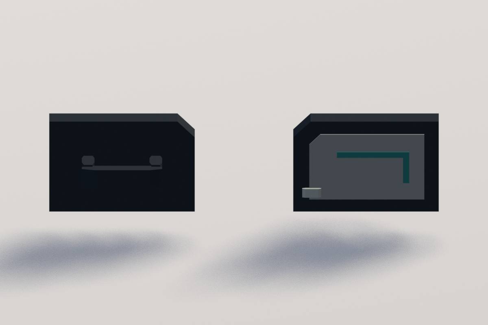

# Miki navigator and sniper pose study

**Status:** Retained four-pose equipment-fit comparison, 24 November 2026. The maintainer selected the [angular graphic direction](../../../art/characters/angular-study/README.md), agreed Miki's [field navigator/explorer role](../../../docs/story/story-bible.md#tablet-and-field-navigation), clarified her sniper identity, then assigned independent character and equipment sources. This file is a linked review composition. Visual review found her rough body differs from the selected concept. The maintainer subsequently approved the [Miki-only modelling references](../../../art/characters/angular-study/miki-reference/README.md) as the basis for a separate [unrigged A-pose rebuild](../miki-reference-blockout/README.md). That new mesh awaits visual review; the four fit poses, sources and results documented below remain unchanged comparisons. Laura and Tom are unchanged. All these sources are unregistered studies and do not export into the app.


## Open and inspect

Open `miki-angular.blend`. Choose a scene from Blender's scene selector:

| Scene | Purpose |
|---|---|
| `01 Tablet role poses` | Default four-pose gallery, with labels and shared bridge lighting |
| `02 Inspection model` | Linked character, rifle and slate in the inspection pose |
| `03 Lowered carry model` | Linked assets showing one-handed rear-grip carry |
| `04 Stowed model` | Linked assets showing the vertical slate in its holster, hands free |
| `05 Weapon ready model` | Linked assets showing holstered slate and two hands on the precision rifle, in low-ready carry |
| `06 Concept comparison` | Original concept crop beside the inspection pose |
| `07 Camera B exact phone scale` | Normal camera B projection at 926 × 428, facing along the route |
| `08 High rear artist close-up` | Enlarged orthographic rear view at the same viewing angle |
| `09 Field slate detail` | Front and back of the shared device without the character |
| `10 Sniper rifle family` | Side-profile design comparison of scout, precision and heavy rifle options |

The four local pose collections assemble linked character and equipment collections. The galleries reuse those same assets. Cameras, labels, floor, lighting and equipment-placement transforms belong to this review file. The concept card is a UV crop of the original generated sheet, not a character texture.

## Asset ownership and editing

```text
blender/studies/
  miki-angular/
    miki-angular.blend                    Linked review composition
    character/
      miki-angular-character.blend        Body, clothing and worn mounts; four static poses
  equipment/
    rifle-scout/rifle-scout.blend          Independent scout rifle
    rifle-precision/rifle-precision.blend  Independent precision rifle
    rifle-heavy/rifle-heavy.blend          Independent heavy rifle
    field-slate/field-slate.blend          Independent tablet
```

Open the [character source](character/README.md) to edit Miki's body, face, hair, clothing or worn holster/sling. Its default scene is directly editable and has no rifle or tablet geometry, including hidden or unused data. It retains four static body poses, not a skeleton or fitted animation. Common body parts share mesh data within that file; arms retain their pose-specific geometry.

Open the relevant [equipment source](../equipment/README.md) to change a rifle or the slate. Each owns native-origin geometry, materials and local grip/reference markers, with no dependency on Miki or the review file. The holster and sling remain character-fitted worn mounts. Save the asset, then reopen this review to reload its linked data.

Adjust holding/stowing placement here, using one local collection instance per equipped asset. Character-side contact markers follow gloves or coat in the character source; local prop counterparts reference the equipment's named native interfaces. These static placements and checks need no library overrides or new attachment framework. Changing a design still requires rechecking fit. No runtime equipment binding is implemented.

## Field slate and carrying arrangement



The slate uses a compact landscape case, clipped corner, matte inset, two broad map marks, a physical control and rear grip. Its **case measures 0.185 × 0.125 × 0.026 m**; the rear handle adds depth beyond the case. It uses the existing palette, without screen emission, text or functional interface. The broad marks suggest field records at artist scale; tiny graphics cannot establish its identity at camera B.

The device rotates vertically into the existing hip-pouch location. The case seats on the floor, with about **22.5 mm exposed above the lip**. A **40 mm open channel** in the holster front clears the rear grip mounts; the back, side strips and floor support the slate. The broad retainer is folded down when the device is held and closed above it when stowed. These are separate static shapes, not a demonstrated opening animation.

| Pose | Visual intent |
|---|---|
| Inspection | Both hands support the slate below the collar; the display faces Miki and her head inclines towards it |
| Lowered carry | One hand holds the rear grip outside the coat, with the display facing her leg |
| Secure stow | The same slate is vertical behind the retainer; both hands are free |
| Weapon ready | The slate remains holstered, both hands meet the rifle and the stock contacts the upper coat below the collar; there is no duplicate back weapon |

The role extends technical inspection and purposeful salvage. The [first-tower observation vignette](../../../docs/gameplay-script.md#mikis-tablet-exploration-vignette-proposal) remains a proposed gameplay example. This pass establishes no new map screen, control, scanner, hacking ability or runtime attachment rule.

## Sniper rifle family


The [sniper direction](../../../docs/story/story-bible.md#sniper-rifle-family) retains Miki's patient observation and precision/disruption role. The three visual options use the same broad design language: tapered shoulder stock and cheek comb, shaped receiver and grip, faceted fore-end, a separated slim barrel and one low-mounted scope. Charcoal, slate and a restrained teal mark keep them consistent with her clothing and field equipment. The scope's front is matte rather than emissive.

| Visual option | Authored shape | Proposed distinction, not implemented balance |
|---|---|---|
| Scout | Shorter barrel, narrower fore-end and smaller optic; about 0.90 m overall | Lighter handling and faster recovery |
| Precision | Medium scope and full fore-end; about 1.06 m overall; used in the four poses | Deliberate, balanced long-range shots |
| Heavy | Deeper receiver, substantial shroud and boxier optic; about 1.17 m overall | Slower anti-machine option |

These are alternative compatible rifles, with one equipped at a time. Each independent source supplies the common stock, grip, support, scope and muzzle convention for comparing designs. The review links the same Precision collection across all four poses. Other variants have not been fitted to the hands or animated. Acquiring, selecting and balancing them remain design work.

The precision rifle replaces the earlier three-piece gun throughout this study. While Miki inspects or carries the tablet, the rifle lies along the existing back sling with a small keeper linking the assembly. That keeper is a static attachment study, not a validated sling or draw mechanism. In the ready pose, the tablet stays secured and the stock is supported against the coat below the tall collar. This is **low-ready**, below her eyes. A convincing scoped aiming pose still needs head, neck, shoulder, cheek and eye-relief work, followed by recoil and transition checks. It is not established by adding an optic to a static gun.

The built bridge retains its current carbine, assisted/manual aim, ammunition, damage and controls. No runtime rifle swap, scope view, equipment interface or new weapon rule is included here.

## Model construction


The small tapered face, swept angular bob, long separated legs, teal wrap coat, broad diagonal ivory collar and unequal coat points remain the preceding blockout's forms. The body, head, tablet and holster from the field-device pass are preserved. This pass replaces the study weapon, adds the sling keeper and refits the ready arms; its contact remains an authoring approximation pending rig fitting.

Each equipped review figure still has **57 mesh parts, 1,446 triangles and 837 vertices**: the character contributes **37 parts / 998 triangles / 573 vertices**, Precision **12 / 280 / 164**, and the slate **8 / 168 / 100**. Counts exclude review context and the rifle-family comparison. Geometry is editable in each owning source. Parts remain closed and intentionally overlap at body/clothing connections; this is not connected deforming topology. The initial blockout at `4ac20ea` had 36 parts and 938 triangles; the field-device pass at `c0e2d56` had 47 parts and 1,222 triangles.

The three independent sources own **17 material datablocks** in total, representing the same **ten distinct numeric palette appearances** as the preceding combined study. Their materials are local so each asset opens without another library. This authoring arrangement establishes no runtime material/draw-call budget; import validation and optimisation remain later gates.

Faces use flat normals and broad planes. There is no armature, skinning, Action, modifier, cloth simulation or custom runtime shader. The clothing/device palette remains teal `#358F84`, teal shadow `#286C66`, teal light `#5B9E91`, ink `#30373C`, ivory `#CDCEBC`, ivory shadow `#A8AA9E`, skin `#CCA17D`, skin shadow `#A37F63` and leather `#594C40`; the rifle adds matte slate `#626C70`. These study choices do not change the current runtime palette or 400-triangle target. Budget and import validation precede integration.

## Camera comparison


The exact camera B scene retains target **(0, 0, 0.95)**, eye **(0, −44, 56.95)**, perspective projection and **22° vertical field of view**. The model's native front is −Y; the route-facing instance rotates 180° around Z to face +Y, away from the camera. Resolution is **926 × 428 at 100%**, with square pixels, corresponding to the baseline phone's landscape point dimensions.

The inspection figure still projects to approximately **11.32 × 18.79 render pixels**. The [uncropped camera B render](camera-b.png) establishes projection and scale, not successful physical-phone readability. The high rear close-up preserves its viewing direction but uses orthographic scale 2.6 to inspect shapes. Neither image is a Simulator screenshot or full bridge/HUD render. Coat, collar, hair, gesture and the rifle's broad silhouette must carry recognition at the distant framing.

Additional inspection views: [front](front.png), [side](side.png), [rear](rear.png). Individual pose views: [inspection](inspection.png), [lowered carry](lowered-carry.png), [stowed](stowed.png), [weapon ready](weapon-ready.png).

## Verification and next gate

An independent saved-source audit compares all ten scenes with the pre-separation revision at `7d0e79b`. Evaluated geometry, normals, material appearances, cameras, lighting, labels and prior markers are preserved, with maximum vertex drift below **0.00027 mm** from floating-point transform composition. All six static contact pairs, native interfaces and one-rifle-per-pose checks pass. The five standalone sources have no external dependencies or misplaced/orphan equipment/character data; the review retains only three local context meshes. These checks do not prove anatomical finger grip, continuous draw/stow motion, scoped aiming, full self-collision clearance or shared-skeleton compatibility.

The public sources match the audited private candidate, with resolving relative libraries/image references and no private staging paths. The review opens on its camera-framed gallery; the character opens on an editable bare stowed pose. Saved studio editing views suppress reference-empty overlays. All **48 protected canonical/source/runtime/export fingerprints** and the earlier rounded study remain unchanged. The existing **62 Blender/export tests pass**, including saved-file hygiene. Relative documentation links, whitespace and Git LFS storage pass.

An isolated-copy edit extended eight Precision muzzle-tip vertices by 20 mm. Reopening the copied review updated all **12 linked placements** across its scenes, with the other eight vertices unchanged. This verifies source reuse, without changing an authored/public file. The previews above remain actual Blender renders from `7d0e79b`; fresh inspection, ready and device-detail renders visually match them, with more than 99.9% matching pixels. No duplicate PNG revisions are needed for this ownership-only change. The linked review and bare character were inspected in connected Blender.

Visual review found helmet-like hair, a plain face, slab-like collar, boxy sleeves and a blank coat panel drifting from the selected concept. The technical checks above validate this earlier study's geometry, extraction and preservation; they do not establish a design match or fresh verification of the new body. The maintainer approved the body turnaround and head/hair/collar/detail sheets as a modelling basis and assigned the separate [reference-led A-pose study](../miki-reference-blockout/README.md), whose mesh still awaits matched-view review. This comparison's device, carrying arrangement and poses remain available for later refitting, before deforming topology or shared motions are fitted. Later motion work must recheck foot contact, coat clearance, hand/weapon alignment and transitions. Physical-phone performance and final visual acceptance remain unverified. No app build, Simulator run, phone test, merge or release is included in this authoring pass.

## Source and licence

- **Source:** Original Blender geometry authored for Lauder by Codex, guided by the selected AI-generated concept, separated into the [character source](character/README.md) and [equipment sources](../equipment/README.md). No third-party mesh, rig, texture or animation was imported. The [concept's provenance](../../../art/characters/angular-study/README.md#generation-and-provenance) remains separate from the model's authorship.
- **Licence:** Original model and documentation under the project's [MIT licence](../../../LICENSE).
- **Storage:** Editable `.blend` source uses the format-wide Git LFS rule. PNGs larger than 1 MiB have explicit-path rules; smaller images remain ordinary Git. Render PNG metadata is removed with compressed pixels unchanged.
