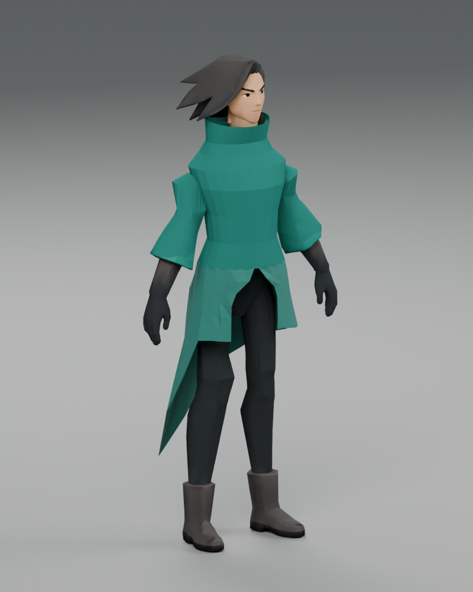

# Miki simple dress and motion study

**Updated authoring review, 25 November 2026.** The maintainer asked: “I think we should simplify and remove the side bag and the belts so only have the dress with a high colar.” This candidate follows that direction with a simple teal dress and integral standing collar. The bag, crossbody/waist belts, rear strap and folded scarf are removed from the current outfit. Original references, raw assets and history remain preserved. Canonical characters, shared motion, gameplay and app resources are unchanged.

## Review in Blender

Open [miki-fullbody-fit-review.blend](miki-fullbody-fit-review.blend) with `character` beside it. Its animated and static scenes use **one relative character library only**: the editable [character/miki-fullbody-fit.blend](character/miki-fullbody-fit.blend), collection `miki-fullbody-fit`. No equipment is displayed or linked into this review.

[Front](front.png) · [Back](back.png) · [Face](face.png) · [Motion reel](motion-preview.mp4)

The images and reel are native Blender renders of the frozen candidate, not AI replacements or retouched previews. The animated scene presents two editorial takes at 120 fps; the other scene remains independently unposed for inspection.

| Take | Source timeline | Repetitions |
| --- | --- | ---: |
| Run | 1–312 | 4 |
| Sneak | 313–744 | 3 |

The **6.2-second**, **960 × 900** H.264 reel contains **186 frames at 30 fps**, sampling every fourth source frame. These editorial cuts demonstrate the selected clips, not gameplay transitions. All eleven fitted body clips remain in the authoring source; Fire is not displayed in this review.

## Outfit, geometry and colour

The accepted [Tripo full-body base](../miki-fullbody-tripo/README.md) began at 1,931,766 triangles and was reduced to a UV-preserving 12,000-triangle core. This outfit revision deliberately replaces obsolete clothing surfaces with clean native topology; the retained original surface and the new clothing are recorded separately. The lower dress is a clean open wrap with a practical high-low front hem and a longer side/back tail. It is not the old fused coat/leg-return mesh.

The upper dress joins a tailored bodice directly into a hollow high collar, with no raised belt ring. A small neck infill fills the source void formerly hidden by the scarf; two clean sleeve roots join the retained lower sleeves. The waist overlaps the lower dress internally. The formerly hidden hip bridge and jagged closure fans are retired. One connected matte-charcoal upper-leggings surface joins the retained pants at 61 exact seam points around 0.62 m; boots and lower legs remain.

| New upper component | Vertices | Triangles |
| --- | ---: | ---: |
| Bodice and integral high collar | 264 | 480 |
| Neck continuity infill | 48 | 92 |
| Clean sleeve roots | 165 | 271 |
| Continuous visible upper leggings | 517 | 1,030 |

Retained face/hair, glove, boot and pants vertices keep their source positions, weights and UVs. **62 neutral-cream scarf triangles previously classified into the head object are removed**; this is clothing cleanup, so the entire old head topology is not claimed unchanged. No jaw, face or hair redesign accompanies this revision. Retained pants receive a uniform charcoal material, with their UVs preserved. The gloves keep their fused-finger topology, without finger articulation.

One new **1,024² base-colour atlas** is baked natively from the cleaned body and head together, retaining their original UV charts and face/hair colours. Plain matte materials cover the new dress, closures and neck infill. No normal or roughness/metallic maps are required. Source images are not overwritten. Equipment remains independent: the [Precision rifle study](../equipment/rifle-precision/README.md) and other equipment are unchanged and excluded from these two takes.

**Frozen actor totals:** 4,669 vertices / 8,821 triangles, across eight meshes, including lining and visible leggings. This remains simplified generator topology plus bounded native clothing work, not production deformation retopology or an established iPhone budget.

## Shared skeleton, motion and regeneration

The actor keeps **17 fitted body bones** with the existing names and hierarchy. The canonical [shared skeleton and eleven `party.*` Actions](../../animations/README.md) remain immutable. The eleven local `miki.fitted.*` Actions preserve the fitted rest-space mapping, sole-contact correction and palm-target work; outfit cleanup changes none of those body curves. The source opens unposed at frame 0.

[refresh-motions.py](refresh-motions.py) refreshes only this study’s derived body motion and rejects a mismatched shared-source fingerprint. [refresh-dress.py](refresh-dress.py), using [dress_clearance.py](dress_clearance.py), regenerates this study’s coherent garment deformation from its frozen rest garment and fitted motion. Its inputs are the saved rest topology, skin weights/modes and fitted body clips. A change to any of those inputs invalidates prior garment samples and requires regeneration and native review; old independent coat correctives must not be reused silently.

The animated review owns local evaluated garment/Key data paired with its body motion; the static scene owns its rest configuration. Refreshing the authoring source requires rebuilding and rechecking the linked review and rendered reel. Neither helper saves the canonical party source. A full 297-frame regeneration reproduces 26 evaluated outer/lining pose samples exactly and leaves the eleven body curves and saved source unchanged. Both helpers reject a mismatched shared-motion fingerprint. A separate body refresh reproduces 33 sampled poses across all eleven clips exactly.

## Verification and remaining gates

Fresh native loads must resolve the single relative library and atlas, preserve the 17-bone/eleven-body-Action contract, and keep normalized skin weights with no more than four influences per vertex. Source-ID comparisons establish that retained body/head positions, weights and UVs are unchanged; they do not imply preservation of retired wardrobe faces. Review clones must bind every new component to their own copy of the same rig, including the head-bound neck infill. Follow the [repository validation and storage rules](../../../CONTRIBUTING.md#validation).

**Frozen validation:** all 62 existing Blender/export tests pass; fresh native inspection verifies 17 fitted bones, eleven unchanged body Actions, normalized weights with at most three influences and no unweighted vertices. The final 591-pose check at 240 Hz covers Run 157, Sneak 289 and Fire 145 poses; all geometry is finite/nondegenerate, foreign-clip keys stay zero, active keys sum to one and loop endpoints match exactly. All 61 pants joins and 55 sleeve joins remain exact. Native rest/front/back/face views and worst-fold/stride poses were inspected on the assembled snapshot. The full two-take sequence was rendered, decoded and opened in Blender for playback. No strict outer or lining triangle crossings were detected against retained legs and the entire actual upper-leggings surface across those 591 poses. The garment gate covers free panels with rest face-centroid Z below 0.98 m; the intentional upper waist attachment band is excluded. Minimum lining-to-floor clearance is 33.89 mm. This does not certify continuous-time/global self-collision or every motion. An angular trailing-tail fold and small Boolean sliver triangles remain; production retopology and runtime intake are unverified. Earlier 591-pose or underbody checks belong to their recorded snapshots and do not automatically validate this new dress.

**Remaining gate:** final visual review and bounded deformation acceptance, then a separately assigned runtime intake. No collision-free clothing guarantee, final appearance approval, all-clip garment approval or iPhone-performance claim follows from this authoring study. It includes no app/Simulator/phone run, canonical replacement, merge or release.

## Saved review files

| File | Bytes | SHA-256 |
| --- | ---: | --- |
| Character source | 2,413,190 | `da1f234dee4476245db69cc31f407018062452a8128d701fe70fdc3448188d56` |
| Two-scene review | 487,089 | `fab727d1bae71c1f5afd9c30cd5343954e9e404d4c9af3558364fe5d0424f5f5` |
| Base-colour atlas | 477,147 | `cd5e2a58ed43e3586a008dd22c16eb63bc144bf59c5f4b330329c98c61cc7d0d` |
| Two-take reel | 548,626 | `c9e73535e1f8467bdbc578d257f9b929472f2729f3c52d5c24c1a68f6c8233cb` |

These values bind the exact saved files and encoded media after the final freeze. Any geometry, material, motion or helper change requires refreshed evidence.

## Provenance and licence

The preserved [raw GLB](../miki-fullbody-tripo/source/miki-h3-trial-v1.glb) has SHA-256 `c21f1c753a5bc2b85017ddbd9428894af0732683daae48f50832059e7ad09edd`, Tripo H3.1 job `c6145ced-0843-4f0e-bcce-283c000f5238`, generated under an active paid subscription. The [input/reference lineage](../../../art/characters/angular-study/miki-fullbody-input/README.md) remains historical evidence even where its outfit differs. This native dress pass uses **no new AI generation, paid credits or purchase**.

The retained generator mesh and atlas keep their [paid-output provenance and applicable Tripo terms](../miki-fullbody-tripo/README.md#provenance-and-licence), separately from the earlier free head trial. Original Lauder motion, equipment, added geometry, fitting/review work, helpers and documentation use the project’s [MIT licence](../../../LICENSE), subject to recorded underlying rights and without an exclusive-rights claim over AI output. Native processing is agent-assisted; no human sculpting is claimed.
