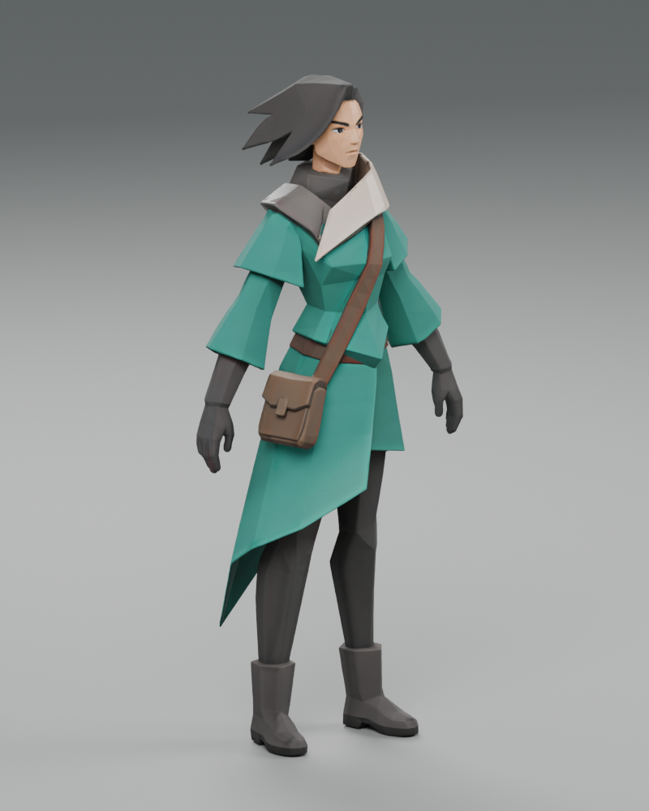

# Miki full-body Tripo draft

**25 November 2026 — static appearance review pending.** After rejecting the earlier body/motion fitting, the maintainer assigned a coherent full-body Tripo draft from the approved Miki art, with static review before another rigging pass. The maintainer then requested a recognisable side bag. The [new single-figure input](../../../art/characters/angular-study/miki-fullbody-input/README.md) replaces the former open frame with a compact brown field satchel. This does not approve the resulting illustration or mesh, or change the historical sheets.

## Inspect the actual model

Open [miki-fullbody-review.blend](miki-fullbody-review.blend) in Blender 5.3 or later, keeping the neighbouring `character` folder. The default **01 Colour review** scene shows the imported generated materials. **02 Clay review** overrides those materials to expose the actual volume. Both use the same linked character, five orthographic cameras, lighting and proportions; choose Front, Left profile, Right profile, Back or Three quarter. These profile labels identify the camera's side around the model, rather than a drawing's page-facing direction.

[Front](front.png) · [Left profile](left-profile.png) · [Right profile](right-profile.png) · [Back](back.png) · [Plain geometry](clay-three-quarter.png)

The PNGs are actual native Blender renders, not AI replacements or retouched proof of a mesh. The single-figure input is an AI-generated illustration and is labelled separately. The cameras use one common orthographic scale of 2.15 m and common 800 × 1,000 framing; profiles are not stretched or independently fitted. The three-quarter view looks from `[-3, -6, 2.5]` towards `[0, 0, 0.9]` at the hip bag's side. This is an artist review, not the gameplay camera B.

## What this trial establishes

The body, collar, coat, hands, boots, hair and bag were generated together, avoiding the forced fit between the earlier blockout's proportions and the shared rest skeleton. The bag has a closed body, overlapping flap, closure and depth, in place of the open cage. Clothing layers have volume in profile. The clay view confirms these large forms are geometry rather than only colour paint.

Visible differences remain: the face has a stronger jaw and sterner expression than the illustration; the generated eye colour is lighter; hair and coat planes are softened; fingers remain mitten-like; the back does not continue the shoulder strap shown in the original construction sheet. The coat's inferred rear construction and exact hem lengths need review. One image cannot constrain every hidden surface. No likeness, final appeal, functional bag construction or rig-ready topology is claimed.

**Next gate:** review this static character's silhouette, face, hair, collar and satchel in front, profiles, back and three-quarter. If its volume is selected, simplify/rebuild deliberate low-poly surfaces and correct hidden construction before fitting a skeleton and retargeting existing motion. Do not automatically force this mesh onto the old rest proportions. No rigging, animation, weapon attachment or runtime integration is included in this draft.

## Source and settings

| Setting | Recorded value |
| --- | --- |
| Provider / model label | Tripo, H3.1 – Best Quality |
| Input | `art/characters/angular-study/miki-fullbody-input/miki-three-quarter-v2.png` |
| Input SHA-256 | `1821e0ea6a87f60792af32521b4b72445627aa933a206d7bf8a127cf3afdf7f3` |
| Text prompt | None entered for this generation; image mode |
| Output | Geometry & Texture; one generation |
| Generate in Parts / 8K | Both off |
| Plan / credits | Existing Pro subscription; 55 credits; no extra purchase |
| Tripo visibility | Private |
| Job | `c6145ced-0843-4f0e-bcce-283c000f5238` |
| Export | GLB, current 4K textures |
| Seed / exact provider model revision | Not exposed by the used UI |

The [private source viewer](https://studio.tripo3d.ai/workspace/generate/c6145ced-0843-4f0e-bcce-283c000f5238) may require the generating account. Its inherited URL/title slug mentions the earlier head job; this generation's new UUID and uploaded v2 image identify the full-body trial. No additional text prompt was entered. There was no retry or later generation.

The [untouched GLB](source/miki-h3-trial-v1.glb) is **60,876,132 bytes**, SHA-256 `c21f1c753a5bc2b85017ddbd9428894af0732683daae48f50832059e7ad09edd`. Its embedded `asset.generator` remains `Tripo`; generated object identifiers and raw bytes are preserved.

## Native authoring split

- [character/miki-fullbody.blend](character/miki-fullbody.blend) is the self-contained, editable native import, with collection `miki-fullbody-tripo`. It has one generated mesh: **993,341 vertices and 1,931,766 triangle faces**, three packed 4,096 × 4,096 images, and no skeleton, skin weights or Actions. The raw GLB also contains no skins or animations.
- The native source adds only one parent alignment transform: a uniform scale and translation to centre the character and place its soles at ground level at a provisional **1.8 m** review height. This is not a new canonical height decision. No axis stretching, remeshing, decimation, sculpting or texture repainting was performed.
- The review links that source through `//character/miki-fullbody.blend`. It owns cameras, lighting, ground and the clay override. The character file contains no review lights or floor.
- The rifle and field tablet remain independent equipment; neither is generated into the mesh. The wearable satchel is included in this raw draft, not a new runtime equipment or inventory system.

This is a **dense reference mesh**, despite its graphic surface treatment. It does not meet the existing lean runtime model/texture contract and must not be copied into the app or canonical character folder. Packed textures here support an isolated visual review, not a claim that runtime model intake passes.

The earlier head/hair/body studies, rejected local motion experiment, approved sheets, shared skeleton/Actions, canonical character models, bridge and application resources remain unchanged by this trial. No app build, Simulator/phone run, performance result, merge or release is claimed.

## Provenance and licence

The inputs are original AI-generated project illustrations with the [recorded reference lineage](../../../art/characters/angular-study/miki-fullbody-input/README.md#generation-and-provenance), not a third-party game's extracted asset or a render of the failed mesh. Codex prepared the input and used Tripo's browser UI to generate/export; Blender performed the native import and review rendering. No human sculpting is claimed.

This new generation used an active paid subscription. The [Tripo terms](https://www.tripo3d.ai/terms), updated **13 November 2026** and checked **25 November 2026**, distinguish new paid content (§5.2.2) from earlier free output (§5.2.1), permit distribution and licensing of paid content subject to applicable rights and the agreement, and restrict removing AI-origin identifiers (§3.2). Retain the untouched source and its Tripo identifiers. This asset's vendor provenance and applicable terms remain attached; do not automatically relabel the raw generator output as an exclusively owned MIT asset. Original review setup, documentation and generated input contributions use the project's [MIT licence](../../../LICENSE), without an exclusive-rights claim over AI output. The earlier free head trial retains its own separate provenance.

## Verification

Raw GLB header/version/declared size, SHA-256 and generator were checked after the browser reported the completed download. Fresh native import agrees with the provider's geometry totals and packs the three embedded textures. Static colour views from front, both profiles, back and three-quarter and a clay view were rendered and inspected. Independent fresh-file inspection confirms exact imported vertex/topology hashes and all three texture payloads, uniform-only alignment, two scenes/five cameras, one resolving relative library, no private absolute references and successful native rendering. All 324 files in the pre-trial preservation baseline were unchanged at that check; subsequent status documentation and LFS entries are intentional edits. These technical checks do not approve appearance. The existing **62 Blender extension/export tests pass**. No runtime intake, deformation, gameplay or device-performance check is implied.
