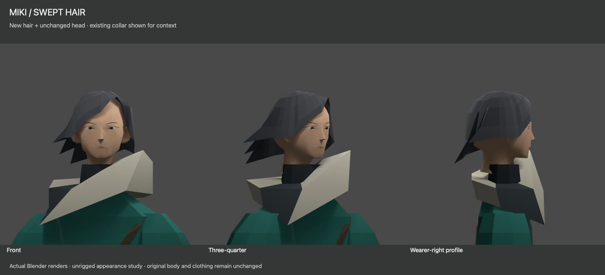
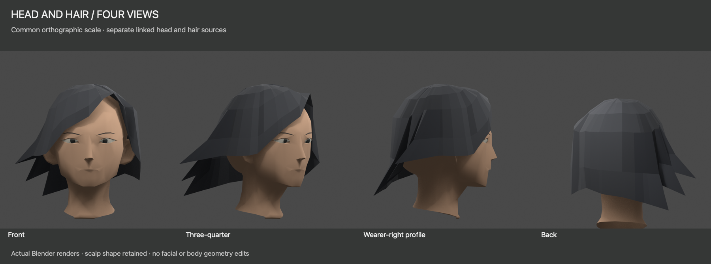
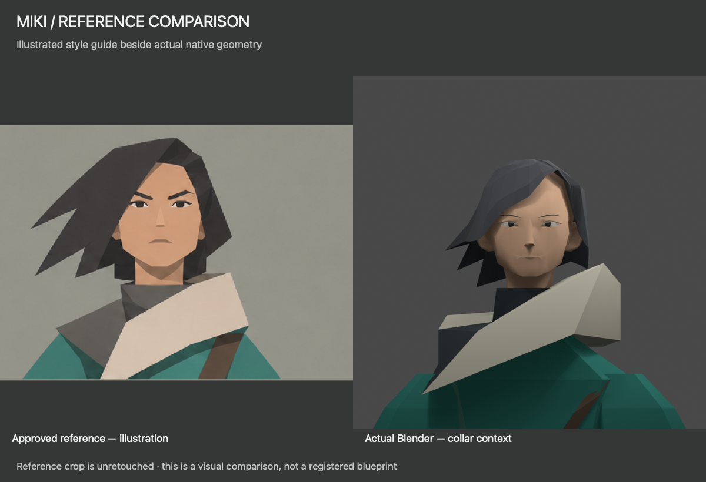

# Miki swept-hair study

**Status: retained hair source and appearance comparison.** After the [head cleanup](../miki-head-cleanup/README.md), the maintainer asked to proceed with Miki's separate swept hair and native reference/game-camera views. The cleaned head is the working base for this pass; its geometry, materials and source provenance remain unchanged. The maintainer subsequently assigned [neck/collar and shared-motion fitting](../miki-motion/README.md); that derivative references this unchanged hair source.

## Open and inspect

Open [miki-hair-review.blend](miki-hair-review.blend) in Blender 5.3 or later, retaining its sibling study folders. The default is the three-quarter head view. The scene selector provides:

| Scene | Purpose |
| --- | --- |
| `01 Head and hair` | Independent linked head and hair; front, wearer-right profile, three-quarter and back cameras |
| `02 Body and collar context` | Existing unaccepted clothing with a uniform preview head fit; portrait and full-body artist cameras |
| `03 Camera B projection` | Uncropped 926 × 428 image using the existing 22° vertical game-camera projection |

Edit [hair/miki-hair.blend](hair/miki-hair.blend) for the original hair geometry. It contains the `miki-swept-hair` collection, separately from the [unchanged Tripo-derived head](../miki-head-cleanup/head/miki-head.blend). The review links these and the earlier body source through relative libraries. No library override, copied head/body geometry, texture, rig, Action or runtime export is introduced.

The broad diagonal fringe starts high on wearer-left and sweeps to wearer-right/back. Three unequal rear points and a compact opposite side curtain frame the face. The crown follows the scalp instead of adding a tall cap. Large flat graphite planes and a small matte palette carry the shape; both eyes remain readable in the inspected views. Front is −Y, up is +Z and wearer-right is −X.

| Hair source | Count |
| --- | ---: |
| Editable mesh objects | 1 |
| Vertices / polygon faces | 201 / 200 |
| Triangles | 360 |
| Matte materials | 3 |
| Modifiers / textures / rigs | 0 |

The hair is a connected **open-hem cap**, with 40 intentional boundary edges. It has no hidden offset shell, thickness modifier or watertight-volume claim. Its shaped outer surface supplies the volume; Blender materials display both sides. Runtime material sidedness and export remain later integration checks. The head plus hair evaluates to **1,608 triangles**; the unchanged body context brings the actor to **3,124**. These are authoring-study counts, not an adopted runtime budget.

The four head views use one **0.40 m orthographic scale**, wide enough to expose the hair points. Their camera angles and lighting derive from the head cleanup; the rear camera shares the frontal vertical framing. No individual view squeezes or fits the head. The collar portraits are separately labelled artist views, not this head comparison or the game projection.

Head and portrait inputs are rendered at 900 × 900. The turnaround displays 450 × 450 panels and the portrait sheet 600 × 600 panels. Camera B remains the original 926 × 428 render without enlargement or cropping.

## Reference and context

The [approved detail sheet](../../../art/characters/angular-study/miki-reference/head-and-construction-v1.png) guides the silhouette and sweep. The reference panel is an unretouched crop of that image; the model panels are actual Blender renders. The sheets assemble those inputs and labels, with no generated beauty replacement, painted anatomy or retouching. The illustration is not a registered geometric blueprint, and this study does not claim exact reproduction.

The collar/body context uses **29 unchanged linked clothing/body parts** from the [earlier unaccepted A-pose study](../miki-reference-blockout/character/README.md). Its old head, face features, hair and neck are excluded from this composition. A uniform scale of approximately **0.892858**, plus translation, aligns the new head's crown/chin to that body's earlier 1.808/1.607 m landmarks and aligns head-depth midpoints. The same transform places the hair. These are preview transforms: no body source, head geometry, neck topology or shared skeleton was edited. Neck/collar clearance, continuity and motion still require a later fitting pass.

Camera B retains eye **(0, −44, 56.95)**, target **(0, 0, 0.95)** and **22° vertical field of view**, with the context turned 180° around Z to face the route. This is a static Blender projection check, not a Simulator screenshot. The tiny actor shows why silhouette and colour matter at gameplay scale; it does not establish facial readability, runtime import or phone performance. Enlarged portraits remain artist views.

## Source and licence

Hair geometry and presentation are original work authored by **Codex** for Lauder, guided by the approved generated Miki illustrations, under the project's [MIT licence](../../../LICENSE). No downloaded third-party hair, character, texture or rig was used. Reference-image provenance remains with the [approved sheets](../../../art/characters/angular-study/miki-reference/README.md).

The independently linked head retains its **Tripo free-output source grant**, Creator/job/hash and [source notice](../miki-head-pilot/tripo/README.md); it is not relabelled MIT by this hair study. The original FBX, CC0 foundation comparison, head cleanup, body/equipment studies, approved art, canonical models, shared animations, bridge and app resources remain unchanged.

Native sources use Git LFS. Each PNG is below 1 MiB and stays in ordinary Git. Blender 5.3 renders supply the model panels; native macOS image composition adds labels and the unchanged reference crop.

| File | Bytes |
| --- | ---: |
| `hair/miki-hair.blend` | 592,516 |
| `miki-hair-review.blend` | 641,924 |
| `preview.png` | 879,116 |
| `turnaround.png` | 637,260 |
| `reference.png` | 641,136 |
| `camera-b.png` | 189,898 |

## Verification and next gate

Fresh native reopening confirms the self-contained hair source, all three retained review scenes, the default head three-quarter camera and three resolving relative libraries. The hair has one connected surface, finite vertices, coherent winding, no overused/internal nonmanifold edges and no zero-area triangles. A nonadjacent-face BVH diagnostic reports no overlap pairs; it is not a universal surface-intersection proof. The intentional hem remains open.

The linked head remains exact, including its source geometry, decoded normals, materials and modifiers. Its inherited brow ribbons retain a zero-area triangulated tip on each side, despite nonzero polygon-face areas; this hair task does not alter that protected head. The earlier head record now distinguishes those properties. Neck joins and this inherited triangulation detail can be addressed during the later fitting/export pass.

Independent saved-file checks confirm exact membership and geometry/normals/materials for the 29 body parts, the uniform preview fit within floating-point precision, and the exact Camera B matrix, vertical FOV and resolution. The head three-quarter and Camera B rerenders match their decoded pixels exactly. The collar three-quarter rerender differs in **333 of 810,000 pixels**, at most **10/255**, with no source-geometry change; this small rendering variance is retained rather than called pixel-exact. Privacy and source-preservation checks pass. All **62 Blender/export tests** pass, and **147 local documentation links/anchors** resolve.

Review the front/profile/back silhouette, eye exposure, rear sweep and collar context before body fitting or reusing the shared skeleton and running, sneaking and shooting clips. This is an unrigged appearance candidate, not final character acceptance or a new runtime budget.

The app and Simulator are not part of these authoring-only checks. No installation, merge or release is included.
