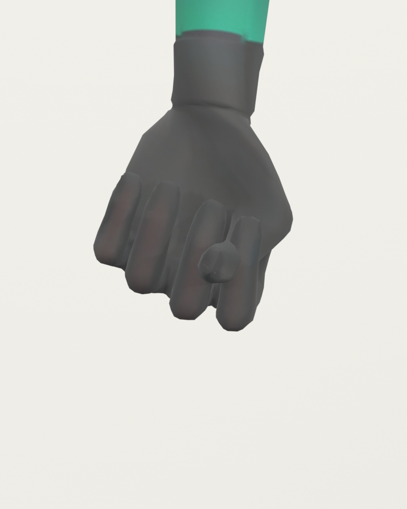
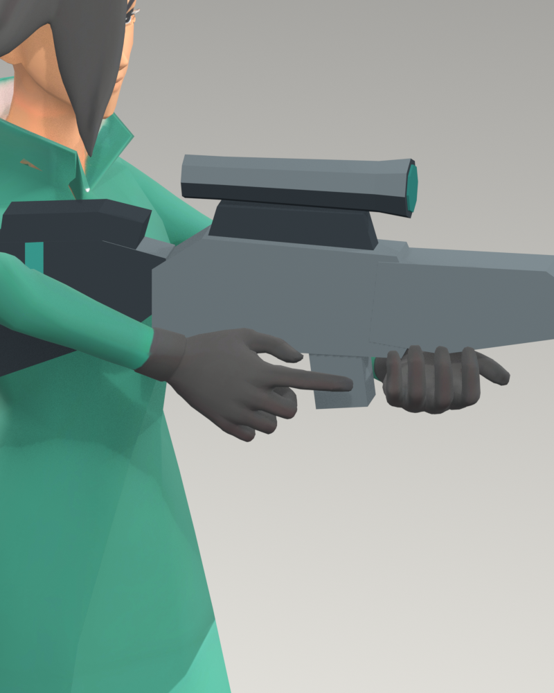

# Miki — measured hand-rig pilot

**25 November 2026 — native Blender review prepared.** The maintainer assigned: “Go ahead with the hand-rig pilot. Fix the palm and wrist alignment, add individual finger controls, preserve Miki’s appearance, and show me relaxed hands, fists and rifle grips in Blender before game integration.” This authorises this separate pilot; canonical models, the shared library and the game remain unchanged.

## Watch and inspect

Open [miki-hand-rig-review.blend](miki-hand-rig-review.blend), keeping `character` beside it. The scene selector offers:

1. **01 Relaxed hands and fists** — a four-second open → fist → open demonstration, opening on the left-hand close-up. Right palm, Both hands and Full body cameras are also available.
2. **02 Rifle grips** — a separate two-hand inspection hold, with an extended index finger and a small independent index flex.
3. **03 Individual finger controls** — all ten digit-isolation demonstrations, followed by wrist movement. Finger, hand and forearm bones are visible over the mesh; timeline markers identify each digit.
4. **04 Neutral appearance** — an independent unposed Miki for comparison.

[Eight-second native movie](motion-preview.mp4) · [Relaxed hand](relaxed.png) · [Right fist](fist-right.png) · [Rifle index flex](rifle-index.png) · [Full-body rifle pose](rifle-full-body.png) · [Neutral appearance](appearance.png)

The movie shows four seconds of relaxed/fist movement, then four seconds of rifle handling: 240 frames at 30 fps, 720 × 900, H.264/yuv420p. It samples every fourth frame of the 120-fps review. These are native Blender renders, without generated or retouched appearance. The cut between takes is editorial; it demonstrates no weapon draw, firing or game transition.

## Controls and poses

The [character source](character/miki-hand-rig.blend) owns the editable mesh, skeleton and three ordinary keyed Actions. Open that source for persistent rig/pose edits. Review instances link its Actions and immutable source data; the review owns separate mesh/Key copies and placement, with a local display-armature copy in the control scene. Source skinning changes require rebuilding those review copies and media.

In Pose Mode, use the **Fingers L** and **Fingers R** bone collections. Each `thumb`, `index`, `middle`, `ring` and `pinky` has three independently selectable FK joints, such as `index.01.L`, `index.02.L` and `index.03.L`. Positive **local X** curls toward that hand's measured palm. Thumb-base opposition uses local Z (negative left, positive right); opposite signs abduct, as used in the rifle pose. The hand and forearm bones retain ordinary three-dimensional rotation. These are direct Blender controls; there is no hidden curl-driver layer or additional runtime solver.

| Action | Source frames at 120 fps | Useful markers |
| --- | --- | --- |
| `miki.hands.relax-fist` | 1–481, 4 s | Relaxed 1; complete fist 241; relaxed 481 |
| `miki.hands.rifle` | 1–481, 4 s | Index extended 1; small index flex 181 |
| `miki.hands.controls` | 1–1441, 12 s | Ten digit peaks 61, 181, …, 1141; wrist flexion 1261; extension 1381 |

The rifle is the unchanged [precision-rifle study](../equipment/rifle-precision/README.md), linked separately into the rifle scene. The character file contains no weapon. Separate measured palm frames and actual rigid palm patches establish left support and right grip placement. The existing block-shaped prop has no modelled trigger gap, so the index demonstration remains off-trigger with small flex; it is not trigger actuation. [pose-record.json](pose-record.json) records the rifle placement, palm frames, contact references and exact pose bookmarks.

## Preserved appearance and measured rig

The pilot adds **30 digit bones, 47 total including ROOT**, to the [prior Miki source](../miki-quaternius-motion/README.md). The original 17 rest bones and all mesh coordinates/topology, retained normals/source IDs, face/hair, UVs, packed 4K JPEG, materials and four garment targets remain exact. **3,244 hand-region vertices** receive localized weight redistribution; other weights, including preserved forearm contributions, stay exact. All vertices remain weighted and normalized with at most four influences.

Each hand is measured independently from its actual five digit branches and centreline sections. [measurements.json](measurements.json) retains the source IDs, joint landmarks and skinning regions; [palm-frames.json](palm-frames.json) records the measured palm normals and distal directions. The new poses use full palm orientation rather than the prior estimated ±X thumb axis. Finger curls follow the measured phalanx chains; thumb closure is sequenced after finger folding so the thumb stays outside the closing fist.

The existing forearm/wrist setup remains. Bounded tests cover ±20° wrist flexion/extension, ±15° sideways motion and ±45° forearm rotation without an observed cuff collapse; those moderate ranges do not establish extreme-rotation quality. Additional twist bones were not justified by those tests.

## Reproduction and validation

Use scratch outputs with the existing Blender installation:

- [rebuild-fingers.py](rebuild-fingers.py): positional `SOURCE LANDMARKS OUTPUT` arguments after `--`. Use the exact prior focused character source and `measurements.json`; it creates the 47-bone skinning derivative and a JSON record. Inputs are preserved and destinations must be new.
- [author-poses.py](author-poses.py): `--source`, `--landmarks`, `--output`, `--report` after `--`. Use that derivative plus `palm-frames.json` to reproduce the three Actions. This helper checks the reviewed rest rig, mesh lineage and identity transform. The source geometry, weights and rest bones stay untouched.

The first helper reproduces the private skinning derivative byte-for-byte. The final public pose helper reproduces **31 evaluated skin poses exactly**, restores action/slot/pose/frame/subframe/FPS context and preserves saved inputs. Seven finger-builder and five pose-author CLI rejection cases preserve protected/sentinel files and create no unintended output.

Independent checks establish the preserved appearance/bind data and actual deformation of all ten independently recovered digit-tip regions. Every authored digit control moves its own skin while the other nine tip cohorts remain exactly stationary, with exact reset. New finger translations stay zero and scales stay one. A fresh evaluated-neutral comparison matches all 10,269 original world vertices within 0.189 micrometres. Measured palm patches follow their target rotations within 0.014 degrees at checked poses; wrist and internal finger-chain gaps remain zero. Nine bounded phases each of the fist and rifle takes have no tested nonadjacent hand self-crossings or whole-glove/actual-rifle triangle crossings; independent vertex-inside-solid checks at five rifle phases find no penetration. These are sampled surface checks, not a continuous or global self-collision guarantee.

All **62 existing Blender/export tests pass**. At 32 sampled source-to-review poses, skin vertices, all 47 bone matrices and garment values match exactly; neutral data stays isolated. Relative character/rifle dependencies and decoded privacy pass.

A separate scratch USDZ imports 47 joints, 181 sampled poses and native skin influences into macOS RealityKit, with independent clone pose state. **Native deformation fidelity remains unverified:** the scratch CPU skin reconstruction does not yet match Blender displacement when accounting for the mesh's nonidentity bind transform. This is an unresolved bind-space verification issue, not an established RealityKit defect. It must be resolved with actual skin/render evidence before integration; no runtime or phone deformation pass is claimed.

## Limits and next gate

The imported hand topology remains irregular, and extreme poses, running/crouching with the new finger rig, weapon variants, scoped aim, recoil and cloth fitting remain unverified. Previous locomotion clothing issues are not fixed by this hand pilot. These Actions are original hand-review poses, not motion capture. No model optimisation or physical-phone performance claim is made.

**Next gate:** maintainer visual review of relaxed hands, fists, palm alignment and the separate rifle hold before game integration. The canonical exporter still deliberately requires 17 bones, and the runtime weapon-grip override/mask identified in the [implementation review](../../../docs/hand-animation-review.md) still needs a separately assigned integration change. This unregistered 47-bone study neither bypasses that contract nor changes gameplay authority. No purchase, merge or release is included.

The mesh/JPEG retain their [Tripo provenance](../miki-option-a-tripo/README.md#provenance-and-licence). Rigging, hand measurements, skinning, hand poses, helpers, review setup and media are original project [MIT](../../../LICENSE) contributions. The separate rifle remains its own original MIT asset.

## Frozen delivery

| Artifact | Bytes | SHA-256 |
| --- | ---: | --- |
| Character source | 3,111,819 | `e68faee3e5dbf49ea9b530e23b5c14abea39d7c766412763c0b9b7584d3e7d73` |
| Native review | 3,440,991 | `06f55983dce5f6b9fb906ace97198e656787b1e5ed8eff1f3a3a717fcc684be8` |
| Native movie | 251,026 | `c6ab639839dc411795ca7c613d0b2c60956029cca1b9f3fe82e01a4a98677e9b` |
