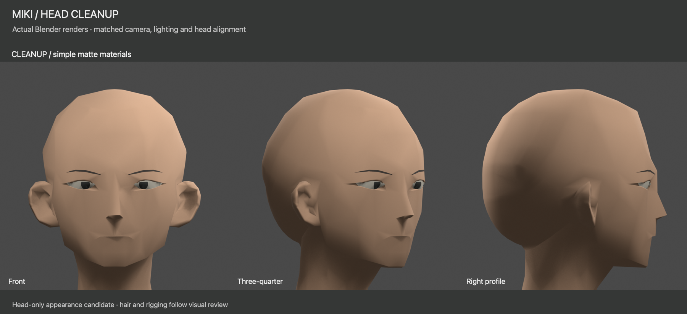

# Miki head cleanup

**Status: assigned head-only refinement, awaiting appearance review.** The maintainer asked Codex to proceed with the recommended cleanup after the [native Tripo/CC0 comparison](../miki-head-pilot/README.md#native-generator-comparison). This study keeps the Tripo head's large forms, replaces its dense projecting eye parts and brow slabs, and repairs local shell defects. The [approved HEAD FRONT reference](../../../art/characters/angular-study/miki-reference/head-and-construction-v1.png) remains the identity guide; the bald generator input has known eye/brow drift.

## Inspect in Blender

Open [miki-head-cleanup.blend](miki-head-cleanup.blend) in Blender 5.3 or later, keeping this folder beside `miki-head-pilot`. Three scenes provide the unchanged source in clay, the cleaned candidate in clay, and the candidate with simple matte facial materials. Each has front, right-profile and three-quarter orthographic cameras. The colour scene opens with its three-quarter camera selected. No camera independently fits or stretches the head.

The review links two relative libraries: the original comparison's Tripo object, and [head/miki-head.blend](head/miki-head.blend). The latter is the editable, self-contained source: one repaired head/ears/neck shell and two paired feature meshes. Each eye and brow pair uses a Mirror modifier with shared bilateral geometry. The eyes are shallow membranes with iris and sclera material regions on one surface, rather than eyeballs or pupil overlays. There is no hair, skeleton, facial rig or animation in this study.

These sheets assemble actual Blender renders and labels. They contain no generated replacement face, painted anatomy or retouching. Before/after pairs use the original comparison's exact camera transforms, orthographic scale, lights, world and common gray material. The colour row changes only the materials. All use the same source crown-to-chin alignment, without axis squeezing. Source renders are 800 × 800, shown at 600 × 600 per panel in the sheets; the camera scale remains approximately 0.28783534 m.

## Local changes

The [repair record](repairs.json) maps the derivative back to source vertex/face IDs. The shell's point attribute `tripo_source_vertex_id` and face attribute `tripo_source_face_id` retain that correspondence; new seam faces use face ID `-1`.

- Closed the one-sided lower-skull/neck gap with a small strip of faces, retaining the ordinary open neck cutoff.
- Welded the pinched eye seam and repaired a single lower-lid notch.
- Removed folded mouth microfaces and restrained the lip opening.
- Raised only the central upper lids slightly, keeping the eye corners fixed, to reduce the sleepy expression.
- Rebuilt shallow almond eyes and face-fitted brows. The two feature meshes total 208 evaluated triangles.

The head's width, depth, crown, jaw and chin remain the source volume. Custom corner normals outside the documented patch neighborhood are preserved. This is a localized static cleanup, not a claim of anatomical retopology, facial deformation readiness or a settled runtime budget.

| Geometry | Before | Cleanup |
| --- | ---: | ---: |
| Head/ears/neck shell vertices | 538 | 533 |
| Shell triangles | 1,037 | 1,040 |
| Eyes and brows, evaluated triangles | 8,698 | 208 |
| Whole head, evaluated triangles | 9,735 | 1,248 |

Of the 533 retained shell positions, **510 are exact**. The 23 coordinate exceptions are the single lower-lid correction, 20 upper-lid/immediate-support points with a maximum lift of **1.9724 mm**, and two lip points reducing the central slit to **0.8 mm**. Eye corners remain fixed. All **1,939 protected decoded corner normals** outside the local mask remain exact; native packed normal encoding is not asserted byte-identical.

## Source and licence

The underlying head is derived from **Tripo Smart Mesh P2.0**, job `222ae975-6406-4c57-9fff-1e148e2143de`, generated once under the free tier and subsequently exported after Pro access. The [unchanged FBX and source notice](../miki-head-pilot/tripo/README.md) retain the original Creator fields and source identifiers. Raw FBX SHA-256: `42b633426b1e30f3905e1ed3dc53fc7de0e085b015518c1154569b2494a09d55`.

The repaired shell retains the [Tripo free-output grant](https://www.tripo3d.ai/terms), dated 13 November 2026, §5.2.1, with the distinctions recorded in the [trial](../miki-head-pilot/tripo-trial.md#provenance-before-a-public-model-import). It is not automatically relicensed MIT, and a later subscription does not change the original free generation's status. New eye/brow geometry, presentation and documentation authored by Codex use the project's [MIT licence](../../../LICENSE), without claiming ownership of the underlying Tripo source. No CC0 foundation geometry was copied into the cleaned head. The native files carry the Tripo Creator/job/hash and derivation record.

## Verification and next gate

Fresh native reopening confirms all three review scenes, the colour/three-quarter default and both resolving relative libraries. The linked original mesh, its alignment, the camera transforms/settings, all three lights, world and gray overrides match the source exactly. The repaired shell has no internal nonmanifold geometry, winding conflicts or zero-area faces; its only boundaries are the neck cutoff and restrained mouth slit. The feature meshes have intentional perimeter boundaries, exact bilateral symmetry and no zero-area faces. Native-file privacy scans pass.

Representative rerenders of the original front/clay and cleaned three-quarter/colour match the initial decoded pixels exactly. The cleaned front/clay differs in **429 of 640,000 pixels**, at most **22/255**, confined to the eye region and visually unchanged. This small saved-file rendering variance is retained rather than claimed pixel-exact. Geometry and camera/light data remain exact.

The existing **62 Blender/export tests pass**, and documentation links resolve. Source checks establish the saved asset and scope of the repair; they do not establish appearance acceptance.

Review the actual front, profile and three-quarter expression before separate hair or fitting to the existing body and shared skeleton. The original FBX/comparison, approved art, canonical models, shared animation and runtime remain unchanged. No app build, Simulator run, phone test, installation, merge or release is claimed for this authoring-only change. The live Blender file was left untouched.
