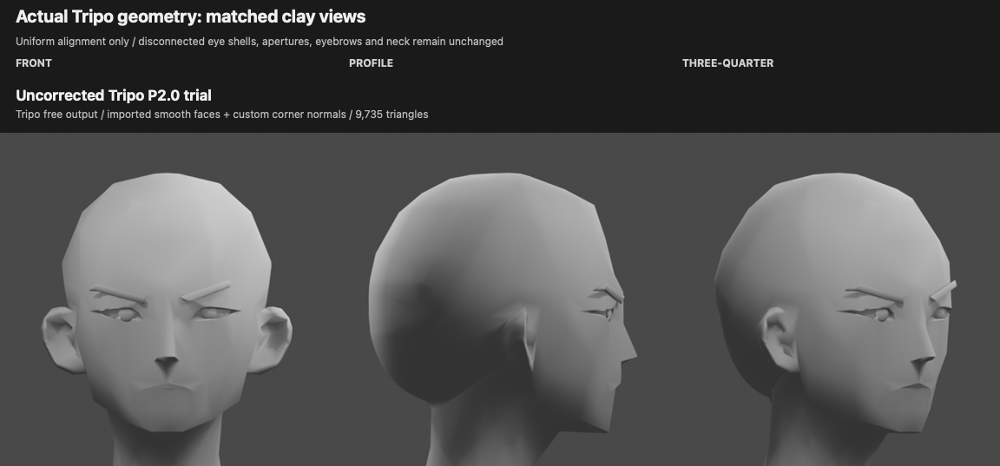

# Miki head-only pipeline trial: CC0 foundations

**Status:** The head-only comparison is available for review, without final appearance selection. This file retains the CC0 foundation gallery and its verification; the [native generator comparison](#native-generator-comparison) adds the actual exported Tripo head. The [pilot art](../../../art/characters/angular-study/miki-head-pilot/README.md) and [trial record](tripo-trial.md) distinguish generated inputs, native mesh findings and the subsequently assigned [cleanup study](../miki-head-cleanup/README.md).

## Open and inspect

Open [head-foundations.blend](head-foundations.blend) in Blender 5.3 or later. It is self-contained and unregistered: it does not export to the game. Five scenes each contain one editable head, neutral clay, three orthographic cameras and identical lighting:

| Scene | Source shape | Review geometry |
| --- | --- | --- |
| `01-generic-basis` | Generic Basis | 2,528 triangles |
| `02-generic-real-female` | `Real_FEMALE = 1` | 2,528 triangles |
| `03-generic-toon-female` | `Toon_FEMALE = 1` | 2,528 triangles |
| `04-generic-mix` | `Real_FEMALE = 0.6`, `Toon_FEMALE = 0.4` | 2,528 triangles |
| `05-planar-default` | Planar source Multires level 5 | 647,168 triangles |

Choose a scene in Blender's scene selector. The front camera is selected by default; use Camera View to inspect it. The other two cameras in that scene provide a right-facing profile and three-quarter view by orbiting the camera, without mirroring geometry. All views share orthographic scale and framing; no view is rescaled to conceal a shape change. Freely orbit the head as well.

These are actual untextured Blender renders, with labels assembled from those renders. No image generation, painted anatomy or screenshot enhancement was used for this sheet. The first four use the source's flat polygon normals with one subdivision level; Planar preserves its smooth sculpted multires finish. That difference is labelled, so it is not a like-for-like topology comparison.

## What is preserved and changed

Each Generic copy retains the source's **318 vertices, 316 quads (632 base triangles), UV map and all ten editable shape keys**. The key coordinates and polygon connectivity are unchanged. Display subdivision is one level for all four (the source's render default is two). The source object's **Show Only Shape Key** setting was enabled on Basis; it is disabled here so the requested mixtures actually evaluate. The head objects have gallery translations, a neutral material and source credits, with no coordinate sculpting, painted facial features, separate eyeballs, hair, neck, skeleton, Actions or animation.

Planar has the same small base cage but stores its visible anatomical planes in internal multires displacement. Its 632-triangle cage alone does not reproduce the pictured form. It is a secondary anatomy reference rather than a proposed runtime model.

The **Generic** head is the more practical editable foundation. Its sockets, cheek transitions, integrated nose/mouth and full skull provide topology to work from. Its stock female/cartoon shapes are not Miki's facial identity. Neither the source defaults nor this gallery settle the final skull, jaw, eyes, budget or style.

## Source and licence

Derived from **Head - Generic Topology** and **Head - Planar**, by **Paul Kotelevets**, in **Blender Human Base Meshes v1.4.1**, Blender Studio and community contributions.

- [Official listing](https://www.blender.org/download/demo-files/#assets).
- [Exact source archive](https://mirror.blender.org/demo/asset-bundles/human-base-meshes/human-base-meshes-bundle-v1.4.1.zip).
- Both selected objects carry explicit **CC0** asset metadata; the bundle README declares all supplied assets public domain under CC0.
- The bundle also has a text named `License` referring to **Rain Rig / CC BY 4.0**. This discrepancy is retained in the provenance record; the selected heads' explicit CC0 metadata and package README are the basis for this intake. The unrelated text, rig and other assets are not appended.
- ZIP SHA-256: `811f43accbb31a88266d932f8f5563b2d13586fca0ba2693aad1f5fe582b3515`.
- Source `.blend` SHA-256: `3c121505651140ceb4d69fd1d8923f7788ffadd81672f5be14845a5f2c75c137`.
- These are locally computed intake fingerprints, not publisher-signed authenticity proofs.
- Gallery presentation and documentation contributions use the project's [MIT licence](../../../LICENSE). The heads in `head-foundations.blend` remain CC0; the separate comparison's Tripo geometry retains its source grant below.

Only the two head object assets were appended. No software, extension or asset-library preference was installed or registered. The official full archive remains local intake material rather than a duplicate committed asset bundle. The editable study uses Git LFS, as does the deliberate preview above 1 MiB.

## Verification and remaining gate

Native Blender 5.3 inspection of `head-foundations.blend` confirms unchanged source vertex/key data and polygon connectivity, independent editable key data, closed manifold base meshes with positive volume, no zero-area faces, no external libraries or images, no armatures or Actions. That foundation file reopens; rerendered front views match its PNG pixels. Privacy inspection of the decompressed native file finds no local user path.

The initial gallery exposed the source's Basis-only display setting: key values alone did not establish the displayed shape. After disabling that setting, all four Generic variants have different evaluated-coordinate and front-render pixel hashes. Versus Basis, maximum evaluated vertex deltas are approximately **15.30 mm** (Real), **24.10 mm** (Toon) and **15.31 mm** (mix); direct cage evaluation agrees with the source-key mixtures within **8.34 nm**. These checks establish that the controls affect real volume; they do not establish attractiveness or Miki likeness.

The existing **62 Blender/export tests pass**. Canonical assets, shared animations, bridge, app, prior studies and approved reference images remain unchanged. No app build, Simulator run, physical-device test, performance claim, merge or release is part of this authoring-only trial. The live Blender file was left untouched.

The single free P2.0 attempt used the hero, geometry only, quad topology and a requested 5,000-face target. After the maintainer enabled Pro, its existing job was exported and inspected in the native comparison below. These are trial settings, not an adopted runtime budget or a guarantee of anatomical edge loops. Select and refine the head on volume and identity before separate hair, body fitting, shared-skeleton/animation verification or a measured runtime budget.

## Native generator comparison

Open [comparison.blend](comparison.blend), keeping it beside `head-foundations.blend`. It opens on **06-tripo-trial**, with the matched front camera active. The five original control scenes remain available. This review links their CC0 geometry through **one relative library**, `//head-foundations.blend`, and owns one imported Tripo mesh, local review cameras/lights and the common gray material override. The [unchanged FBX](tripo/README.md) is retained separately.

- [Full six-row comparison](comparison.png): four Generic states, Planar, then the uncorrected Tripo head, using the same cameras, orthographic scale, lights and gray override.
- [Volume and complete-neck views](tripo-volume.png): two additional matched-scale free angles and two explicitly wider full-asset views. The matched head frame partly crops the extra neck; the wider views expose it.
- Generic retains source flat normals plus subdivision 1; Planar retains its smooth multires finish; Tripo retains all imported smooth flags and custom corner normals. These differences are labelled rather than concealed.

### Alignment

The FBX importer already places front at **−Y** and up at **+Z**. The review applies no extra rotation or mirroring. It uses the same orthographic scale, **0.2878353377 m**, throughout the matched views.

The selected Tripo crown is vertex **736**, at raw world Z **0.99951171875**. The selected underside-of-chin marker is the midpoint of vertices **46/58**, at Z **0.2407226861**. Their **0.7587890327** span excludes the neck. One uniform scale, approximately **0.2966829709**, aligns that span to the Generic Basis's actual evaluated crown-to-chin height, **0.2251197845 m**. Crown/chin midpoint and head-shell depth bounds are centred to the Basis surface. Ears and skull width are retained; no axis is squeezed and no individual camera view is fitted.

The initial alignment proposal used the conservative object-bound height, **0.23401247 m**. The final review instead measures actual evaluated surface vertices; the bound-based scale is not used. These are chosen authoring landmarks for an honest shape comparison, not a claim of physical head dimensions, exact concept registration or runtime fit.

### Finding and next pass

The Tripo head supplies more Miki-specific large forms, while the CC0 sources supply cleaner anatomical starting topology. The imported head is an **uncorrected modelling candidate**. Four eye parts account for **88.41% of its vertices**; raised brows, a one-sided skull/neck gap, a pinched eye aperture, an iris seam and a local mouth-winding issue need repair. An open neck cutoff is expected and is not itself a defect. Counts and source findings belong in the [FBX record](tripo/README.md).

The maintainer subsequently assigned the recommended [cleanup study](../miki-head-cleanup/README.md), which keeps the Tripo silhouette while rebuilding leaner eyes/brows and repairing those local defects. That derivative and its matched views are separate files. No cleanup, hair, UV work, rig, animation fitting or runtime integration is performed in this original comparison. The original FBX bytes, native mesh coordinates/connectivity, smooth flags and custom normals remain unchanged.

The raw Tripo source and its embedded comparison geometry retain their [Tripo free-output provenance](tripo/README.md); CC0 controls and original MIT review contributions remain distinct. A later subscription enabled export and did not retroactively make the free generation paid/private output.

Fresh public-file reopening confirms the default scene/camera, resolving relative dependencies, exact source geometry/custom normals and unchanged foundation file. Tripo's front/profile/three-quarter rerenders match the original decoded pixels exactly. A separate Generic Basis front-control rerender check differed from its initial comparison render by at most **3/255 in 4,110 pixels**; linked geometry and camera/light data remain exact. All 229 protected source/art/runtime files checked during the save audit remain unchanged. This establishes the saved comparison and its limits, not final appeal or animation readiness.
