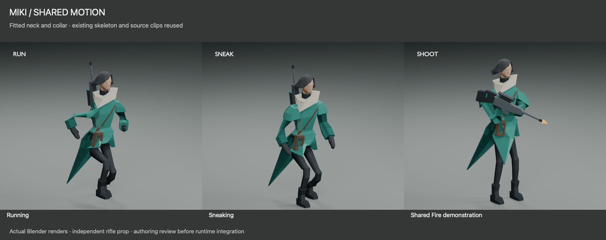
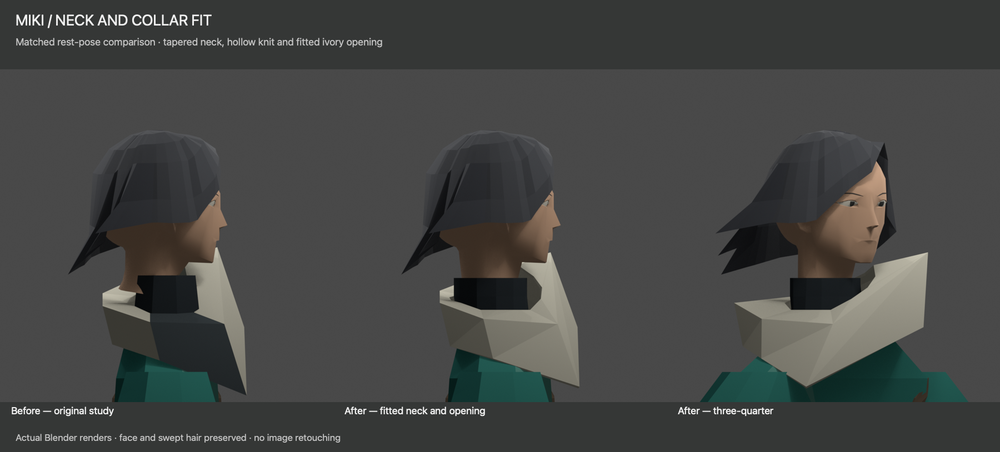

# Miki neck, collar and shared-motion review

**Status: appearance rejected by the maintainer, 25 November 2026.** The maintainer asked to refine Miki's neck/collar, reuse the existing skeleton and animations, and show running, sneaking and shooting. This derivative uses the current [head and swept hair](../miki-hair/README.md) and angular clothing as its appearance basis. It does not replace a canonical game asset or change gameplay. The maintainer subsequently said the 3D model looks awful. The technical checks below do not establish art quality; this local experiment is held and is not selected for integration. Static character design must be resolved before further rig fitting.

## Open and play

Open [miki-motion-review.blend](miki-motion-review.blend), enter Camera View and play the timeline. The default `01 Run Sneak Shoot` scene shows the whole character. `02 Neck and collar motion` offers close three-quarter and wearer-right profile cameras on the same motion. The labelled cuts separate three takes; they are not gameplay transitions or draw/stow animations.

| Take | Frames at 120 fps | Repetitions | Source |
| --- | ---: | ---: | --- |
| Run | 1–312 | 4 × 0.65 s | `party.run` |
| Sneak | 313–744 | 3 × 1.2 s | `party.sneak` |
| Shoot | 745–1104 | 5 × 0.6 s | `party.fire` |

The three ordered **REVIEW ONLY** NLA tracks reference the original Actions directly. Newer tracks take priority at the exact cut frames, avoiding the previous strip's inclusive endpoint. There are no duplicated skeletal keyframes or new shared clips. Eleven muted **SOURCE ONLY** tracks retain links to the complete original motion set. The source library, 17 rest bones and hierarchy remain unchanged.

The [motion reel](motion-preview.mp4) is rendered from the saved public review: 960 × 800, 30 fps, 276 frames and 9.2 seconds, with source evaluation every four frames at 120 fps. It is silent review footage, outside app resources. The source motion is in place; the game remains responsible for travel and firing.

## Fit and ownership

- The angled lower-neck flange is replaced by a centred, tapered neck ending inside the clothing at Z = 1.48 m. **467 head positions** and the face/skull/jaw remain unchanged in the fitted rest frame. Only the 66 lower-neck positions are reshaped. Protected decoded normals outside the local neck mask remain exact; the small boundary encoding difference is recorded in the source fitting evidence.
- The knit collar is a hollow, five-height envelope around the skin. The thinner ivory wrap keeps its high wearer-left side and diagonal front, with a sampled opening that clears the knit instead of cutting across it. Both receive explicit Head/Chest skin weights. The inherited brow-tip degeneracies are welded in this derivative; the previous head source is untouched.
- Three loose coat panels have planar subdivisions, fitted returns, clearance flare and manual weights so the running legs clear them. The other **24 body parts retain their original rest coordinates**. No cloth simulation, corrective clip, driver or new control rig was added.
- The original swept hair remains a separate linked source, rigidly attached to the existing head bone. It retains its intentional open hem. Rifles are separate review props, absent from the character source.

| Character geometry | Triangles |
| --- | ---: |
| 27 fitted body/clothing parts | 1,888 |
| Head, eyes and welded brows | 1,246 |
| Fitted knit and ivory collars | 348 |
| Unchanged independent hair | 360 |
| Evaluated character total | **3,842** |

These are authoring counts, above the current canonical target; no new runtime budget is adopted. The character has 32 weighted meshes, a rigid hair instance and one local rig Object. Its Armature data and eleven source Actions link to [party.blend](../../animations/README.md). Face, eyes, brows and hair follow the head rigidly; lower neck/collar vertices blend the existing head and chest bones. Weights are normalized and ROOT remains nondeforming.

Edit [character/miki-motion-character.blend](character/miki-motion-character.blend) for geometry and weights. Edit shared motion in its existing library, without renaming/rest-editing its bones. The character source owns the review-only NLA arrangement; mute its REVIEW ONLY tracks before any future canonical export preparation. The current unregistered study does not trigger model export.

## Equipment and presentation

The review links the existing [Precision rifle](../equipment/rifle-precision/README.md). Editorial carried and held placements follow chest and right-hand bones. A brief muzzle cue marks the original Fire event; it schedules no gameplay shot. The original generic Fire clip is a low-ready firing demonstration, **not a new scoped sniper stance**, cheek weld, verified two-hand grip or draw/stow sequence. Equipment handling needs a separate fitting pass before gameplay use.

The review owns its floor, studio lighting, cameras, labels and firing cue. They are excluded from the character source. Pose sheets and neck comparisons assemble actual Blender renders and labels, without generated replacement anatomy or retouching. The before/after neck views use matched static framing and lighting; the enlarged studio views are not the gameplay camera or Simulator evidence.

## Verification and limits

The fitting checks sample Run, Sneak and Fire at 240 Hz: **591 poses**. Final derived clothing has no detected strict coat/trouser crossings in those samples. The fitted skin, knit, ivory and hair have no detected pairwise BVH candidates or strict crossings. The minimum sampled knit-vertex-to-skin distance is **4.815 mm**; it is not a certified global surface minimum or universal self-collision proof.

Independent core checks verify unchanged shared bones/Actions, normalized weights, finite deformation and rigid face/hair attachment within floating-point precision. Sneak retains at least one grounded boot in every sampled pose; this does not prove world-space foot friction because the source motion is in place. Shoulder and sleeve stretch in the existing Fire pose remains a visual-review diagnostic rather than a claim of anatomical perfection.

The existing **62 Blender/export tests pass**. This review does not establish RealityKit import, runtime blending, material/draw-call budgets, all eleven clips on the new body, phone performance or final appearance acceptance. No app build, Simulator/phone test, installation, merge or release is included. Canonical characters, shared motion, original head/hair/body/equipment sources, reference art, bridge and runtime remain unchanged.

Fresh public-file reopening confirms both review scenes, the 120-fps timeline, 3,842 actor triangles and resolving relative dependencies: two in the character source and four in the review including indirect links. All eleven source Actions and the 17-bone rest data match the library exactly. Twenty-four editorial/source pose comparisons, including both exact cut frames, match bone matrices exactly. All weights are normalized with no loose, ROOT-weighted or unknown groups; all 591 tested poses deform finitely. Rigid head/hair point errors remain below **0.000243 mm**. The lowest sampled sole is within **0.000132 mm** below ground; Sneak's best grounded sole never rises above **0.000153 mm**. These are numerical sampling bounds rather than friction or continuous-time proofs.

Three saved-file rerenders have only tiny differences from the first native renders: Run one of 768,000 pixels at most 1/255; neck Sneak five of 810,000 at most 2/255; Shoot nineteen of 768,000 at most 1/255. They look unchanged and are not claimed pixel-exact. The source/review privacy scans pass, and the full 276-frame H.264 reel decodes successfully. Live Blender playback is checked separately from these headless audits, without saving over earlier work.

## Source and licence

New body/collar fitting, skin weights and presentation are original **Codex** contributions under the project's [MIT licence](../../../LICENSE). The original hair, body, rifle and shared motion retain their recorded project provenance. The head remains a localized derivative of the **Tripo free-output source**, with Creator, job/hash identifiers and its [source grant](../miki-head-pilot/tripo/README.md) preserved; it is not relabelled MIT. No additional third-party model, rig, animation or texture was downloaded or generated for this pass.

| File | Bytes | Storage |
| --- | ---: | --- |
| `character/miki-motion-character.blend` | 1,419,995 | Git LFS |
| `miki-motion-review.blend` | 696,443 | Git LFS |
| `motion-preview.mp4` | 651,003 | Explicit-path Git LFS |
| `poses.png` | 929,890 | Ordinary Git, below 1 MiB |
| `neck-fit.png` | 843,187 | Ordinary Git, below 1 MiB |
