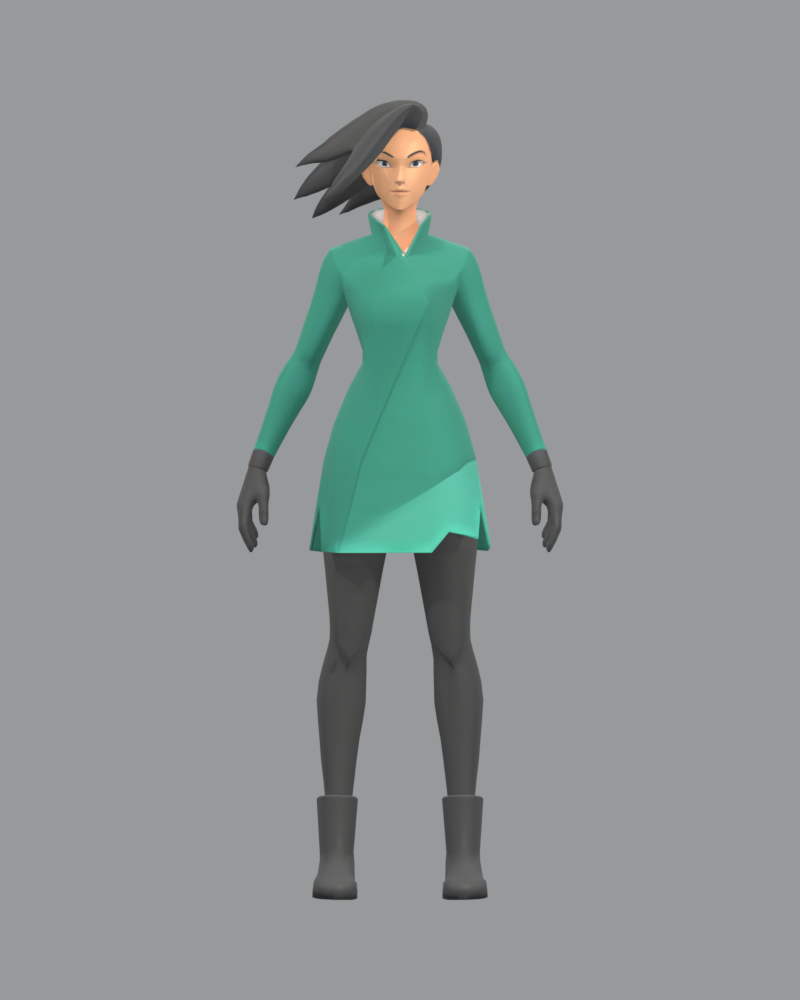

# Miki Option A — fitted running and sneaking

**25 November 2026 — animation review prepared.** The maintainer assigned: “Go ahead and prepare Miki for animation, fit the existing skeleton and show me running and sneaking in Blender. Make sure we preserve her current appearance.” This is a separate fitted derivative of the [unrigged P2.0 trial](../miki-option-a-tripo/README.md). It preserves the selected body rather than reshaping it to the old skeleton.

## Watch and inspect

Open [miki-option-a-motion-review.blend](miki-option-a-motion-review.blend), keeping `character` beside it. **01 Run and Sneak** plays the two existing clips in sequence; **02 Rest appearance** holds an independent neutral model. Front, Side, Back, Three quarter and Face cameras allow inspection without editing the character.

[Native motion reel](motion-preview.mp4) · [Run](running.png) · [Sneak](sneaking.png) · [Sneak side](sneaking-side.png) · [Run back](running-back.png)

[Neutral side](side.png) · [Neutral back](back.png) · [Neutral face](face.png)

The PNGs and video are native Blender renders, not new concept art or retouched evidence. The reel is **6.2 seconds, 186 frames at 30 fps, 720 × 900**, H.264/yuv420p. It samples the 120-fps review every fourth frame. Blender playback uses frame dropping for the intended cadence.

| Review take | Timeline | Repetitions | One source cycle |
| --- | --- | ---: | --- |
| Run | 1–312 | 4 | 0.65 s, Action frames 1–79 |
| Sneak | 313–744 | 3 | 1.2 s, Action frames 1–145 |

The cut between takes is editorial, not an implemented game transition. These are in-place animation previews.

## Preserved appearance and minimal preparation

All **10,269 original vertices**, body proportions, facial/hair geometry, retained UVs, material and original packed 4K JPEG remain. Three exactly zero-area source faces are removed without moving the surface; retained corner normals need a tiny re-encoding at 29 corners, at most about 0.006°. There is no decimation, new mesh generation, retexturing, dress redesign or added accessory. Source vertex/face/loop IDs retain the original lineage. The resulting mesh has **10,742 native faces / 20,305 triangulated faces**.

Fresh matched neutral renders of front, face and profile differ in at most 147 of 800,000 pixels per view, with at most two 8-bit colour codes at three face pixels and one elsewhere. Evaluated neutral positions differ by at most 0.239 micrometres due to transform evaluation. These checks support preserved appearance; they do not replace visual judgement.

Native heat binding is cleaned up with rigid head/hair/eye weights, rigid soles and a shin/foot blend through each boot shaft. The upper pants follow the pelvis, preventing the detached hip cap from following a thigh through the waist. Weights normalize with at most four influences and no unweighted vertex.

The short dress uses **four fixed, zero-at-rest shape targets**, driven by thigh bend. The two front partitions respond together to the leading thigh, lifting the continuous front panel; rear targets provide bounded rear/side ease. These are ordinary editable pose correctives, not per-frame shape samples or cloth simulation. Their movement can read as a stiff graphic flap in a deep crouch; review that styling in the complete loop. The rejected dense wardrobe-correction system is not reused.

## Shared skeleton and source motion

The fitted rig retains the shared **17 bone names and hierarchy**, with rest joints placed inside this body. The [original animation library](../../animations/README.md) and canonical actors remain unchanged. Two derived local Actions reuse `party.run` and `party.sneak` through rest-space rotation mapping, actual sole anchors and a 0.2 mm contact guard. Quarter-frame keys retain the source's 480 Hz sampling on the 120-fps timeline.

Run receives mirrored hand roll for a natural thumb-up orientation. Sneak uses a two-link arm fit to keep the gloves clear of the raised hem: 16 cm outward, 2 cm forward and 1 cm up in chest orientation, retaining hand orientation and limb lengths. No new bones, facial animation or independent source motion is authored. Equipment stays separate and is not displayed.

[refresh-motions.py](refresh-motions.py) regenerates only these two fitted Actions inside the **character source**. Call `refresh_target(rig, body, source_library)` in Blender. The rig's `motion_fit` property stores the fitting metadata; the helper checks the shared file SHA, both rest signatures and actual sole binding, preserves the caller's pose/frame/NLA context and never saves the shared library. Changed inputs require deliberate refitting and fresh review rather than bypassing the guards.

The [character source](character/miki-option-a-motion.blend) owns the fitted mesh, skin, native correctives and derived Actions. The review links this one source library for rest rig, Actions, material and image, while owning separate local mesh/Key data and rig Objects for the animated and static instances. Each corrective driver targets its own instance. Geometry/weight/corrective edits to the source require rebuilding and rechecking the review's copies and reel; do not author a second character in the review file.

## Validation and limits

Independent source checks cover **446 actual poses at 240 Hz**: Run 157 and Sneak 289, including subframes and exact cycle endpoints. The tested free dress panels have no strict crossings with the entire pants component; both loops close exactly, geometry stays finite and sole clearance remains positive. The head/hair remain rigidly shaped through motion to within 0.72 micrometres. The crossing gate covers the original main-body triangles below rest-centroid Z 1.12 m with all rest |X| below 0.23 m; it is not global self-collision certification or proof for future clips/transitions.

A separate hand check covers all **289 Sneak poses at 240 Hz**, with no strict crossings between the distal weighted gloves and 104 actual free-dress triangles. Nine sampled poses additionally retain at least 10.40 mm of distal-vertex clearance. This is a bounded sampled check, not a continuous collision guarantee.

The public refresh helper reproduces **19 evaluated skin poses exactly**, including demonstrably active dress drivers, restores context and rejects changed source/rest/sole bindings without changing saved files. Native fitting checks also cover 1,778 rig poses at 960 Hz, exact arm continuity and positive sole clearance. All **62 Blender/export tests pass**; source/review packaging and relative dependencies are checked on fresh loads.

Two original collinear tessellation triangles inside tiny right-eye quads remain, without introducing new collapsed triangles. The candidate is an authoring review, not a production retopology certificate, final animation acceptance or a measured iPhone budget. Rifle/aim/fire fitting, other clips, transitions and runtime intake remain separate tasks. No app/Simulator/phone run, canonical replacement, merge or release is included.

## Provenance and licence

The mesh and JPEG derive from the unchanged [Tripo P2.0 source exports and recorded terms](../miki-option-a-tripo/README.md#provenance-and-licence), job `63cb506c-f7db-4c67-8312-669af8c64ee3`. Their original identifiers and source downloads remain preserved. This task used **no new AI generation or paid credits**. No human sculpting is claimed. Original fitting, motion adaptation, helper, review setup and documentation are project [MIT](../../../LICENSE) contributions, subject to the recorded generated-source provenance and underlying rights.

| Frozen delivery | Bytes | SHA-256 |
| --- | ---: | --- |
| Character source | 3,760,040 | `d3b2480f847bfcdcb51271d128a8f12470aedb112cace7721af854a6ac625864` |
| Native review | 1,782,084 | `2954915e739f92c0e44f9fcceaf3848b922faae0cfe5c99badc2af86058f92f2` |
| Motion reel | 574,423 | `bb164f156ababd07a94d3904132a284c8d7e1db89c4232548781d214b77083f9` |
