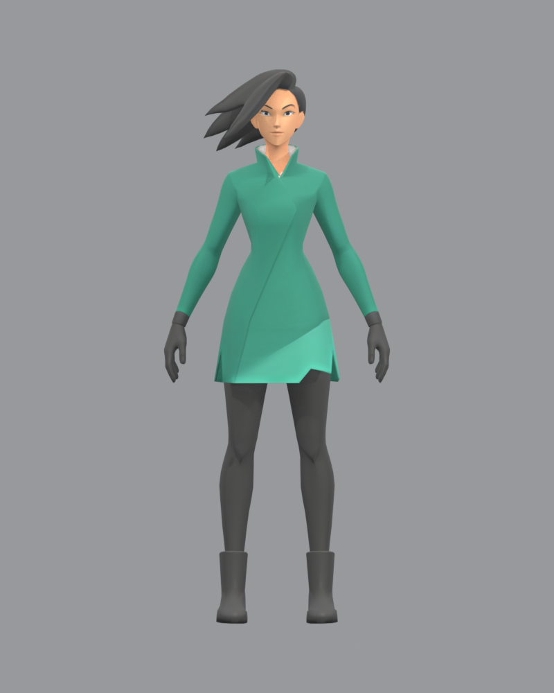

# Miki Option A — unrigged Tripo trial

**25 November 2026 — native static review prepared; appearance pending.** The maintainer selected [concept A](../../../art/characters/angular-study/miki-option-a/README.md), then said **“proceed”** after reviewing the prepared body/head references and the proposed single unrigged Tripo candidate. This study preserves that first generated result for visual review before skeleton, animation or further mesh work.

## Inspect the actual model

Open [miki-option-a-review.blend](miki-option-a-review.blend), keeping `character` beside it. **01 Colour review** uses the generated material; **02 Clay review** exposes the same geometry without the texture. The review links one [editable character source](character/miki-option-a.blend) and owns the studio, floor, six orthographic cameras and material override. The character source owns no camera, floor or lights.

[Three-quarter](three-quarter.png) · [Left profile](left-profile.png) · [Right profile](right-profile.png) · [Back](back.png) · [Face](face.png) · [Clay](clay-three-quarter.png)

These are native Blender renders of the downloaded mesh, not AI concept images or retouched previews. Body cameras share a 2.25 m orthographic scale and 800 × 1,000 framing; the face camera is a deliberate close-up. Profile names identify the camera's side around the model, not anatomical labels. This is artist review framing, not camera B or a phone-performance check.

## Appearance and remaining questions

The single generation preserves the compact high collar, continuous short teal dress, diagonal front line, angular hem opening, dark limbs and swept hair without adding the old bag or belts. Colour and clay show that the main dress/face/hair volumes are geometry, while some graphic colour divisions come from the texture.

Differences remain visible: the hair is thicker and rounder than the illustrated flat planes and obscures more of the face from one three-quarter direction; the eyes/face are softer and more rendered, and the expression is less smiling. The generated back, under-hem construction, hands and material response need review. Do not treat this as accepted final likeness or deformation-ready topology. **Three zero-area faces already exist in the raw generation and remain unchanged.** No repair or aggressive reduction has been performed to make the screenshots look better.

**Next gate:** inspect front, both sides, back, clay and face against the selected concept. Agree any bounded appearance correction before retargeting the shared skeleton. If selected, resolve the source defects and test one running/sneaking cycle before expanding; do not carry the rejected wardrobe's corrective-key chain into this asset. Rifles and the field slate remain separate and absent from this model.

## Generation and original exports

| Setting | Observed value |
| --- | --- |
| Provider/model | Tripo Smart Mesh, P2.0 |
| Input | [Standalone front A-pose](../../../art/characters/angular-study/miki-option-a/front-a-pose-v1.png) |
| Input SHA-256 | `56159d9fadf3f674814a910ad6135174a97515a799c1a917d58890a5742b9e68` |
| Input mode/prompt | One image; no additional text prompt or generated multiview input |
| Topology request | Quad; target 10,000; one generation |
| Visibility | Private in Tripo |
| Operations/credits | One model generation using the displayed trial discount (0 credits), then one texture operation (20 existing credits); no retry or extra purchase |
| Job | `63cb506c-f7db-4c67-8312-669af8c64ee3` |
| Export | FBX with Blender preset; textured ZIP includes the current 4K base-colour JPEG |
| Seed/exact provider revision | Not exposed by the used UI |

The [Tripo viewer](https://studio.tripo3d.ai/workspace/generate/63cb506c-f7db-4c67-8312-669af8c64ee3) may require the generating account. Its longer URL inherited a previous head-job title; the new UUID and uploaded A-pose identify this trial. The untouched [geometry FBX](source/miki-option-a-p2-raw.fbx) and [textured export ZIP](source/miki-option-a-p2-textured.zip) retain original vendor names and bytes. The ZIP contains one FBX and its `.fbm` base-colour JPEG. It passes ZIP CRC validation.

| File | Bytes | SHA-256 |
| --- | ---: | --- |
| Geometry FBX | 415,632 | `7a75a3e8c8a10f77eb0d3a40596140981f0a24792c5b137c8a49e9023b974971` |
| Textured ZIP | 2,261,731 | `5f84580d3449d4c933286c083ebba0d7e758296eac0dc1df7a3f99dfcfb3ac70` |
| FBX inside ZIP | 627,184 | `1e3d40f742d4deeeb3beb330f0e386447524fb7d1c9d6735f5bcde4f4f637a49` |
| JPEG inside ZIP | 1,665,979 | `dfabbdc82c3d2c2fef777a24a5752be73bd6fd96f4371e6dbaa2f470c95b329b` |

## Native source and verification

The source has **one mesh, 10,269 vertices, 9,564 quads and 1,181 triangles**: 10,745 native faces, or 20,309 triangles after triangulation. Tripo's Quad label describes a predominantly quad result, not an all-quad mesh. There is one packed original 4,096² JPEG. Its bytes, native geometry, vertex order, face indices, names, custom normals and textured UVs are preserved. Texturing changes the original untextured UV layout; it does not change the geometry.

One new parent supplies uniform scale/translation only, centring the import and grounding it at a provisional 1.8 m review height. There is no axis stretching, sculpting, remeshing, decimation, repainting, armature, skin weight, modifier or Action. The original imported alignment is retained beneath that parent.

Fresh independent native loads verify exact raw → textured → saved geometry, exact textured → saved UVs, byte-identical packed JPEG, exact source/review geometry and world transforms, one resolving relative source library, no rig/Actions and finite grounded bounds. Both compressed Blender files pass local-path scans after cleaning packed-image path buffers. All **62 Blender/export tests pass**. The seven native views were rendered and inspected; each PNG is below 1 MiB. All 315 files in the pre-trial source/art/runtime preservation baseline were unchanged before intentional status-document edits.

| Native file | Bytes | SHA-256 |
| --- | ---: | --- |
| Character | 2,381,273 | `fbddc9dccbd03465b60215b74af880c6786811fdfe7ec49620757095ae5289d2` |
| Review | 92,500 | `3c8165734a2cb75aacc1ce46e54321846f97b59a0e8bb5e0d8ae74417a279132` |

Those checks establish source preservation and packaging, not final appeal, animation suitability, game-camera readability or a runtime budget. No app build, Simulator/phone check, canonical replacement, merge or release is included.

## Provenance and licence

Codex uploaded the project's original selected A-pose through Tripo's browser UI and imported the resulting exports in Blender 5.3.0. No third-party game model, mesh, rig or animation was used. The [concept/reference lineage and prompts](../../../art/characters/angular-study/miki-option-a/prompts.md) remain attached. Original source identifiers and untouched downloads are preserved; no human sculpting is claimed.

The generated source and texture retain their Tripo provenance and applicable [Tripo terms](https://www.tripo3d.ai/terms), dated 13 November 2026 and checked 25 November 2026. The observed trial discount and paid texture operation are recorded separately; neither a zero-credit discount nor a previous generation's status is used to silently reclassify this output. Do not automatically relabel the raw generator output as an exclusively owned MIT asset. Original review setup, documentation and project inputs are contributions under the project's [MIT licence](../../../LICENSE), subject to recorded underlying rights and without an exclusive-rights claim over AI output.
