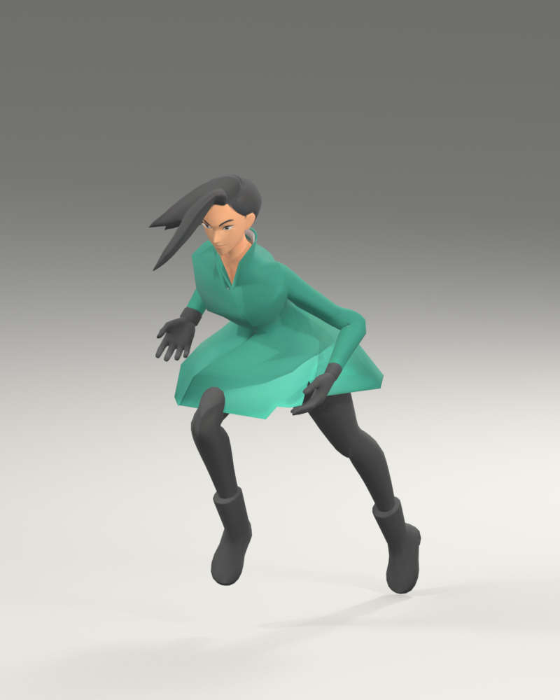
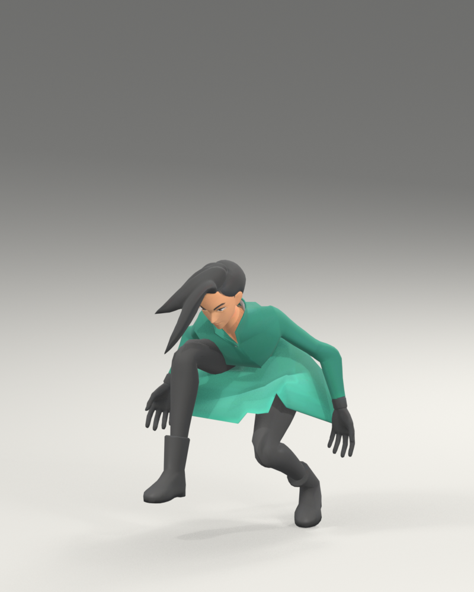

# Miki — free Quaternius motion trial

**25 November 2026 — visual comparison prepared; garment fitting unfinished.** The maintainer assigned: “Go ahead and try the free Quaternius running and crouching animations with Miki. Preserve her current appearance and show me the results in Blender before we buy anything.”

This separate study transfers existing motion onto the [current fitted Option A Miki](../miki-option-a-motion/README.md). Its face, hair, proportions, dress, UVs, texture, skin weights, rest skeleton and four garment shape targets remain unchanged. It replaces no canonical model or shared animation. The earlier fixed Run hand roll and Sneak outward-arm offsets are not applied to these clips.

**Follow-up:** The maintainer subsequently assigned the [measured hand-rig pilot](../miki-hand-rig/README.md), then accepted its hand poses and assigned [export verification with complete running, sneaking and shooting](../miki-hand-motion/README.md). The new motion study uses the existing fitted project body clips with corrected hands, rather than these known-clipping deep-crouch paths. This original 17-bone downloaded comparison and its documented palm/garment limitations remain unchanged.

## Watch in Blender

Open [miki-quaternius-review.blend](miki-quaternius-review.blend), keeping its `character` folder beside it. Play the timeline. The scene selector provides:

- **01 Quaternius Run and Crouch:** the actual Miki mesh, first three sprint cycles, then two crouch-walk cycles.
- **02 Skeleton motion:** the same motion on a separate display rig with visible joint axes, without a character mesh.
- **03 Rest appearance:** an independent, unchanged neutral Miki for appearance comparison.

Front, Side, Back, Three quarter and Face cameras are retained. The skeleton view uses viewport bones; ordinary Blender image rendering does not render those bones. The cut between the running and crouching takes is editorial, not a game transition.

[Native six-second movie](motion-preview.mp4) · [Run side](running-side.png) · [Crouch side](crouching-side.png)

| Take | Downloaded source | Source cycle | Fitted Action | Review timeline at 120 fps |
| --- | --- | ---: | --- | --- |
| Run | `Sprint_Loop` | 0.667 s | `miki.quaternius.run`, frames 1–81 | 1–240, three cycles |
| Crouch | `Crouch_Fwd_Loop` | 2.0 s | `miki.quaternius.crouch`, frames 1–241 | 241–720, two cycles |

These are in-place clips. The source is sampled at 30 Hz; the fitted Actions are baked at 120 Hz without changing their duration. The native movie samples every fourth review frame: 180 frames, 30 fps, 720 × 900, H.264/yuv420p. Stills and video are actual Blender output, without generated or retouched appearance.

## Source and licence

The source is **Quaternius Universal Animation Library, free Standard edition**, obtained through the normal itch.io **Download Now → No thanks → Standard** flow. No payment, account, subscription, paid edition or additional modelling was used.

- [Official pack and creator](https://quaternius.itch.io/universal-animation-library); the page also credits contributing animator Gonzalo Furnier.
- [Untouched free archive](source/universal-animation-library-standard.zip), 15,904,933 bytes, SHA-256 `cc73fc4e495b82958207316596317a3f40b9fa38065bde1027937452da537724`.
- Included [CC0 licence](source/License.txt) and [upstream README](source/upstream-README.txt), with display-copy whitespace normalised; the exact originals remain in the ZIP. See the [stable provenance record](source/provenance.json).
- The actual donor is `Universal Animation Library[Standard]/Unreal-Godot/UAL1_Standard.glb` inside the ZIP: 7,618,436 bytes, SHA-256 `69591853d817488edaa8fd9bf8fc1d821eaeaf789f8627b3cd23b41c4ed67997`. The free pack contains 43 clips and a 65-joint rig. Both selected in-place clips have exactly stationary root translation; pelvis sway, crouching and vertical motion remain intentional.

The downloaded motion remains **CC0-1.0**, not a claimed original Lauder animation. Miki's mesh/JPEG retain the separate [Tripo provenance](../miki-option-a-tripo/README.md#provenance-and-licence). The retarget helper, review setup and documentation are original project MIT contributions. No third-party mannequin, new character appearance or weapon is substituted for Miki.

## Retargeting and reproduction

The [character source](character/miki-quaternius.blend) owns the unchanged fitted Miki and two derived Actions. The donor T-pose is fitted against Miki's A-pose using actual limb directions and a palm-frame calculation whose target thumb axis is estimated. The later hand review finds that estimate unreliable; correct palm roll remains unresolved. Source world-space torso motion, scaled pelvis displacement and source foot height are fitted to the existing 17-bone target with fixed lengths and a 0.5 mm sole guard. The source's aerial running phases remain. The donor's additional spine, neck, clavicle, toe and finger joints have no independent targets in this simple rig. This specific donor contains no twist joints. This is a reduced-rig trial, not full-fidelity retargeting.

Sprint's source endpoints differ slightly (largest matrix-element difference 0.01075); the final fitted sample is closed to its first pose. Crouch already closes. No wrist-angle avoidance offsets, reweighting, mesh edits or new garment targets are added. The separate review links the character library and owns independent animated/static mesh and Key data, studio, cameras and skeleton display rig.

[retarget.py](retarget.py) reproduces only the two local candidate Actions using the exact reviewed donor and fitted rest rig. Extract the retained archive to a scratch folder and run its CLI in background Blender with explicit `--source`, `--target`, `--output` and `--report` paths after `--`. Use the original focused `miki-option-a-motion/character/miki-option-a-motion.blend` as target and fresh output/report filenames. Its API is `retarget(rig, body, source_glb)`. Bone mapping and clip provenance are recorded in [retarget-record.json](retarget-record.json). This helper is specific to this reviewed donor/target pair; it is not a general animation framework.

Keep the existing `party.blend`, canonical actors and registered exporters separate from this visual comparison. Promoting accepted motion later requires fitting to the canonical rest rig, recording timing/speed metadata, fresh exports and normal app validation. Saving this unregistered study does not export it into the game.

## Validation and visible limitations

Independent fresh-file checks confirm all **12 protected appearance/binding sections** match the prior Miki exactly: geometry and retained normals, source IDs, UVs, materials and packed JPEG, every skin weight, all rest bones/transforms, binding and existing garment targets/drivers. All **23 source-to-review/skeleton pose comparisons** have zero evaluated error; neutral data stays isolated and relative dependencies resolve. Packed texture decoding and decoded-file privacy checks pass. The public retarget helper reproduces 19 evaluated skin poses exactly and preserves saved inputs. All **62 Blender/export tests pass**.

The first renders show less sharply bent wrists, but the target palm frame is estimated from a fixed axis rather than measured against the actual glove. Correct palm roll is not established. The [hand-animation review](../../../docs/hand-animation-review.md) records the missing finger support and runtime grip-orientation issue. **Garment clearance does not pass**. Nine representative phases per clip detect strict dress/pants crossings at **3/9 Run and 9/9 Crouch** poses, plus distal glove/dress crossings at **1/9 Run** pose. The crouch is deep, knees meet the garment and the existing front lift reads stiff; rear/hip contact is visible in the side view. No dense or continuous collision guarantee is claimed. Rest appearance preservation does not mean the old clothing deformation fits these new motions.

This trial establishes free clip availability, preserved appearance and a reviewable motion transfer. **Next gate:** agree the hand-rig and palm-calibration plan from that review, then evaluate the selected motion and clothing fit. Finger articulation needs joints and localized skin weights; it is not implemented in this trial. Other clips, transitions, rifle fitting, runtime intake and phone performance are outside this study. No purchase, merge or release is included.

## Frozen delivery

| Artifact | Bytes | SHA-256 |
| --- | ---: | --- |
| Character source | 3,065,494 | `7dfe9f05b046b52add5db576ebee3790087df6708c2cf8ced59d561f5048fb17` |
| Native review | 1,783,585 | `4789459138cb65780d4a2fb101fef20c2fbbc306ab7f59d184b06061256ef287` |
| Native movie | 628,764 | `78df9e550c5194f49bcfcef39eaf0661542a2ed810e1e21e39fe6f26eac32a49` |
