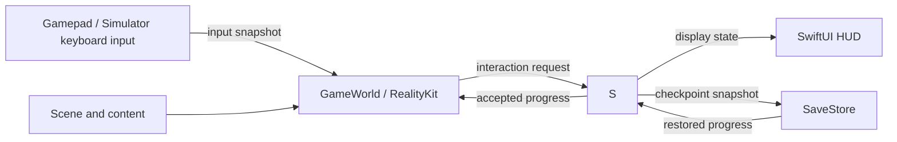

# Lauder — architecture

**Date:** 16 November 2026\
**Status:** Swift and RealityKit accepted. Architecture below is proposed for the first prototype.\
**Scope:** Movement and controls are implemented. The [gameplay script](gameplay-script.md) is under review; mission rules and persistence below remain planned.

## Decision and platform

Use **Swift + RealityKit** for gameplay and the 3D world, and **SwiftUI** for the interface. Build scenes in Swift and load USDZ assets directly, following the [maintainer's clarified code-first decision](https://github.com/RonildoBraga/lauder/issues/9#issuecomment-6907224023).

The accepted rationale, alternatives, costs and three-session Stage 1 stop criterion are in [ADR 0001](decisions/0001-engine.md).

Interpret “latest iOS” as the current stable **iOS 27 family**. Proposed minimum deployment target: **iOS 27.0**. Build with the latest stable SDK and test on the latest stable patch. On the review date, Apple lists **iOS 27.2.1** and **Xcode 27.2** as released; iOS/Xcode 27.3 are beta. [Apple releases](https://developer.apple.com/news/releases/)

Use the stable Xcode 27.2 toolchain for the first prototype. Record the actual editor, SDK, device and OS versions with the first device validation results.

Start with iPhone and landscape orientation. The initial performance baseline is an **iPhone 13 Pro Max**, testing on the current stable iOS 27 release. Broader Apple device support can follow a working iPhone prototype.

## Shape of the project

**One Xcode app target**, one unit-test target, and ordinary feature folders. No internal package hierarchy or third-party dependencies are needed initially.

| Part | Responsibility | Boundary |
|---|---|---|
| App composition | Creates the session, world and save store; owns launch, restart and teardown | Wiring and lifecycle |
| Gameplay | Mission facts, progress transitions and simple dialogue definitions | Ordinary Swift values and rules; no RealityKit entities or SwiftUI views |
| World | Loaded scene, Miki, movement, camera, collision and nearby interactions | RealityKit owns live spatial state |
| Interface | Gamepad/Simulator keyboard input, objective, action prompt, dialogue and pause presentation | Presents state and supplies input snapshots |
| Persistence | Versioned checkpoint snapshots and ordered atomic file writes | Stores values, never scene/entity graphs |
| Content | Scene, models, animation, materials and small authored definitions | Presentation and stable identifiers |

These are folders and responsibilities within the app, rather than separate frameworks. Extract a shared component when a second actual use needs it. Use app-bundled USDZ resources within the single app target.

## Scene and asset authoring

Compose the graybox from RealityKit entities in Swift: generated meshes, simple materials, lights, camera and collision shapes. Stage 1 needs only a few explicit placements. As the route and interactions are added in Stages 2–3, keep their positions, dimensions and stable interaction IDs in one small typed Swift layout definition that GameWorld consumes. Use the binding validation described below. No JSON schema, parser, custom scene format or editor framework is needed.

Load character and prop USDZ files directly from the app bundle. Preserve editable inputs and deliberate exports with their provenance. The current [stand-in generator](../sources/content/character/README.md) emits a real rig and idle/walk clips without a GUI; it is a prototype asset tool, not a system for producing finished character art. Artist-made assets and specialist tools remain options when a concrete visual requirement needs them.

Iterate placements and gameplay in Simulator. At milestones, before merging playable features, verify the affected controls, lifecycle and performance on the baseline iPhone. Source review and simulator screenshots cannot prove phone control comfort or performance. Keep the prototype plan's physical-device checks and measured frame-rate gate.

## Swift conventions

- Select **Swift 6 language mode** deliberately from the first source commit. It enables complete data-race checking; do not rely on an Xcode template's default language mode. Keep UI/session work main-actor isolated and make concurrency boundaries explicit. [Swift migration guidance](https://www.swift.org/migration/documentation/swift-6-concurrency-migration-guide/enabledataracesafety/)
- Use **Swift Testing** for new unit tests. The physical-device checks in the prototype plan remain necessary. [Swift Testing](https://developer.apple.com/xcode/swift-testing/)
- Use the toolchain's **`swift format`** and the repository's [`.swift-format`](../.swift-format): two-space indentation and a 100-column line length; other options use tool defaults. No third-party formatter or linter is needed.
- Run **`./scripts/check`** for toolchain formatting, the shared Lauder scheme's build and its Swift Testing target. [Validation requirements](../CONTRIBUTING.md#validation)

The first playable uses in-memory progress. The saving design below remains the target for later hardening; [the prototype plan](prototype-plan.md) separates those milestones.

## Runtime ownership

- **GameSession** is the sole authority for mission progress. Keep its mutations on the main actor and expose coarse changes to the interface.
- **GameWorld** owns the live RealityKit scene, transient movement input, entity references, asset load tasks and frame subscriptions.
- **SaveStore** owns one local save file and serialises writes away from the frame loop.
- The app composition owns stable instances of all three. SwiftUI view reevaluation must not recreate them.

Mission state does not contain entities. The world does not keep a second inventory or an independent “radio repaired” flag.

## The prototype's state

Use one small mission phase:

**Briefing → Seeking regulator → Carrying regulator → Radio repaired → Meeting agreed**

A successful conversation with Tomas starts the search. Taking the regulator changes the phase once. Repair requires that phase and consumes the carried part. Finishing the family call secures the meeting.

For this one-item prototype, the carried-item indicator is derived from the phase. There is no separate inventory collection or generic quest system.

Interactions have stable IDs such as `relay.tomas`, `depot.regulator` and `relay.transmitter`. GameWorld binds the authored scene objects to those IDs once at load. Missing or duplicate required bindings are reported during scene validation. Runtime UUIDs and display names are not save keys.

### One interaction

1. GameWorld identifies the accessible object within interaction range.
2. The interface shows the available action prompt: **Talk**, **Take**, **Repair** or **Call**.
3. Pressing the action input (Cross/A, or E in Simulator) rechecks current distance and accessibility in GameWorld before submitting a named gameplay command; a stale prompt cannot trigger a remote interaction.
4. GameSession validates its phase and accepts or rejects it.
5. The accepted state drives the objective, item visibility, radio appearance and checkpoint save.

Repeated presses cannot award a second regulator or consume it twice. An unavailable repair gives a short explanation.

After completion, the transmitter offers **Read plan**. It displays the agreed meeting details without restarting the mission or changing secured progress.

Keep the prototype's dialogue as a short ordered set of text lines in one content definition. The existing story documents remain the narrative source. No dialogue graph, branching editor or Markdown-to-game generator is required.

## Movement and presentation

Use RealityKit's built-in character controller and collision behaviour. Continuous movement and camera work run through owned RealityKit simulation/frame callbacks using elapsed time.

**RealityView.update is for state-driven scene changes, not the simulation loop.** Avoid a second timer-based simulation or publishing character transforms into SwiftUI every frame. Apple documents the relationship between SwiftUI state and RealityKit updates in its [integration guidance](https://developer.apple.com/videos/play/wwdc2025/274/).

GameWorld sets up and tears down its callbacks explicitly. Cancel unfinished loads when restarting or leaving; a late load must not attach objects to a discarded scene.

The camera has a fixed elevated perspective, follows Miki and cannot rotate in the prototype. Use level layout and low obstacles to maintain visibility before adding an occlusion subsystem.

Phone gameplay uses one GameController extended-gamepad input path for PS5 DualSense and Xbox controllers. The left stick moves; with default mappings, logical `buttonA` is Cross/A for actions and `buttonMenu` is Options/Menu for Pause/Resume. Read the selected profile's `sfSymbolsName` for action glyphs, including system remapping. Simulator keyboard controls use WASD for movement, E for action and Escape for Pause/Resume. Both supply the same input snapshot to GameWorld; selection, pause input and neutral-input gating belong to the interface input owner. There are no virtual touch controls or clickable screen actions.

Use keyboard input for everyday Simulator iteration. A generic MFi profile was enumerated, but live PS5 stick input did not work in the tested setup, including with Device Hub visible; controller forwarding remains unresolved. Validate controller behavior, interruptions and performance on the iPhone at milestones before merging playable features. The [Stage 2 record](stage-2.md) separates simulator observations from physical checks. The foreground game keeps the screen awake, including Pause, and restores the idle timer when inactive.

Scene composition and the named animation library are configured in Swift for the first playable. Mission and repair rules remain in Swift so there is one authority. RealityKit already supplies an entity/component model; no custom ECS framework is needed. [RealityKit systems](https://developer.apple.com/documentation/realitykit/implementing-systems-for-entities-in-a-scene)

## Saving and interruption

Save a small Codable snapshot containing a schema version and mission phase. Rebuild the world from that state.

Use two authored safe spawn locations:
- Before collection: Relay House.
- Carrying the regulator: the depot exit, so the return trip remains.
- After repair or completion: Relay House.

The mission phase selects the spawn. No arbitrary pose, physics state or animation is serialised.

Save after each meaningful phase change. A single ordered writer prevents an older snapshot overwriting a newer one. Restarting a run must invalidate old pending work. Report save failures rather than claiming progress is secured.

Normal background/foreground pauses and resumes the live scene in place. Clear held input, stop simulation/animation progression while inactive, pause interaction, and reset frame timing on resume. After termination, Continue reconstructs the saved checkpoint. Do not depend on an application shutdown callback to save.

If termination interrupts a conversation, replay that conversation from its checkpoint. Normal pause/resume keeps the current line in the live session; no dialogue cursor is added to the save format.

A corrupt or unsupported save must not be silently erased. Offer an explicit restart while leaving the original file untouched until the player chooses.

## Assets and checks

Start with a graybox environment and one representative rigged placeholder with idle/walk animation. Verify editable source → validated USDZ export → RealityKit loading and Swift composition → iPhone playback early. Keep editable sources, delivery assets and asset provenance together; generated build caches stay out of source control.

Test rules and save round-trips independently of the rendered scene. Test controls, visibility, collisions, interruptions and sustained performance on the physical phone. The [prototype plan](prototype-plan.md) defines the exit criteria.

## Deliberately deferred

Additional packages, custom rendering, generic inventory/crafting/quest frameworks, service locators, a global event bus, backend accounts, networking, cloud saves, monetisation, scene streaming and a broad UI automation suite.

RealityKit's [NavigationComponent](https://developer.apple.com/documentation/realitykit/navigationcomponent) is available on iOS 27 and later, but stationary Tomas and a single controllable character do not yet require NPC pathfinding. Add it when a demonstrated interaction needs it.

## Revisit after the first playable

Use playtesting to decide the next survival pressure, first combat encounter, companion movement and visual target. Change the architecture only for a concrete requirement exposed by those additions.
