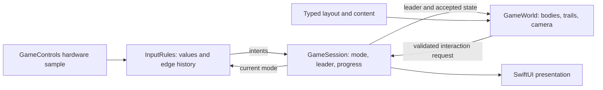

# Lauder — architecture

**Date:** 16 November 2026\
**Status:** Swift and RealityKit accepted. The party design below is proposed in response to [Claude's PR #21 review, B1/B3](https://github.com/RonildoBraga/lauder/pull/21#issuecomment-6916286122), for review and maintainer agreement before implementation.\
**Scope:** The current app has one moving character, stationary Tomas, observation prompts and Pause/Resume. GameSession, three-body following, switching, specialist interactions, mission rules, Restart and persistence are not implemented. The [walkthrough](gameplay-script.md) and [prototype plan](prototype-plan.md) define the proposed party experience; this document does not authorise code or settle the cast's open relationships.

## Decision and platform

Use **Swift + RealityKit** for gameplay and the 3D world, and **SwiftUI** for the interface. Build scenes in Swift and load USDZ assets directly, following the [maintainer's code-first decision](https://github.com/RonildoBraga/lauder/issues/9#issuecomment-6907224023). The accepted rationale, alternatives and unchanged three-session Stage 1 stop criterion are in [ADR 0001](decisions/0001-engine.md).

The project targets **iOS 27.0 or later**, iPhone first, in landscape. Use stable Xcode 27.2 / SDK 27.2 and record the actual toolchain, OS and build with validation results. The initial performance baseline is **iPhone 13 Pro Max**, with a measured 60 fps target. Broader Apple-device support follows a working iPhone prototype. See the [recorded toolchain and device evidence](stage-1.md); a target is not a performance result.

## Shape of the project

Keep **one app target**, one Swift Testing target and ordinary feature folders. No package hierarchy, third-party dependency, custom ECS or new rendering layer is needed.

| Part | Proposed responsibility | Boundary |
|---|---|---|
| App composition | Own stable session/world instances and launch/teardown | SwiftUI reevaluation does not recreate them |
| GameSession | Mode, active leader and shared mission facts; accept/reject commands | Plain Swift values and rules, no entities or views |
| GameWorld | Three bodies, camera, collision, following, scene effects and owned update/load work | RealityKit owns live spatial state |
| Interface/input | Poll hardware, hold input-rule state, present coarse session/world state | Supplies intents; does not own a second gameplay mode |
| Content | Typed layout, character/interaction IDs, approaches, prompts and delivery assets | Small authored definitions within the app |
| Persistence, later | Versioned checkpoints and an ordered writer | Values, never entity graphs |

These are responsibilities, not new frameworks or a requirement to create every folder immediately. Add GameSession for Party A; add interaction/progress rules with B/C and SaveStore only during later hardening.

## Scene and asset authoring

Compose the graybox using generated meshes, simple materials, lights, camera and collision shapes. Keep authored positions, dimensions and stable IDs in the existing small typed layout, rather than adding JSON, a parser or an editor framework.

Party A uses three named, differently coloured primitive stand-ins. Replace the stationary Tomas landmark with his party body; the keeper briefing is text-only, without a fourth character rig. No new character models or animation are required. The completed rig/idle/walk proof remains recorded in [Stage 1](stage-1.md). Preserve editable sources, deliberate exports and provenance together; the [stand-in generator](../sources/content/character/README.md) is a prototype asset tool, not a finished-art pipeline.

Scene composition and the named animation library remain Swift code. Do not add per-frame visual work, publish character transforms to SwiftUI, or require art production before evaluating the party.

## Swift conventions

- Use **Swift 6 language mode** and complete data-race checking. Keep session/UI/world coordination main-actor isolated; concurrency boundaries must be explicit. [Swift migration guidance](https://www.swift.org/migration/documentation/swift-6-concurrency-migration-guide/enabledataracesafety/)
- Use **Swift Testing** for rules and value-based trail tests. [Swift Testing](https://developer.apple.com/xcode/swift-testing/)
- Use toolchain **`swift format`** with the committed [`.swift-format`](../.swift-format): two-space indentation, 100-column length and otherwise tool defaults.
- Run **`./scripts/check`** for formatting, the shared scheme's build and tests. [Validation requirements](../CONTRIBUTING.md#validation)

## Runtime ownership

**GameSession is the sole authority** for:

- Mode: exploring, dialogue or paused. Pausing records whether to resume exploring or the current dialogue; pauses do not nest or lose the dialogue cursor.
- Active leader: one stable member ID, with proposed order Miki → Lara → Tomas.
- Mission phase, introduced with Party C.
- A separate `passageOpen` flag, introduced with Party B. Opening access is not a mission phase and either solution sets the same flag.

Use plain Swift session state and rules on the main actor, exposing only coarse changes to the interface. The carried-regulator indicator is derived from the mission phase, not stored on a leader or duplicated in the world. There are no separate member inventories.

**GameWorld owns spatial state:** a body reference for each stable member ID, their actual positions, follower trails/cursors, one camera, scene bindings, playback where present, load cancellation and one simulation subscription. It reads the active leader from the session. Operational facts such as loading, app activity and hardware availability are not another exploring/dialogue/paused mode.

**GameControls owns device attachment and raw sampling.** Pure InputRules owns the transformation of raw values plus prior input-rule state into intents and next rule state. Neither keeps an independent pause/dialogue policy. Remove the current GameWorld pause authority and GameControls pause copy when migrating to the session; do not leave synchronized competing modes.

The owned world update coordinates this sequence. Rules do not retain RealityKit entities, and the world does not keep a second leader, inventory or passage-open truth.

## Input and command routing

Keep the shared GameController extended-gamepad path for PS5 DualSense/Xbox and the Simulator keyboard path. Existing mappings are left stick/WASD movement, Cross/A/E action and Options/Menu/Escape Pause. **Proposed switching:** R1/RB, read through the [right shoulder element](https://developer.apple.com/documentation/gamecontroller/gcextendedgamepad/rightshoulder), or **Q** in Simulator. Q replaces the earlier Tab proposal; switch delivery and comfort have not been tested. There are no touch controls or clickable screen actions.

Extend InputRules with switch-button state and explicit previous-button/edge state instead of adding another edge detector in GameWorld. Tests cover:

1. Pause takes priority over other commands in the same sample. The session stores the resume mode and routes subsequent inputs accordingly.
2. While exploring, a fresh switch edge cycles leadership and suppresses the same-sample action. Record that action's held state even when suppressed: it requires release and a fresh press before use.
3. Held movement may continue on the new leader. Switching alone does not close the neutral-input gate.
4. While in dialogue or Pause, switch edges are ignored and consumed, not queued. Action advances text or confirms the pause-menu choice; it cannot also interact with the world. Movement can navigate a menu only where explicitly defined, never move the bodies.
5. Inactivity, input-source changes and Pause/Resume retain the release gate. All gameplay buttons, including switch, must be released and the stick centred before fresh input. Opposing held movement keys do not count as neutral.

GameSession decides what an allowed intent means for the current mode. World movement/following runs only when exploring, presented, active, ready, supplied with an available input source and past the neutral-input gate. This does not require nonzero movement: followers may settle along their routes while the leader stands still. Dialogue, Pause, input loss or a closed release gate freezes the whole party; input sampling needed for dialogue/menu/Pause remains available.

## Movement and presentation

Continue using one owned RealityKit simulation update with elapsed time. **RealityView.update is for state-driven scene changes, not the simulation loop.** Do not add a timer or per-input tasks. Keep the existing cancellation, first-step timing reset and late-load protection.

All three initial stand-ins use the same controller footprint and collide with the world, including closed barriers. Exclude party-member collisions from one another so companions cannot physically block the leader in the narrow opening. Trail spacing provides best-effort visual separation; temporary overlap on reversals is a graybox trade-off, not a claim that spacing guarantees separation. RealityKit exposes a character-controller [collision filter](https://developer.apple.com/documentation/realitykit/charactercontrollercomponent/collisionfilter); verify the intended world/party masks in the actual route tests.

Use a bounded recorded-path trail with retained route connections and per-member cursors, as specified in [ADR 0002](decisions/0002-party-following.md). A leader's recorded path is useful evidence of travel, not proof of follower clearance. Each follower still moves through collision-checked world space; corners, reversals, switching and a changed barrier can invalidate an assumed connection.

The camera keeps the accepted elevated offset and field of view and follows the session's selected leader. On switching, ease the target from the current camera target to the new leader over a proposed **0.25 seconds**, tunable in playtests. Preserve the offset/orientation and world positions; another switch starts from the current interpolated target. Freeze transition progress when the world is frozen. This is an easing proposal, not a tested comfort result.

## The prototype's state

Proposed Party C mission phase:

**Briefing → Seeking regulator → Carrying regulator → Radio repaired → Meeting agreed**

The keeper's briefing starts the search with all three travellers present. Miki identifies/takes the regulator and later consumes it in the repair. Any leader can start the coastal water-crew call or use **Read plan** after completion. Finishing the call secures the appointment. Lara is local; no Nina-specific dialogue is required while relationships remain undecided.

The separate passage flag survives every leader switch. Lara's latch and Tomas's panel action are alternative transitions from closed to open; after either succeeds, both requests are harmless. No second obstacle or skill tree is needed.

### One interaction

Before Party B, extend the typed layout's interaction definitions with stable action IDs, eligible member IDs, an authored accessible approach area, prompt/role-feedback text and the relevant collision dimensions. Put per-object collision data there instead of selecting it by ID in GameWorld; this absorbs [#19 L4](https://github.com/RonildoBraga/lauder/issues/19). Required IDs must exist once at load.

1. GameWorld evaluates the actual active body's position against the interaction's approach area and current world accessibility.
2. The HUD presents the active character's action or a suggestion to switch. No remote companion acts automatically.
3. A fresh action rechecks active identity, approach, range, accessibility and relevant progress. An approach must be authored on the usable side of a wall; proximity alone is insufficient.
4. GameSession validates mode, eligibility and phase/flag and accepts or rejects the named command.
5. Accepted state changes project onto the static world: the barrier opens, the regulator disappears or the transmitter changes state. The world retains no independent progress flags.

Tests cover stale prompts after movement/switching, both alternative methods independently, duplicate actions and repair without the part. Read plan leaves secured progress unchanged. Keep short ordered speaker-labelled text in content; no branching dialogue framework is required.

## Restart and lifecycle

Party C implements the proposed **in-place Restart** of the existing session/world. Reset mode to exploring, active leader to Miki, mission to briefing and passage to closed. Restore all three authored spawn positions, controller motion state, regulator visibility, unrepaired transmitter, dialogue/objective state and observation/prompt state. Clear/reseed trails, camera transition and input edge history; require neutral input before movement resumes.

Restart does not attach a second simulation callback, rebuild the static scene or reload already available stand-ins. Invalidate unfinished run-specific effects or loads so late results cannot alter the reset run. Verify a single owned subscription and exactly three members across repeated restarts.

Normal inactivity freezes the current scene and preserves session/dialogue progress. Clear held input and reset frame timing when returning. The foreground app remains awake, including Pause; restore the idle timer when inactive. Leaving the view cancels owned updates and unfinished loads. These rules extend the current lifecycle to all three bodies rather than creating a separate party lifecycle manager.

## Saving and interruption

**Persistence is later hardening, not a first-playable dependency.** Create SaveStore then, rather than alongside Party A.

Use a versioned Codable checkpoint with mission phase, the independent passage flag, active member ID and an authored safe group-spawn ID. Derive the carried part from phase. Restore all three to a validated group placement on the correct reachable side of any closed barrier; define the checkpoint mapping before implementing saves. Do not serialise arbitrary transforms, trails, physics or animation state.

Save meaningful changes with one ordered atomic writer. Restart invalidates older writes. Report failures; a corrupt/unsupported save remains intact until the player explicitly chooses Restart. Termination during dialogue replays its checkpoint; ordinary Pause preserves the live line. Do not rely on a shutdown callback.

## Assets and checks

Party A adds pure tests for input precedence, session modes/leadership and trail advancement/rebasing; manual Simulator route checks cover real collision, turns, reversals, camera easing and switching to each separated member. B adds layout eligibility/approach and shared-gate checks. C adds the full progression, dialogue and repeated in-place Restart checks. Unit tests do not prove the rendered route.

Use Simulator keyboard input for everyday iteration. Live PS5 input did not work in the tested Simulator setup; enumeration does not prove delivery. The revised proposal is a phone checkpoint after **Party A** and another after **Party C**, with B's controls checked alongside C. It awaits maintainer agreement, preserves [#18's earlier deferral](https://github.com/RonildoBraga/lauder/issues/18), and requests no phone session now. Record controller/lifecycle observations and measured frame pacing; neither the solo phone checks nor Simulator timing prove party performance. Sustained 15–20 minute thermal/memory checks remain later hardening.

## Deliberately deferred

Finished character art/animation, free jumping/climbing, formation orders, separate inventories, generic navigation/ECS/inventory/quest frameworks, additional packages, networking, cloud saves, monetisation and scene streaming. Ordinary following and switching are part of Party A, not deferred companion features.

## Revisit after the first playable

Use the plan's proposed Party A stop review if following is unreliable. First reconsider trail handling and the bounded layout; any navigation replacement or automatic regroup requires a deliberate review. Add the next survival pressure, combat encounter or visual requirement only when a concrete playtest need warrants it.
