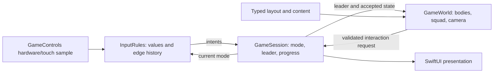

# Lauder — architecture

**Date:** 18 November 2026\
**Status:** Swift and RealityKit accepted. The party design was consolidated through [PR #22](https://github.com/RonildoBraga/lauder/pull/22); the maintainer has now assigned Party A regardless of Claude's response.\
**Scope:** Party A implements primitive bodies, leadership/Pause, switching and camera follow. Companions follow as a squad under [ADR 0003](https://github.com/RonildoBraga/lauder/blob/a5437e5/docs/decisions/0003-squad-movement.md) phase S1, which replaced Party A's recorded trails. Its [session record](party-a.md) distinguishes verification from remaining work. [Party B](party-b.md) added the passage's specialist actions, and [Party C](party-c.md) the mission phases, dialogue, a pause menu and in-place Restart. Persistence remains later hardening; this design does not settle open relationships. [ADR 0004](decisions/0004-brooklyn-bridge-opening.md), accepted on 18 November 2026, opens the game on the Brooklyn Bridge. Its milestone M1 made levels values, gave the session the party's membership and trigger areas, and added the greybox bridge; the [M1 record](opening-m1.md) lists what was built and checked. M2 added the first fight: Fire, assisted aim, line of sight, hits and a retry, as its [record](opening-m2.md) describes. M3 added searching, the ambush scene and Tom joining, as its [record](opening-m3.md) describes. Laura follows in M4.

## Decision and platform

Use **Swift + RealityKit** for gameplay and the 3D world, and **SwiftUI** for the interface. Build scenes in Swift and load USDZ assets directly, following the [maintainer's code-first decision](https://github.com/RonildoBraga/lauder/issues/9#issuecomment-6907224023). The accepted rationale, alternatives and unchanged three-session Stage 1 stop criterion are in [ADR 0001](decisions/0001-engine.md).

The project targets **iOS 27.0 or later**, iPhone first, in landscape. Use stable Xcode 27.2 / SDK 27.2 and record the actual toolchain, OS and build with validation results. The initial performance baseline is **iPhone 13 Pro Max**, with a measured 60 fps target. Broader Apple-device support follows a working iPhone prototype. See the [recorded toolchain and device evidence](stage-1.md); a target is not a performance result.

## Shape of the project

Keep **one app target**, one Swift Testing target and ordinary feature folders. No package hierarchy, third-party dependency, custom ECS or new rendering layer is needed.

| Part | Proposed responsibility | Boundary |
|---|---|---|
| App composition | Own stable session/world instances and launch/teardown | SwiftUI reevaluation does not recreate them |
| GameSession | Mode, who is in the party, active leader, shared mission facts, fired trigger areas, the story's beat and a fight's hits, rounds and defeated hostiles; accept/reject commands | Plain Swift values and rules, no entities or views |
| GameWorld | A body for each member, hidden until they join, camera, collision, following, fights, scene effects and owned update/load work | Owns entity state; uses plain Swift motion, routes, formation and combat rules |
| Combat | Weapon timing, sight lines, assisted aim, each hostile's states and an encounter's timed cues | Plain Swift values, no entities; the world drives them each step |
| Interface/input | Poll hardware, hold input-rule state, present coarse session/world state | Supplies intents; does not own a second gameplay mode |
| Content | Typed levels (the Brooklyn Bridge and Relay House): scenery, starting party, spawns, interactions, approaches, trigger areas and prompts; character IDs and delivery assets | Small authored definitions within the app |
| Persistence, later | Versioned checkpoints and an ordered writer | Values, never entity graphs |

These are responsibilities, not new frameworks or a requirement to create every folder immediately. Party A added GameSession with exploring/paused modes and leadership, Party B the passage flag, Party C the mission phase, the dialogue mode and the pause menu, M1 the party's membership and the trigger areas fired in a run, and M2 the story's beat and a fight's hits, rounds, defeated hostiles and retry checkpoint. SaveStore follows in later hardening.

## Scene and asset authoring

Compose the graybox using generated meshes, simple materials, lights and camera. Keep authored positions, collision dimensions and stable IDs in typed levels, rather than adding JSON or a parser to the game. A `Level` value holds a place's floor, blocker boxes, decoration pieces, points of interest, interactions, trigger areas, starting party, spawn points, starting heading, and the camera's offset and field of view. `BrooklynBridge` and `RelayHouse` each build one, and the world, the session, the navigation grid and the scene dressing take the level they are given. The scene dressing draws the decoration that blocks nothing: the bridge's from the pieces in its level, such as the cables and raised walkway, and Relay House's from rules in Swift.

Since [ADR 0005](decisions/0005-blender-level-editor.md), Blender is the level editor. A level's layout, where everything stands, is a plain-data Swift file with stable names: the bridge's is `BrooklynBridgeLayout.swift`, holding the ground, boxes, landmarks, flat areas, markers, decoration pieces and the game camera. `scripts/blender/lauder_levels.py` loads it into Blender and saves it back after checking the game's rules. Blender also shows the details the game adds to each vehicle and landmark, without saving them. The level's own file adds the words and refers to entries by name. The Swift file stays the source of truth, and the game still compiles typed data, with no parser or loading at runtime. Relay House is still written by hand.

Party A uses three named, differently coloured primitive stand-ins. Replace the stationary Tom landmark with his party body; the keeper briefing is text-only, without a fourth character rig. No new character models or animation are required. The completed rig/idle/walk proof remains recorded in [Stage 1](stage-1.md). Preserve editable sources, deliberate exports and provenance together; the [stand-in generator](../sources/content/character/README.md) is a prototype asset tool, not a finished-art pipeline.

Scene composition remains Swift code. The preserved [test-only asset fixture](../tests/support/CharacterAsset.swift) validates the named animation library; Party A does not ship its loader in the app target. Do not add per-frame visual work, publish character transforms to SwiftUI, or require art production before evaluating the party.

## Swift conventions

- Use **Swift 6 language mode** and complete data-race checking. Keep session/UI/world coordination main-actor isolated; concurrency boundaries must be explicit. [Swift migration guidance](https://www.swift.org/migration/documentation/swift-6-concurrency-migration-guide/enabledataracesafety/)
- Use **Swift Testing** for rules and value-based movement tests. [Swift Testing](https://developer.apple.com/xcode/swift-testing/)
- Use toolchain **`swift format`** with the committed [`.swift-format`](../.swift-format): two-space indentation, 100-column length and otherwise tool defaults.
- Run **`./scripts/check`** for formatting, the shared scheme's build and tests. [Validation requirements](../CONTRIBUTING.md#validation)

## Runtime ownership

**GameSession is the sole authority** for:

- Mode: exploring, dialogue or paused. Pausing records whether to resume exploring or the current dialogue; pauses do not nest or lose the dialogue cursor.
- Who is in the party, in switching order, and the active leader among them. A level can start with fewer than three: the bridge starts with Miki alone, and Relay House with Miki → Laura → Tom. Members join through the story; Next appears only when there is someone to switch to.
- The trigger areas that have shown their line in this run, added by M1.
- The story's beat: Miki alone, then the stranger (M2), then the ambush and travelling with Tom (M3). A beat begins only after the one before, once and while exploring. During a fight the session also holds the leader's hits, the carbine's rounds, the hostiles that are down and the checkpoint that a retry returns to. Since M3 it also holds the bodies searched and a small shared inventory with the medical kits, and adds Tom to the party when the exchange after the ambush ends.
- Mission phase, added by Party C.
- A separate `passageOpen` flag, introduced with Party B. Opening access is not a mission phase and either solution sets the same flag.
- The current conversation and line, and the pause menu's choice.

Use plain Swift session state and rules on the main actor, exposing only coarse changes to the interface. The carried-regulator indicator is derived from the mission phase, not stored on a leader or duplicated in the world. So are the regulator's place in the scene, the transmitter's status light and the objective line. The world shows them by projecting the phase onto fixed scene parts, and movement and routes read the passage flag directly, so the world keeps no progress flags of its own. There are no separate member inventories.

**GameWorld owns spatial state:** a body reference for each stable member ID, hidden and out of movement until that member joins, their actual positions, companion routes and formation state, one camera, scene bindings and one owned scene-update subscription. It reads the active leader from the session. Its `EncounterStage` holds the hostiles' bodies and positions, their aim and shots, the assisted target and whether the carbine is drawn, and keeps no second copy of hits, rounds or who is down. Operational facts such as loading, app activity and hardware availability are not another exploring/dialogue/paused mode.

**GameControls owns device attachment and raw sampling.** Pure InputRules owns the transformation of raw values plus prior input-rule state into intents and next rule state. Neither keeps an independent pause/dialogue policy. `GameSession` now owns the exploring/Pause mode; `GameWorld` reads it and `GameControls` receives it when resolving input. Planned dialogue extends that same authority.

The owned world update coordinates this sequence. Rules do not retain RealityKit entities, and the world does not keep a second leader, inventory or passage-open truth.

## Input and command routing

Keep the shared GameController extended-gamepad path for PS5 DualSense/Xbox and the Simulator keyboard path. Existing mappings are left stick/WASD movement, Cross/A/E action and Options/Menu/Escape Pause. **Fire**, added by M2, is R2/RT, read through the right trigger, or **F** in Simulator; on touch, a **Fire** button shows during a fight or once the carbine is drawn. **Initial switching defaults:** R1/RB, read through the [right shoulder element](https://developer.apple.com/documentation/gamecontroller/gcextendedgamepad/rightshoulder), or **Q** in Simulator. Q replaces the earlier Tab proposal. Q delivery was checked in Simulator; R1 and the switching camera/HUD were confirmed in the short baseline phone check. Xbox RB hardware delivery remains unverified. The maintainer subsequently authorised [touch controls](touch-controls.md), superseding the no-touch decision. A fixed bottom-left analog stick, **Look**, **Next: name** and **Pause/Resume** supply the same intents. Touch is automatic without an extended controller; an attached controller is preferred unless **Use touch controls** is selected, and **Use controller** returns to it. The preference is in memory, not persisted.

GameControls samples hardware and TouchInput state; InputRules resolves all sources with the same mode, priority and fresh-edge history. Touch controls do not call GameSession or world actions directly. Independent zones support a stick finger alongside button fingers. Source changes and inactivity cancel captures through a generation token so stale callbacks cannot affect the new source. Pause leaves capture mounted and preserves held contacts: all fingers must lift, including a centred-stick finger, before the neutral gate clears. The foreground idle-timer policy is unchanged.

Keep explicit previous-button/edge state in InputRules instead of adding another edge detector in GameWorld. Tests cover:

1. Pause takes priority over other commands in the same sample. The session stores the resume mode and routes subsequent inputs accordingly.
2. While exploring, a fresh switch edge cycles leadership and suppresses the same-sample action. Record that action's held state even when suppressed: it requires release and a fresh press before use.
3. Held movement may continue on the new leader. Switching alone does not close the neutral-input gate.
4. While in dialogue or Pause, switch edges are ignored and consumed, not queued. Action advances text or confirms the pause-menu choice; it cannot also interact with the world. Movement can navigate a menu only where explicitly defined, never move the bodies.
5. Inactivity, input-source changes and Pause/Resume retain the release gate. All gameplay buttons, including switch and Fire, must be released and the stick centred before fresh input. Opposing held movement keys do not count as neutral.
6. While exploring, Fire is both a fresh press, which draws a holstered carbine, and a hold, which keeps firing at the weapon's own pace. Dialogue and Pause consume it.

**The minimal pause menu**, added by Party C, has two choices, **Resume** and **Restart**, and opens on Resume. A fresh up or down press, from W/S or the stick, chooses; the action confirms; Pause resumes directly. Restart takes effect at once, without a second confirmation. On touch, the action button reads **Restart** while paused and **Resume** stays at the top right. The action button keeps the intent it sent when its finger came down until that finger lifts, so a press that began before Pause cannot release as Restart. In a conversation the action button reads **Continue**, and Pause keeps the current line.

GameSession decides what an allowed intent means for the current mode. World movement/following runs only when exploring, presented, active, ready, supplied with an available input source and past the neutral-input gate. This does not require nonzero movement: followers may settle along their routes while the leader stands still. Dialogue, Pause, input loss or a closed release gate freezes the whole party; input sampling needed for dialogue/menu/Pause remains available.

## Movement and presentation

Continue using one owned RealityKit scene update with elapsed time. **RealityView.update is for state-driven scene changes, not the simulation loop.** Do not add a timer or per-input tasks. Keep the existing cancellation, first-step timing reset and late-load protection.

Party A samples input and advances plain body transforms through one owned `SceneEvents.Update` subscription. Movement does not require rigid-body simulation; the earlier physics-only subscription stopped delivering input updates when the all-static scene idled.

Inside that update, party movement advances in **fixed 1/120-second steps**. Each frame adds its elapsed time, capped at 1/30 second, runs as many whole steps as fit and carries the remainder; the first step after an interruption discards any remainder. Equal steps record equal trail edges for a given stick input, which follower spacing depends on: with variable steps, followers lost distance they could not regain while the leader kept running ([#28](https://github.com/RonildoBraga/lauder/issues/28), fixed as [authorised by the maintainer](https://github.com/RonildoBraga/lauder/issues/28#issuecomment-6942750650)). Camera easing uses the frame's elapsed time. Bodies move in whole steps without interpolation, so a frame can show up to one step (about 2 cm at full speed) more or less than its elapsed time; that is accepted for the graybox. This is still the single owned update, with no timer.

All three stand-ins use the same circular footprint. The assigned [#25 correction](wall-contact.md) resolves continuous horizontal movement in plain Swift against the axis-aligned rectangles derived from the level's visible blocker dimensions. Offset faces and exact rounded corners use the body radius plus a **2 mm normal skin**, including unobstructed endpoints. A body starting inside that clearance may move outward or tangentially, while inward movement stays blocked; idle input never snaps its position. Resolve the initial leg and at most one wall-slide leg, then check the final start-to-end chord so the recorded trail cannot cut through another blocker.

RealityKit renders the bodies and scenery; movement no longer uses engine shape queries or static physics components. Ground, decorations and party members are excluded from the authored blocker list. Body height stays fixed on the existing flat floor; slopes, steps, vertical traversal and a new physics/navigation system are outside this correction. Trail spacing remains best-effort, with temporary overlap on reversals accepted for the graybox. Earlier [Party A route results](party-a.md) apply to the old implementation, not this fix.

Companions move as a squad under [ADR 0003](https://github.com/RonildoBraga/lauder/blob/a5437e5/docs/decisions/0003-squad-movement.md), [accepted by the maintainer](https://github.com/RonildoBraga/lauder/pull/32#issuecomment-6944093756); phase S1 replaced the recorded trail of [ADR 0002](decisions/0002-party-following.md). Each step:

1. The leader moves from the stick as before, and a short **route memory** records their last 6 m.
2. **SquadPlanner** places a **Close** formation slot for each companion, 0.9 m to the side and 0.9 m behind, turned towards the leader's heading at up to 180° per second. A slot is used only where a body fits outside doorway-like passages and the straight line from the leader is clear. Otherwise it is pulled halfway in, then moved onto the leader's route; it spreads out again once it has fitted for 0.3 s. A waiting companion stands clear of doorways.
3. **CompanionMotor** steers each companion: straight to the slot when the line is clear, matching the leader's movement and closing the gap; otherwise along an A* route on **NavigationGrid**, a 0.2 m grid over the level's authored rectangles, straightened against the same footprints. When the grid is built, each rectangle checks only the cells within its reach, which gives the same grid as checking every cell and suits the long bridge. Companions may reach 1.25× the leader's speed to catch up, accelerate and turn at limited rates, settle without shuffling and keep about 0.75 m of personal space. Laura reacts first and Tom last, by a fraction of a second.
4. Every movement, the leader's included, is resolved by PartyMotion.

A companion that stalls for a second re-plans; after three stalls they wait, the HUD names them, and they retry by themselves. The leader and the other companion keep moving, and nobody teleports. The planner places whoever is in the party with the leader: two companions, or one before the third member joins.

The camera keeps the accepted elevated offset and field of view and follows the session's selected leader. Each level supplies the offset: Relay House keeps the accepted one, and the bridge keeps its height and distance but looks straight along the deck, so pushing up walks towards Manhattan. On switching, ease the target from the current camera target to the new leader over **0.25 seconds**, tunable in playtests. Preserve the offset/orientation and world positions; another switch starts from the current interpolated target. Freeze transition progress when the world is frozen. The short Simulator and baseline phone checks confirmed readable leader changes and camera/HUD framing; longer-session comfort and other layouts remain unverified. During a fight, added by M2, the target leans from the leader towards the nearest hostile in the open, 40% of the way and at most 3 m, easing in and out over about a second, so both stay on screen; the bridge camera otherwise shows only about 10 m ahead. Restart and a fight's retry straighten it at once.

## The prototype's state

The app opens on the **Brooklyn Bridge** ([ADR 0004](decisions/0004-brooklyn-bridge-opening.md), milestone M1): Miki crosses alone from the Brooklyn end, and trigger areas on the deck each show a line the first time she enters them in a run. Tom and Laura's bodies wait, hidden, at the places their scenes will use. M2 adds the stranger's fight, and M3 the search, the ambush and Tom joining; Laura arrives with M4. Debug builds open Relay House with `-LauderLevel relay-house`, and its playtests load it themselves.

### The first fight

An encounter is a value in its level: the beat it starts, a trigger area, the point a retry returns to, its hostiles and its timed cues. When the leader enters the area and its beat is next, the session starts the beat and keeps a checkpoint. The world then advances the fight in each fixed simulation step, after the leader moves:

1. `StoryDirector` plays the cues that are due: a hostile steps out, a line shows, a hostile starts to fight.
2. Each `HostileState` advances. A finished wind-up is a shot, resolved against range and line of sight: a deliberate first miss, a hit, or blocked by cover or distance. A hit asks the session to count it.
3. If Fire is held, the carbine is drawn and ready, the leader shoots the assisted target. The session spends the round and counts the hit, and the stage knocks the hostile down when the session says it is down.
4. When every hostile is down, the session ends the fight and the leader's hits recover.

The session's last allowed hit starts the retry. The screen fades out over 0.6 s; the session restores its checkpoint; the stage puts every hostile back unseen; the leader returns to the retry point with fresh route memory, formation planner and motors; the screen fades in over 0.4 s; and the input owner requires neutral input, as on Resume. Pause holds the fight and the fade, because both advance only while exploring.

### Scenes

M3 adds the scene: an encounter that an action begins, that holds the leader still while its cues play, and that has no retry, because the leader cannot be hurt in it. The ambush is one. Searching the stranger's body begins it, and its cues, all played in the fixed step, do the following in order:

- step the attacker out from behind the van and set him running at Miki;
- take the body's loot into the session's shared inventory;
- show Tom;
- fire Tom's scripted shot, which the session counts as a takedown;
- turn Miki and Tom to each other;
- start their exchange.

A scene ends after its last cue, once its hostiles are down. The exchange's effect, Tom joining, takes place when it ends, like Party C's mission steps. Pause holds a scene, and Restart cancels it. While a scene holds the leader, the world ignores movement, Fire and actions; Pause still works.

**Relay House**, the second level, keeps Party C's mission phase, as implemented:

**Briefing → Seeking regulator → Carrying regulator → Radio repaired → Meeting agreed**

The keeper's briefing starts the search with all three travellers present. Miki identifies/takes the regulator and later consumes it in the repair. Any leader can start the coastal water-crew call or use **Read plan** after completion. An accepted step starts its short conversation, and the phase advances when the conversation ends, so finishing the call secures the appointment. The world shows the new state at that moment; Restart part-way through a conversation discards its step. Read plan starts its conversation without changing the phase. Laura is local; no Nina-specific dialogue is required while relationships remain undecided.

The separate passage flag survives every leader switch. Laura's latch and Tom's panel action are alternative transitions from closed to open; after either succeeds, both requests are harmless. No second obstacle or skill tree is needed.

### One interaction

Before Party B, extend the typed layout's interaction definitions with stable action IDs, eligible member IDs, an authored accessible approach area, prompt/role-feedback text and the relevant collision dimensions. [Party B](party-b.md) does this for the passage's two actions, in what is now `RelayHouse.interactions`, with the barrier's footprint alongside; the observation points keep their existing definitions. Put per-object collision data there instead of selecting it by ID in GameWorld; this absorbs [#19 L4](https://github.com/RonildoBraga/lauder/issues/19). Required IDs must exist once at load.

[Party C](party-c.md) adds five actions to the same list: **Talk to keeper**, **Call** and **Read plan** for any leader, and **Take regulator** and **Repair** for Miki. An action with no eligible member is open to every leader. The four transmitter actions share one approach inside the shelter, which includes where the party starts, and the session offers exactly one of them in each phase. The regulator's approach is inside the depot, so it is reachable only through the open passage. Where no action is offered, a press explains the first action there: already done, or not yet. The landmarks now carry their own size, so nothing selects per-object data by ID, and #19 L4 is addressed. Their observations change with the phase. Only the passage's small standing spots ask companions to keep clear.

1. GameWorld evaluates the actual active body's position against the interaction's approach area and current world accessibility.
2. The HUD presents the active character's action or a suggestion to switch. No remote companion acts automatically.
3. A fresh action rechecks active identity, approach, range, accessibility and relevant progress. An approach must be authored on the usable side of a wall; proximity alone is insufficient.
4. GameSession validates mode, eligibility and phase/flag and accepts or rejects the named command.
5. Accepted state changes project onto the static world: the barrier opens, the regulator disappears or the transmitter changes state. The world retains no independent progress flags.

Tests cover stale prompts after movement/switching, both alternative methods independently, duplicate actions and repair without the part. Read plan leaves secured progress unchanged. Keep short ordered speaker-labelled text in content; no branching dialogue framework is required.

## Restart and lifecycle

Party C implements the **in-place Restart** of the existing session and world, chosen from the pause menu through the selected input path. Its exact steps:

1. The session resets: exploring, the level's starting party with its first member (Miki) leading, no trigger fired, the first story beat with no fight under way, full rounds, no hits, nobody down, no body searched and an empty inventory, the briefing phase, the passage closed, no conversation, and the pause menu back on Resume.
2. The world puts every body back on its level's spawn point, facing the level's starting direction, shows only the members in the party and marks the leader. Route memory restarts at the leader's spawn; the formation planner, each companion motor, the companion targets and the stall warning start afresh.
3. The camera transition is cancelled and the camera target returns to the start. Owed simulation time is dropped and the next step is skipped.
4. At Relay House, the barrier, the regulator on its housing and the transmitter's amber light show again, projected from the reset session; movement and routes follow the closed passage because they read the session's flag. On the bridge, the encounter stage puts every hostile back unseen and holsters the carbine, Tom is hidden again, and a scene or a retry in progress is cancelled with its fade.
5. The observation returns to the level's opening line, and the prompt and nearby landmark are recomputed. The input owner requires neutral input, as on Resume, so every button, key and finger must be released before anything moves.

Restart does not attach a second simulation callback, rebuild the static scene, add entities or reload already available stand-ins. The run has no asynchronous effects or loads today, so nothing needs invalidating; one added later must check that it still belongs to the current run. Tests restart three times on each level and count every entity and the party bodies. The update subscription is attached only when the view appears, so Restart cannot add a second one.

Normal inactivity freezes the current scene and preserves session/dialogue progress. Clear held input and reset frame timing when returning. The foreground app remains awake, including Pause; restore the idle timer when inactive. Leaving the view cancels owned updates and unfinished loads. These rules extend the current lifecycle to all three bodies rather than creating a separate party lifecycle manager.

## Saving and interruption

**Persistence is later hardening, not a first-playable dependency.** Create SaveStore then, rather than alongside Party A.

Use a versioned Codable checkpoint with mission phase, the independent passage flag, active member ID and an authored safe group-spawn ID. Derive the carried part from phase. Restore all three to a validated group placement on the correct reachable side of any closed barrier; define the checkpoint mapping before implementing saves. Do not serialise arbitrary transforms, trails, physics or animation state.

Save meaningful changes with one ordered atomic writer. Restart invalidates older writes. Report failures; a corrupt/unsupported save remains intact until the player explicitly chooses Restart. Termination during dialogue replays its checkpoint; ordinary Pause preserves the live line. Do not rely on a shutdown callback.

## Assets and checks

Party A adds pure tests for input precedence and session modes/leadership; S1 adds grid, route-memory and whole-party formation, stillness, switching and service-opening tests. The #25 correction adds exact collision regressions and fixed-seed whole-party route tests using the authored blockers; [its record](wall-contact.md) separates pending validation from earlier results. Manual Simulator checks still cover the rendered route, turns, reversals, camera easing and switching to each separated member. B adds layout eligibility/approach and shared-gate checks. C adds the full progression, dialogue, pause-menu and repeated in-place Restart checks, and a `mission` playtest scenario. M2 adds sight-line, assisted-aim, hostile-timing and cue tests, the session's beat, hit, round and retry rules, the Fire input, whole-fight tests on the bridge, and the `first-fight` and `fight-retry` scenarios. M3 adds tests of the search and its loot, the attacker's charge, the scene playing the same way three times, Pause and Restart during it, and Tom joining and following, and the `ambush` scenario. Unit tests do not prove the rendered route. Debug builds also contain scripted playtests that `scripts/playtest` runs in the rendered Simulator app; they feed scripted input through the normal controls and record traces, and are compiled out of Release builds.

Use Simulator keyboard and single-pointer touch input for everyday iteration. The [touch-control validation record](touch-controls.md#validation) distinguishes those checks, the maintainer's physical multi-touch/Pause/recovery observations and remaining controller/performance gaps. Live PS5 input did not work in the tested Simulator setup; enumeration does not prove delivery. The accepted checkpoint schedule is after **Party A** and **Party C**, with B checked alongside C. It preserves [#18's earlier deferral](https://github.com/RonildoBraga/lauder/issues/18). Record controller/lifecycle observations and measured frame pacing; neither the solo phone checks nor Simulator timing prove party performance. Sustained 15–20 minute thermal/memory checks remain later hardening.

## Deliberately deferred

Finished character art/animation, free jumping/climbing, formation orders, separate inventories, generic navigation/ECS/inventory/quest frameworks, additional packages, networking, cloud saves, monetisation and scene streaming. Ordinary following and switching are part of Party A, not deferred companion features.

The [future squad/combat design](gameplay-script.md#future-squad-and-combat-design) and [The Quiet Yard](encounters/the-quiet-yard.md) describe intended experiences for review. Their [design gate](prototype-plan.md#combat-design-review-gate) precedes an implementation assignment; they do not replace the current trail/collision design or define a new navigation or combat architecture. [ADR 0003](decisions/0003-squad-movement.md) sets out that navigation and formation design; it is accepted, and its phase S1 replaces the trail following described above when it lands.

## Revisit after the first playable

Use the plan's Party A stop review if following is unreliable. First reconsider the squad movement's tuning and the bounded layout; an automatic regroup requires a deliberate review. Add the next survival pressure, combat encounter or visual requirement only when a concrete playtest need warrants it.
