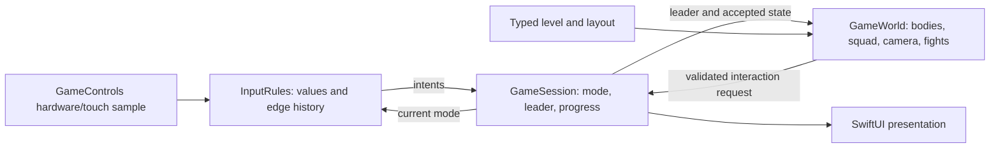

# Lauder — architecture

**Updated:** 21 November 2026\
**Status:** Swift and RealityKit ([ADR 0001](decisions/0001-engine.md)). The game opens on a greybox Brooklyn Bridge ([ADR 0004](decisions/0004-brooklyn-bridge-opening.md)), whose Blender file is its source ([ADR 0002](decisions/0002-blender-source-of-truth.md)): Blender exports the bridge's scene file and layout file. Companions move as a squad under [ADR 0003](decisions/0003-squad-movement.md) phases S1 to S3. Persistence remains later hardening; this design does not settle open relationships.

## Decision and platform

Use **Swift + RealityKit** for gameplay and the 3D world, and **SwiftUI** for the interface. Compose scenes in Swift and load the USDZ files that Blender exports directly. The rationale and the alternatives are in [ADR 0001](decisions/0001-engine.md).

The project targets **iOS 27.0 or later**, iPhone first, in landscape. Use stable Xcode 27.2 / SDK 27.2 and record the actual toolchain, OS and build with validation results. The performance baseline is **iPhone 13 Pro Max**, with a measured 60 fps target. Broader Apple-device support follows a working iPhone prototype. A target is not a performance result.

## Shape of the project

Keep **one app target**, one Swift Testing target and ordinary feature folders. No package hierarchy, third-party dependency, custom ECS or new rendering layer is needed. The app, its tests and its project live in `apple/`, and the levels' Blender files and the Lauder extension in `blender/`; a later platform gets a folder of its own beside `apple/`, as the [project structure](../README.md#project-structure) shows. Both targets use Xcode's folder-synchronised groups for `apple/sources/` and `apple/tests/`, so a new Swift file needs no project-file edit.

| Part | Responsibility | Boundary |
|---|---|---|
| App composition | Own stable session/world instances and launch/teardown; `Game` holds the world of the level in play | SwiftUI reevaluation does not recreate them; only the pause menu's third choice makes a new world |
| GameSession | Mode, who is in the party, active leader, the squad's formation and each companion's order, fired trigger areas, the story's beat, a fight's hits, rounds and defeated hostiles, bodies searched and the shared inventory; accept/reject commands | Plain Swift values and rules, no entities or views |
| GameWorld | A body for each member, hidden until they join, camera, collision, following, fights, scenes and owned update/load work | Owns entity state; uses plain Swift motion, routes, formation and combat rules |
| Combat | Weapon timing, sight lines, assisted aim, each hostile's states and an encounter's timed cues | Plain Swift values, no entities; the world drives them each step |
| Interface/input | Poll hardware, hold input-rule state, present coarse session/world state | Supplies intents; does not own a second gameplay mode |
| Content | The Brooklyn Bridge as a typed level: its layout file, its places' words, interactions, trigger areas, encounters and conversations; character IDs and delivery assets | Small authored definitions within the app |
| Persistence, later | Versioned checkpoints and an ordered writer | Values, never entity graphs |

These are responsibilities, not new frameworks or a requirement to create every folder immediately. SaveStore follows in later hardening.

## Scene and asset authoring

A level's look comes from its scene file; the game builds the rest from typed data. Keep authored positions, collision dimensions and stable IDs in typed levels, rather than adding JSON or a parser to the game. A `Level` value holds a place's floor, blocker boxes, interactions, trigger areas, encounters, starting party, spawn points, starting heading, the camera's offset and field of view, its lights and the name of its scene file. `BrooklynBridge` builds the opening, and `CombatYard` and `SalvageYard` the two experiments' temporary greybox yards, which have no Blender file or scene file; the world, the session and the navigation grid take the level they are given, so tests can build small levels of their own. The game draws a level without a scene file as plain blocks on snow. The party and the hostiles come from their models' scene files, which Blender exports too; the gameplay signals keep their own colours in code, in `SceneStyle`.

Each level and each model is a Blender file, its source ([ADR 0002](decisions/0002-blender-source-of-truth.md)). Saving the bridge's file through the Lauder extension, which holds a module for each job, checks the game's rules and exports its scene file, `BrooklynBridge.usdz`, and its layout file, `BrooklynBridgeLayout.swift`, as [Editing a level in Blender](../CONTRIBUTING.md#editing-a-level-in-blender) describes. The level's own Swift file adds the words and refers to the layout's entries by name, and Export refuses to drop a name it uses.

`GameWorld` loads the scene file synchronously while it is made, with `Entity.load(named:in:)`, so start-up has no asynchronous step, and Restart keeps it. `SceneStyle` loads each model's scene file the same way, once, and gives every figure a copy. The game compiles the layout file as typed data, with no parser.

The party uses three named, differently coloured primitive stand-ins, each a Blender model with a scene file of its own. No character art or animation is required. Add no per-frame visual work beyond what gameplay needs, such as fading a landmark or sizing a marker; do not publish character transforms to SwiftUI or require art production before evaluating play.

## Swift conventions

- Use **Swift 6 language mode** and complete data-race checking. Keep session/UI/world coordination main-actor isolated; concurrency boundaries must be explicit. [Swift migration guidance](https://www.swift.org/migration/documentation/swift-6-concurrency-migration-guide/enabledataracesafety/)
- Use **Swift Testing** for rules and value-based movement tests. [Swift Testing](https://developer.apple.com/xcode/swift-testing/)
- Use toolchain **`swift format`** with the committed [`.swift-format`](../apple/.swift-format): two-space indentation, 100-column length and otherwise tool defaults.
- Run **`./scripts/check`** for the Blender extension's tests, then formatting and the shared scheme's build and tests. [Validation requirements](../CONTRIBUTING.md#validation)

## Runtime ownership

**GameSession is the sole authority** for:

- Mode: exploring, dialogue or paused. Pausing records whether to resume exploring or the current dialogue; pauses do not nest or lose the dialogue cursor.
- Who is in the party, in switching order, and the active leader among them. The bridge starts with Miki alone, and members join through the story; **Next** appears only when there is someone to switch to.
- The squad's formation: Close, Spread or Column. It changes only while exploring and once the leader has two companions; a change of leader keeps it, and Restart returns it to Close.
- Each companion's order: following, going to a point or holding one. Orders are accepted on the same terms as the formation and persist until replaced; the formation button calls everyone back before it cycles again. In a fight in a level with combat positioning, such as the combat yard, the button regroups the companions instead: the session clears the orders and holds that they are regrouping until the world reports them back in the formation, a new order is given or the fight ends. A switch clears the new leader's order, and if the others are going or holding, the previous leader holds where they stand. The session decides who left and right mean: the members before and after the leader in switching order, so right is whoever **Next** would lead as. The world checks where a point lies and records where a hold in place stands.
- The trigger areas that have shown their line in this run.
- The story's beat: Miki alone, the stranger, the ambush, travelling with Tom, Laura found, helping her, travelling with Laura, and arriving at the Manhattan end. A beat begins only after the one before, once and while exploring. During a fight the session also holds the leader's hits, the carbine's rounds, the hostiles that are down and the checkpoint that a retry returns to. It holds the bodies searched and a small shared inventory with the medical kits, and adds a member to the party when the conversation that recruits them ends.
- The current conversation and line, and the pause menu's choice.

Use plain Swift session state and rules on the main actor, exposing only coarse changes to the interface. There are no separate member inventories, and the world keeps no progress flags of its own.

**GameWorld owns spatial state:** a body reference for each stable member ID, out of movement until that member joins and hidden until then unless the level has them lying hurt where they wait, their actual positions, companion routes and formation state, one camera, scene bindings and one owned scene-update subscription. It reads the active leader from the session. Its `EncounterStage` holds the hostiles' bodies and positions, their aim and shots, the assisted target and whether the carbine is drawn, and keeps no second copy of hits, rounds or who is down. Operational facts such as loading, app activity and hardware availability are not another exploring/dialogue/paused mode.

**GameControls owns device attachment and raw sampling.** Pure InputRules owns the transformation of raw values plus prior input-rule state into intents and next rule state. Neither keeps an independent pause/dialogue policy: `GameWorld` reads the mode from `GameSession`, and `GameControls` receives it when resolving input.

The owned world update coordinates this sequence. Rules do not retain RealityKit entities, and the world does not keep a second leader, inventory or progress truth.

## Input and command routing

Keep the shared GameController extended-gamepad path for PS5 DualSense/Xbox and the Simulator keyboard path; the [input contract](prototype-plan.md#input-and-interaction-contract) lists the bindings. R1 is read through the [right shoulder element](https://developer.apple.com/documentation/gamecontroller/gcextendedgamepad/rightshoulder), L1 through the left shoulder, Triangle through button Y, Square through button X and R2 through the right trigger; Xbox hardware delivery remains unverified. [Touch controls](touch-controls.md) supply the same intents. Touch is automatic without an extended controller; an attached controller is preferred unless **Use touch controls** is selected, and **Use controller** returns to it. The preference is in memory, not persisted.

GameControls samples hardware and TouchInput state; InputRules resolves all sources with the same mode, priority and fresh-edge history. Touch controls do not call GameSession or world actions directly. Independent zones support a stick finger alongside button fingers, and a finger on the ground for the order menu alongside both. As the menu opens, its point reaches InputRules as a share of the screen, and the world fixes what the camera's ray through it meets first, a block or the ground; the menu's choice follows once, when its finger lifts. A finger on the ground holds the release gate like any other. Source changes and inactivity cancel captures through a generation token so stale callbacks cannot affect the new source. Pause leaves capture mounted and preserves held contacts: all fingers must lift, including a centred-stick finger, before the neutral gate clears.

The panel button, Circle / B or H, is one more fresh-press intent: it hides or shows the status panel while exploring or in a conversation, and the pause menu consumes it. Keep explicit previous-button/edge state in InputRules instead of adding another edge detector in GameWorld. Tests cover:

1. Pause takes priority over other commands in the same sample. The session stores the resume mode and routes subsequent inputs accordingly.
2. While exploring, a fresh switch edge, Next or Previous, cycles leadership and suppresses the same-sample signature and action; Next wins over Previous. A formation or order edge suppresses them too, and a signature edge suppresses the action. Record each held state even when suppressed: it requires release and a fresh press before use.
3. Held movement may continue on the new leader. Switching alone does not close the neutral-input gate.
4. While in dialogue or Pause, switch edges are ignored and consumed, not queued. Action advances text or confirms the pause-menu choice; it cannot also interact with the world. Movement can navigate a menu only where explicitly defined, never move the bodies.
5. Inactivity, input-source changes and Pause/Resume retain the release gate. All gameplay buttons, including switch and Fire, must be released and the stick centred before fresh input. Opposing held movement keys do not count as neutral.
6. While exploring, Fire is both a fresh press, which draws a holstered carbine, and a hold, which keeps firing at the weapon's own pace. Dialogue and Pause consume it.

**The pause menu** has three choices, **Resume**, **Restart** and, while the experiments last, the next level in a cycle that `LevelCycle` names: **Combat test** on the bridge, **Salvage test** in the combat yard and **Bridge** in the salvage yard. It opens on Resume. A fresh up or down press, from W/S, the stick, the D-pad or the arrow keys, chooses; the action confirms; Pause resumes directly. Restart takes effect at once, without a second confirmation. The third choice asks `Game` for a new run of the other level: it stops the old world and makes a new one, which the app gives a new view and scene, and the touch preference, a hidden panel and a scripted playtest carry over. On touch, the action button reads **Restart** while paused, **Resume** stays at the top right, and a button beside it offers the third choice. The action button keeps the intent it sent when its finger came down until that finger lifts, so a press that began before Pause cannot release as Restart. In a conversation the action button reads **Continue**, and Pause keeps the current line. Below its choices the pause menu shows the app's version and build as TestFlight lists them, such as **Lauder 0.1.0 (14)**, so a tester can tell which build they are playing.

GameSession decides what an allowed intent means for the current mode. World movement/following runs only when exploring, presented, active, ready, supplied with an available input source and past the neutral-input gate. This does not require nonzero movement: companions may settle while the leader stands still. Dialogue, Pause, input loss or a closed release gate freezes the whole party; input sampling needed for dialogue/menu/Pause remains available. Keep the foreground game awake, including Pause, and restore the idle timer on leaving it.

## Movement and presentation

Continue using one owned RealityKit scene update with elapsed time. **RealityView.update is for state-driven scene changes, not the simulation loop.** Do not add a timer or per-input tasks. Keep the existing cancellation, first-step timing reset and late-load protection. Movement does not require rigid-body simulation.

Inside that update, party movement advances in **fixed 1/120-second steps**. Each frame adds its elapsed time, capped at 1/30 second, runs as many whole steps as fit and carries the remainder; the first step after an interruption discards any remainder. Equal steps keep the companions' spacing independent of the display's frame times. Camera easing uses the frame's elapsed time. Bodies move in whole steps without interpolation, so a frame can show up to one step (about 2 cm at full speed) more or less than its elapsed time; that is accepted for the greybox.

All three stand-ins use the same circular footprint. PartyMotion resolves continuous horizontal movement in plain Swift against the axis-aligned rectangles derived from the level's blocker dimensions. Offset faces and exact rounded corners use the body radius plus a **2 mm normal skin**, including unobstructed endpoints. A body starting inside that clearance may move outward or tangentially, while inward movement stays blocked; idle input never snaps its position. Resolve the initial leg and at most one wall-slide leg, then check the final start-to-end chord so a move cannot cut through another blocker. RealityKit renders the bodies and scenery; movement uses no engine shape queries or physics components. Ground, decoration and party members are excluded from the blocker list. Body height stays fixed on the flat floor; slopes, steps and vertical traversal are outside the prototype.

Companions move as a squad under [ADR 0003](decisions/0003-squad-movement.md). Each step:

1. The leader moves from the stick, and a short **route memory** records their last 6 m.
2. **SquadPlanner** places a slot of the session's formation for each companion, turned towards the leader's heading at up to 180° per second: **Close**, 0.9 m to the side and 0.9 m behind, or **Spread**, 2.2 m to the side and 0.5 m behind. A slot is used only where a body fits outside doorway-like passages and the straight line from the leader is clear. Otherwise it is pulled halfway in, then moved onto the leader's route; it spreads out again once it has fitted for 0.3 s. **Column** puts the companions on that route, 1 m and 2 m back. A new formation assigns its places afresh, by least walking in total, so the companions' ways to them do not cross. A waiting companion stands clear of doorways.
3. **CompanionMotor** steers each companion: straight to the slot when the line is clear, matching the leader's movement and closing the gap; otherwise along an A* route on **NavigationGrid**, a 0.2 m grid over the level's authored rectangles, straightened against the same footprints. When the grid is built, each rectangle checks only the cells within its reach, which gives the same grid as checking every cell and suits the long bridge. Companions may reach 1.25× the leader's speed to catch up, accelerate and turn at limited rates, settle without shuffling and keep about 0.75 m of personal space. Laura reacts first and Tom last, by a fraction of a second.
4. Every movement, the leader's included, is resolved by PartyMotion.

A companion with an order keeps to its point instead of a slot, and the others share the formation's places, so one companion following alone takes a slot of its own (phase S3). The D-pad's point lies 6 m ahead along the leader's facing, brought back in front of the first wall; a touch order's is what the finger's ray meets first. Either may move up to a metre to a reachable place in the leader's connected area, out of doorways where possible; otherwise a red cross shows there for a second and nothing happens. Two companions sent together take spots 1 m apart around the point, side by side across the line from the leader where they fit, by least walking in total; one sent onto the other's point stands 1 m beside it, on the side the order names. The motor steers to a marked point as to a still target, so a holding companion never drifts with the leader, and a going companion holds once within 0.35 m. A new order moves a settled companion off however near the point is, instead of waiting for it to be 0.6 m away as a formation place must be. A ring in their colour marks a going companion's point until they arrive.

In a level whose fight rules have it, the combat yard's, companions follow ADR 0003's combat positioning, phase S4, once a fight is under way, which [ADR 0005](decisions/0005-squad-combat-experiment.md#after-the-second-session) tries. Between the places and the motor, **CoverPlanner** weighs each companion's choices of cover:
- **The choices:** keeping to their place, which wins a tie, or a spot within 1.5 m of it in Close and Column, or 2.5 m in Spread. Spots are navigation-grid cells about 40 cm apart, in the companion's connected area, 0.8 m clear of the leader and the other companion.
- **The cost:** the cheapest choice wins. Being in sight and reach of the most dangerous shooter, whoever aims at the companion or else the nearest, costs 10, and of each other shooter 5. No firing position within a metre costs 4. Each metre from the place costs 1, each metre walked 0.5, and each of three points on the way there that a shooter can see 1. Hidden means hidden even 0.3 m to either side.
- **Each member's preference** adds to that cost, never enough to outweigh being seen:
  - Miki pays 0.5 for each metre her firing position lies outside 6 to 10 m from her target, the shooter she would fire at from there: the nearest target in her sight and reach, as the stage chooses.
  - Laura pays up to 2 for standing, or stepping out to fire, in front of the most dangerous threat's facing, which is towards whom it aims at.
  - Tom pays 0.5 for each metre, up to three, off the line between a threat within 10 m and the teammate nearest it.
- **Commitment:** a choice is kept for two seconds, and then another replaces it only if it costs at least 1 less.
- **Firing:** from a spot the companion steps out to its firing position while a target is in sight from there, and back while a shooter's wind-up aims at them. A firing position keeps its shot even 0.25 m short of it, where the motor may settle. The motor steers to either as to a still target, and moves a settled companion off however short the step.

The stage tells the planner where each standing shooter is, how far it reaches, whom its wind-up aims at and which way it faces. Keeping to the place, a companion follows it as before.

**OpenGround** keeps companions in a fight off the ground the shooters see, by the same sight rule as shots. The motor takes no straight way longer than 1.5 m whose middle, sampled every half metre, a shooter can see, even when nothing blocks it. Instead it plans a route on the grid, where each cell a shooter sees costs four times as much to cross. It straightens that route, and skips ahead on it, by the same rule. Finding a hidden way can take a search over much of the level, so what the shooters see from each cell is remembered until they move or fall, and the search's step to each neighbouring cell builds nothing.

**Regroup** comes from the formation button in such a fight. While the session holds it, the companions take no cover: they come back to the formation on those routes, and the stage holds their fire. Once both stand within a metre of their places in the formation, the world ends it.

A companion that stalls for a second re-plans; after three stalls they wait, the HUD names them, and they retry by themselves. The leader and the other companion keep moving, and nobody teleports. The planner places whoever is in the party with the leader: one companion or two.

The camera keeps the level's elevated offset and field of view and follows the session's selected leader. The bridge's camera stands high and far, 65 m from its target and 50° down with a 20° lens, as the [visual direction](visual-direction.md#camera-and-scale) sets out, and looks straight along the deck, so pushing up walks towards Manhattan. On switching, ease the target from the current camera target to the new leader over **0.25 seconds**, tunable in playtests; another switch starts from the current interpolated target, and the transition freezes with the world. During a fight the target leans from the leader towards the nearest hostile in the open, 40% of the way and at most 3 m, easing in and out over about a second, so both stay on screen; the bridge camera otherwise shows about 19 m ahead. While a scene with a focus plays, such as Laura calling out, it leans 80% of the way towards the focus, at most 7 m, so what the scene is about shows clear of the HUD's panel. Restart and a fight's retry straighten it at once.

From the bridge's height, looking 50° down, a tower hides the party for some 40 m beyond it. Any part of the level's look rising above 6 m belongs to a tall landmark, with the tall parts it touches, so a tower's legs, pier and top are one landmark. A landmark fades over 0.3 seconds to a see-through ghost of itself while it stands between the camera and the leader, a companion or the camera's target, and shows again once it does not, so the player still sees what is in the way. Restart and a fight's retry settle it at once. The ghost shows the landmark at 30%, unlit, each part in its own base colour: close to the camera a landmark fills much of the screen, and at the Manhattan end a tower left lit at a fifth held the iPhone 13 Pro Max to 42 fps with its GPU at 97%, where faded out, or opaque, it held 60 fps at about half. A landmark casts no live shadow. Its shadow is baked into the level's look in Blender, where the level's sun throws it, so the shadow stays while the landmark fades, though it does not darken the people who walk through it. The first see-through frame of a material is slow to prepare, so for the first half second of play a speck too small and faint to notice shows each landmark's ghost just before the camera; the first fade then does not stall.

World markers keep their size on screen. The leader's disc, the order rings, the refusal cross, the aim marker and the aim and shot lines were made for the bridge's earlier camera, 14 m from its target with a 42° lens. A level's camera that shows more of the ground across the screen draws them larger by the same ratio, about 2.1 times on the bridge, and never smaller than made.

The HUD's compass points to the level's goal for the story's beat: each goal is a name and a point, from the layout file's markers and areas, and takes over from its beat on. GameWorld turns the direction from the leader into an angle on screen, clockwise from up the camera's ground direction, to the nearest degree, and the distance into whole metres, and updates them only when they change. A new line or objective stays in the status panel for 6 seconds of play, which Pause and conversations hold; Restart shows them afresh.

## The opening

The app opens on the **Brooklyn Bridge**: Miki crosses alone from the Brooklyn end, and trigger areas on the deck each show a line the first time she enters them in a run. Tom's body waits, hidden, where his scene will use it. Laura lies hurt in view at hers, face down in the snow beyond mid-span, until her scene stands her up; she stays out of movement and the squad until she joins. The objective line changes as the story moves on.

### Interactions

An interaction is an entry in the level: a stable action ID, a name for the prompt, an authored approach area on the usable side of any wall, and the lines for success, repetition and too early. Required IDs must exist once at load. Whoever leads can use an interaction.

1. GameWorld evaluates the leader's actual position against the interaction's approach area, and the HUD shows the action's name where the session offers it.
2. A fresh action press rechecks the leader, the approach and the session's progress, so a prompt left over from before a move or a switch cannot act.
3. GameSession validates the mode and progress and accepts or rejects the named command. An accepted action can begin an encounter, as the search begins the ambush and Help, which uses the shared medical kit, begins Laura's scene.

### Fights

An encounter is a value in its level: the beat it starts, how it begins (a trigger area or an action), the point a retry returns to, its hostiles and its timed cues. When it begins and its beat is next, the session starts the beat and keeps a checkpoint. The world then advances the fight in each fixed simulation step, after the leader moves:

1. `StoryDirector` plays the cues that are due: a hostile steps out, a line shows, a hostile starts to fight.
2. Each `HostileState` advances. A finished wind-up is a shot, resolved against range and line of sight: a deliberate first miss, a hit, or blocked by cover or distance. A hit asks the session to count it. A charging hostile runs at the leader instead and never shoots.
3. If Fire is held, the carbine is drawn and ready, the leader shoots the assisted target. The session spends the round and counts the hit, and the stage knocks the hostile down when the session says it is down. Only Miki carries the carbine.
4. When every hostile is down, the session ends the fight and the leader's hits recover.

The session's last allowed hit starts the retry. The screen fades out over 0.6 s; the session restores its checkpoint; the stage puts every hostile back unseen; the leader returns to the retry point with fresh route memory, formation planner and motors; the screen fades in over 0.4 s; and the input owner requires neutral input, as on Resume. Pause holds the fight and the fade, because both advance only while exploring.

A level's fight rules are data, so the opening keeps the rules above while the combat yard of [ADR 0005](decisions/0005-squad-combat-experiment.md), a temporary greybox venue defined in Swift, tries more:
- A hostile can aim at whoever is nearest in clear sight within its reach, and be a target from its first wind-up.
- The level's `combat` rules can give companions weapons of their own, which fire by themselves at their own assisted targets once a fight is under way, never before, and spend no rounds.
- They can let everyone take hits, so that the last allowed hit on anyone falls the whole party back to the level's spawn points: everyone's hits recover and the orders clear, while the hostiles keep the damage dealt and those down stay down.
- They can give Miki **Disrupt**, which cancels a wind-up within her reach and in her clear sight while she leads.
- They can give companions combat positioning once a fight is under way: cover near their places, routes off the ground the shooters see, and Regroup, as [Movement and presentation](#movement-and-presentation) describes.

The session counts each member's hits, and the stage keeps whom each hostile aims at and when each companion fires next.

### Salvage

A level can hold a salvage task, as the salvage yard of [ADR 0006](decisions/0006-salvage-and-exploration-experiment.md) does: a gate, cabinets, a transmitter and the approach area of each. The session keeps what the party has done in `SalvageProgress`:
- **The progress:** what each cabinet holds in this run, whether the gate is open, which cabinets the party knows, which are emptied, the regulators in the shared bag and whether the party knows each one's model, and whether the repair is done. Each run, Restart included, deals the cabinets' contents afresh, in a random order.
- **The rules:** what whoever leads can do at each place, decided afresh on each press.
  - Laura reaches the latch, or Tom shifts the panel.
  - Miki inspects. Once the party knows a cabinet, anyone takes the right regulator from it, and nobody takes the wrong model.
  - Anyone else searches blind, and nobody opens the live cabinet.
  - Anyone fits a regulator at the transmitter while one in the bag might fit. A failed fit tells the party what it carries, and the bag then names it.

The world finds which place the leader stands in, names its action in the prompt, and shows the line that comes back. Where someone can do nothing at the gate, the line says who could; at the transmitter, with only the wrong model in the bag, it says who could tell the models apart.

The gate blocks movement while it is shut; once open, it stands as a thin wall into the depot. While loading, the world makes the movement blockers and the navigation grid both ways, and swaps them when the gate opens or shuts, so that neither stalls a frame. The gate then swings open on its hinge over a moment, or Restart shuts it at once. The world shows the rest of the task's progress in the palette's colours (the visual direction):
- the latch and the panel in amber until the gate opens;
- a tag on each cabinet the party knows, and an emptied cabinet in ink;
- the transmitter in faded teal under ink aerials, then amber once repaired.

Restart starts the task afresh.

### Scenes

A scene is an encounter that holds the party still while its cues play, whoever leads, so that only its cues place and turn anyone; switching leader during it moves no one. It has no retry, because the leader cannot be hurt in it. An encounter can also have no hostiles at all, and then ends after its last cue. The ambush is a scene. Searching the stranger's body begins it, and its cues, all played in the fixed step, do the following in order:

- step the attacker out of the first tower's west arch and set him running at Miki;
- take the body's loot into the session's shared inventory;
- show Tom;
- fire Tom's scripted shot, which the session counts as a takedown;
- turn Miki and Tom to each other;
- start their exchange.

Laura's scene follows the same pattern: Help begins it, she stands, she and Miki turn to each other, and their exchange ends with her joining. Reaching the Manhattan end with all three begins a last scene, a short closing exchange.

A scene ends after its last cue, once its hostiles are down. What a conversation settles, such as Tom or Laura joining, takes effect when it ends, so Restart part-way through discards it. Pause holds a scene, and Restart cancels it. While a scene holds the party, the world ignores movement, Fire and actions; Pause still works. A conversation that a cue begins also ends the frame's remaining movement steps. Keep conversations as short, ordered, speaker-labelled text in content; no branching dialogue framework is required.

## Restart and lifecycle

Restart resets the existing session and world in place, chosen from the pause menu through the selected input path:

1. The session resets: exploring, the level's starting party with its first member (Miki) leading, the Close formation with no orders, no trigger fired, the first story beat with no fight under way, full rounds, no hits, nobody down, no body searched and an empty inventory, no conversation, and the pause menu back on Resume.
2. The world puts every body back on its level's spawn point, facing the level's starting direction, shows only the members in the party and marks the leader. Route memory restarts at the leader's spawn; the formation planner, each companion motor, the companion targets, the order markers and the stall warning start afresh.
3. The camera transition is cancelled and the camera target returns to the start. Owed simulation time is dropped and the next step is skipped.
4. The encounter stage puts every hostile back unseen and holsters the carbine, members who have not joined are hidden again or lie hurt again where they wait, and a scene or a retry in progress is cancelled with its fade.
5. The observation returns to the level's opening line, and the prompt is recomputed. The input owner requires neutral input, as on Resume, so every button, key and finger must be released before anything moves.

Restart does not attach a second simulation callback, rebuild the static scene, add entities or reload stand-ins. The run has no asynchronous effects or loads today, so nothing needs invalidating; one added later must check that it still belongs to the current run. Tests restart repeatedly and count every entity. The update subscription is attached only when the view appears, so Restart cannot add a second one.

Normal inactivity freezes the current scene and preserves session and dialogue progress. Clear held input and reset frame timing when returning. Leaving the view cancels owned updates and unfinished loads.

## Saving and interruption

**Persistence is later hardening, not a first-playable dependency.** Create SaveStore then.

Use a versioned Codable checkpoint with the story's beat, the party, the shared inventory, the active member ID and an authored safe group-spawn ID. Restore the party to a validated group placement; define the checkpoint mapping before implementing saves. Do not serialise arbitrary transforms, routes, physics or animation state.

Save meaningful changes with one ordered atomic writer. Restart invalidates older writes. Report failures; a corrupt or unsupported save remains intact until the player explicitly chooses Restart. Termination during dialogue replays its checkpoint; ordinary Pause preserves the live line. Do not rely on a shutdown callback.

## Checks

Swift Testing covers the input rules, the session's modes, leadership, beats, fights, the combat yard's rules, companions' combat positioning and the pause menu's switch between levels, inventory and Restart, exact collision regressions and fixed-seed whole-party runs with wall contact, leader changes and formation changes, the navigation grid, the squad's formations, how each squeezes through a doorway and re-forms, changing formation without crossing paths, squad orders and the touch order menu's gesture, the camera's mapping between the screen and the ground, stillness and switching, sight lines, assisted aim, hostile timing, cues, scenes, and the level's content. Squad-movement tests run in a test-only yard with a 1.8 m opening, since the bridge has no doorway that narrow. Unit tests do not prove the rendered route: Debug builds also contain scripted playtests that `apple/scripts/playtest` runs in the rendered Simulator app, feeding scripted input through the normal controls and recording traces; they are compiled out of Release builds, and the standard check also drives them without rendering.

Use Simulator keyboard and single-pointer touch input for everyday iteration. Live PS5 input did not work in the tested Simulator setup; enumeration does not prove delivery. [Touch controls](touch-controls.md#checking) separates what the Simulator checks from what was checked on the phone: multi-touch, Pause and recovery. Device behaviour and performance need the phone; Simulator timing is not phone evidence. Sustained 15–20 minute thermal and memory checks remain later hardening.

## Deliberately deferred

Finished character art and animation, free jumping and climbing, combat positioning, separate inventories, generic navigation/ECS/inventory/quest frameworks, additional packages, networking, cloud saves, monetisation and scene streaming.

The [future squad and combat design](gameplay-script.md#future-squad-and-combat-design) and [The Quiet Yard](encounters/the-quiet-yard.md) describe intended experiences. Their [design gate](prototype-plan.md#combat-design-review-gate) precedes any implementation assignment beyond the opening. [ADR 0003](decisions/0003-squad-movement.md) sets out the navigation and formation design; phase S2 is the opening's M5, and phase S3 adds squad orders to it.

## Revisit after the first playable

If following is unreliable, first reconsider the squad movement's tuning and the layout; an automatic regroup requires a deliberate review. Add the next survival pressure, combat encounter or visual requirement only when a concrete playtest need warrants it.
