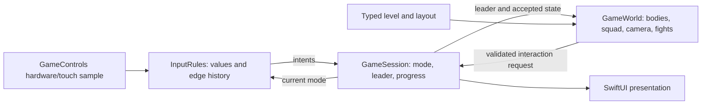

# Lauder — architecture

**Updated:** 18 November 2026\
**Status:** Swift and RealityKit accepted ([ADR 0001](decisions/0001-engine.md)). The game opens on a greybox Brooklyn Bridge ([ADR 0004](decisions/0004-brooklyn-bridge-opening.md)), whose layout Blender edits ([ADR 0005](decisions/0005-blender-level-editor.md)). Companions move as a squad under [ADR 0003](decisions/0003-squad-movement.md) phase S1. The [opening record](opening.md) lists what each milestone built; the [project history](history.md) covers the earlier Relay House slice, whose level was removed. Persistence remains later hardening; this design does not settle open relationships.

## Decision and platform

Use **Swift + RealityKit** for gameplay and the 3D world, and **SwiftUI** for the interface. Build scenes in Swift and load USDZ assets directly, following the [maintainer's code-first decision](https://github.com/RonildoBraga/lauder/issues/9#issuecomment-6907224023). The accepted rationale, alternatives and the Stage 1 stop criterion are in [ADR 0001](decisions/0001-engine.md).

The project targets **iOS 27.0 or later**, iPhone first, in landscape. Use stable Xcode 27.2 / SDK 27.2 and record the actual toolchain, OS and build with validation results. The performance baseline is **iPhone 13 Pro Max**, with a measured 60 fps target. Broader Apple-device support follows a working iPhone prototype. A target is not a performance result.

## Shape of the project

Keep **one app target**, one Swift Testing target and ordinary feature folders. No package hierarchy, third-party dependency, custom ECS or new rendering layer is needed. The app, its tests and its project live in `apple/`, and Blender's level script in `blender/`; a later platform gets a folder of its own beside `apple/`, as the [project structure](../README.md#project-structure) shows. Both targets use Xcode's folder-synchronised groups for `apple/sources/` and `apple/tests/`, so a new Swift file needs no project-file edit.

| Part | Responsibility | Boundary |
|---|---|---|
| App composition | Own stable session/world instances and launch/teardown | SwiftUI reevaluation does not recreate them |
| GameSession | Mode, who is in the party, active leader, fired trigger areas, the story's beat, a fight's hits, rounds and defeated hostiles, bodies searched and the shared inventory; accept/reject commands | Plain Swift values and rules, no entities or views |
| GameWorld | A body for each member, hidden until they join, camera, collision, following, fights, scenes and owned update/load work | Owns entity state; uses plain Swift motion, routes, formation and combat rules |
| Combat | Weapon timing, sight lines, assisted aim, each hostile's states and an encounter's timed cues | Plain Swift values, no entities; the world drives them each step |
| Interface/input | Poll hardware, hold input-rule state, present coarse session/world state | Supplies intents; does not own a second gameplay mode |
| Content | The Brooklyn Bridge as a typed level: its layout file, its places' words, interactions, trigger areas, encounters and conversations; character IDs and delivery assets | Small authored definitions within the app |
| Persistence, later | Versioned checkpoints and an ordered writer | Values, never entity graphs |

These are responsibilities, not new frameworks or a requirement to create every folder immediately. SaveStore follows in later hardening.

## Scene and asset authoring

Compose the greybox from generated meshes, simple materials, lights and camera. Keep authored positions, collision dimensions and stable IDs in typed levels, rather than adding JSON or a parser to the game. A `Level` value holds a place's floor, blocker boxes, decoration pieces, points of interest, interactions, trigger areas, encounters, starting party, spawn points, starting heading, the camera's offset and field of view, and its lights. `BrooklynBridge` builds the one level; the world, the session, the navigation grid and the scene dressing take the level they are given, so tests can build small levels of their own. The scene dressing draws the decoration that blocks nothing from the level's pieces, such as the cables and the raised walkway. The surfaces' materials come from one shared palette, `Surfaces.swift`; the stand-ins and the gameplay signals keep their own colours in code.

Since [ADR 0005](decisions/0005-blender-level-editor.md), Blender is the level editor. The bridge's layout is a plain-data Swift file with stable names, `BrooklynBridgeLayout.swift`, holding the ground, boxes, landmarks, flat areas, markers, decoration pieces, the game camera and the lights. The palette, `Surfaces.swift`, is a second plain-data file, shared by every level. The Lauder extension for Blender, `blender/extensions/lauder_levels`, loads both into Blender and saves them back after checking the game's rules, refusing to overwrite changes made to them since its last Load or Save. Each level has a working Blender file in `.local/blender`, outside Git, and Blender's Play button builds the game and opens it in the Simulator through `apple/scripts/play`. Blender also shows the details the game adds to each vehicle and landmark, without saving them. The level's own file adds the words and refers to entries by name. The Swift files stay the source of truth, and the game still compiles typed data, with no parser or loading at runtime.

The party uses three named, differently coloured primitive stand-ins. No new character models or animation are required. Stage 1's rig and idle/walk proof is preserved: keep editable sources, deliberate exports and provenance together; the [stand-in generator](../apple/sources/content/character/README.md) is a prototype asset tool, not a finished-art pipeline. The [test-only asset fixture](../apple/tests/support/CharacterAsset.swift) validates the named animation library; the app target does not ship its loader. Do not add per-frame visual work, publish character transforms to SwiftUI, or require art production before evaluating play.

## Swift conventions

- Use **Swift 6 language mode** and complete data-race checking. Keep session/UI/world coordination main-actor isolated; concurrency boundaries must be explicit. [Swift migration guidance](https://www.swift.org/migration/documentation/swift-6-concurrency-migration-guide/enabledataracesafety/)
- Use **Swift Testing** for rules and value-based movement tests. [Swift Testing](https://developer.apple.com/xcode/swift-testing/)
- Use toolchain **`swift format`** with the committed [`.swift-format`](../apple/.swift-format): two-space indentation, 100-column length and otherwise tool defaults.
- Run **`./scripts/check`** for formatting, the layout script's tests, the shared scheme's build and tests. [Validation requirements](../CONTRIBUTING.md#validation)

## Runtime ownership

**GameSession is the sole authority** for:

- Mode: exploring, dialogue or paused. Pausing records whether to resume exploring or the current dialogue; pauses do not nest or lose the dialogue cursor.
- Who is in the party, in switching order, and the active leader among them. The bridge starts with Miki alone, and members join through the story; **Next** appears only when there is someone to switch to.
- The trigger areas that have shown their line in this run.
- The story's beat: Miki alone, the stranger, the ambush, travelling with Tom, Laura found, helping her, travelling with Laura, and arriving at the Manhattan end. A beat begins only after the one before, once and while exploring. During a fight the session also holds the leader's hits, the carbine's rounds, the hostiles that are down and the checkpoint that a retry returns to. It holds the bodies searched and a small shared inventory with the medical kits, and adds a member to the party when the conversation that recruits them ends.
- The current conversation and line, and the pause menu's choice.

Use plain Swift session state and rules on the main actor, exposing only coarse changes to the interface. There are no separate member inventories, and the world keeps no progress flags of its own.

**GameWorld owns spatial state:** a body reference for each stable member ID, out of movement until that member joins and hidden until then unless the level has them lying hurt where they wait, their actual positions, companion routes and formation state, one camera, scene bindings and one owned scene-update subscription. It reads the active leader from the session. Its `EncounterStage` holds the hostiles' bodies and positions, their aim and shots, the assisted target and whether the carbine is drawn, and keeps no second copy of hits, rounds or who is down. Operational facts such as loading, app activity and hardware availability are not another exploring/dialogue/paused mode.

**GameControls owns device attachment and raw sampling.** Pure InputRules owns the transformation of raw values plus prior input-rule state into intents and next rule state. Neither keeps an independent pause/dialogue policy: `GameWorld` reads the mode from `GameSession`, and `GameControls` receives it when resolving input.

The owned world update coordinates this sequence. Rules do not retain RealityKit entities, and the world does not keep a second leader, inventory or progress truth.

## Input and command routing

Keep the shared GameController extended-gamepad path for PS5 DualSense/Xbox and the Simulator keyboard path. Mappings: left stick/WASD movement, Cross/A/E action, R1/RB/Q to cycle the leader, R2/RT/F to fire, and Options/Menu/Escape Pause. R1 is read through the [right shoulder element](https://developer.apple.com/documentation/gamecontroller/gcextendedgamepad/rightshoulder) and R2 through the right trigger; Xbox hardware delivery remains unverified. The maintainer authorised [touch controls](touch-controls.md), superseding the earlier no-touch decision: a fixed bottom-left analog stick, **Look**, **Next: name**, **Pause/Resume** and, during a fight or once the carbine is drawn, **Fire** supply the same intents. Touch is automatic without an extended controller; an attached controller is preferred unless **Use touch controls** is selected, and **Use controller** returns to it. The preference is in memory, not persisted.

GameControls samples hardware and TouchInput state; InputRules resolves all sources with the same mode, priority and fresh-edge history. Touch controls do not call GameSession or world actions directly. Independent zones support a stick finger alongside button fingers. Source changes and inactivity cancel captures through a generation token so stale callbacks cannot affect the new source. Pause leaves capture mounted and preserves held contacts: all fingers must lift, including a centred-stick finger, before the neutral gate clears.

Keep explicit previous-button/edge state in InputRules instead of adding another edge detector in GameWorld. Tests cover:

1. Pause takes priority over other commands in the same sample. The session stores the resume mode and routes subsequent inputs accordingly.
2. While exploring, a fresh switch edge cycles leadership and suppresses the same-sample action. Record that action's held state even when suppressed: it requires release and a fresh press before use.
3. Held movement may continue on the new leader. Switching alone does not close the neutral-input gate.
4. While in dialogue or Pause, switch edges are ignored and consumed, not queued. Action advances text or confirms the pause-menu choice; it cannot also interact with the world. Movement can navigate a menu only where explicitly defined, never move the bodies.
5. Inactivity, input-source changes and Pause/Resume retain the release gate. All gameplay buttons, including switch and Fire, must be released and the stick centred before fresh input. Opposing held movement keys do not count as neutral.
6. While exploring, Fire is both a fresh press, which draws a holstered carbine, and a hold, which keeps firing at the weapon's own pace. Dialogue and Pause consume it.

**The pause menu** has two choices, **Resume** and **Restart**, and opens on Resume. A fresh up or down press, from W/S or the stick, chooses; the action confirms; Pause resumes directly. Restart takes effect at once, without a second confirmation. On touch, the action button reads **Restart** while paused and **Resume** stays at the top right. The action button keeps the intent it sent when its finger came down until that finger lifts, so a press that began before Pause cannot release as Restart. In a conversation the action button reads **Continue**, and Pause keeps the current line.

GameSession decides what an allowed intent means for the current mode. World movement/following runs only when exploring, presented, active, ready, supplied with an available input source and past the neutral-input gate. This does not require nonzero movement: companions may settle while the leader stands still. Dialogue, Pause, input loss or a closed release gate freezes the whole party; input sampling needed for dialogue/menu/Pause remains available. Keep the foreground game awake, including Pause, and restore the idle timer on leaving it.

## Movement and presentation

Continue using one owned RealityKit scene update with elapsed time. **RealityView.update is for state-driven scene changes, not the simulation loop.** Do not add a timer or per-input tasks. Keep the existing cancellation, first-step timing reset and late-load protection. Movement does not require rigid-body simulation.

Inside that update, party movement advances in **fixed 1/120-second steps**. Each frame adds its elapsed time, capped at 1/30 second, runs as many whole steps as fit and carries the remainder; the first step after an interruption discards any remainder. Equal steps keep the companions' spacing independent of the display's frame times ([#28](https://github.com/RonildoBraga/lauder/issues/28)). Camera easing uses the frame's elapsed time. Bodies move in whole steps without interpolation, so a frame can show up to one step (about 2 cm at full speed) more or less than its elapsed time; that is accepted for the greybox.

All three stand-ins use the same circular footprint. PartyMotion resolves continuous horizontal movement in plain Swift against the axis-aligned rectangles derived from the level's visible blocker dimensions ([#25](https://github.com/RonildoBraga/lauder/issues/25)). Offset faces and exact rounded corners use the body radius plus a **2 mm normal skin**, including unobstructed endpoints. A body starting inside that clearance may move outward or tangentially, while inward movement stays blocked; idle input never snaps its position. Resolve the initial leg and at most one wall-slide leg, then check the final start-to-end chord so a move cannot cut through another blocker. RealityKit renders the bodies and scenery; movement uses no engine shape queries or physics components. Ground, decoration and party members are excluded from the blocker list. Body height stays fixed on the flat floor; slopes, steps and vertical traversal are outside the prototype.

Companions move as a squad under [ADR 0003](decisions/0003-squad-movement.md), [accepted by the maintainer](https://github.com/RonildoBraga/lauder/pull/32#issuecomment-6944093756). Each step:

1. The leader moves from the stick, and a short **route memory** records their last 6 m.
2. **SquadPlanner** places a **Close** formation slot for each companion, 0.9 m to the side and 0.9 m behind, turned towards the leader's heading at up to 180° per second. A slot is used only where a body fits outside doorway-like passages and the straight line from the leader is clear. Otherwise it is pulled halfway in, then moved onto the leader's route; it spreads out again once it has fitted for 0.3 s. A waiting companion stands clear of doorways.
3. **CompanionMotor** steers each companion: straight to the slot when the line is clear, matching the leader's movement and closing the gap; otherwise along an A* route on **NavigationGrid**, a 0.2 m grid over the level's authored rectangles, straightened against the same footprints. When the grid is built, each rectangle checks only the cells within its reach, which gives the same grid as checking every cell and suits the long bridge. Companions may reach 1.25× the leader's speed to catch up, accelerate and turn at limited rates, settle without shuffling and keep about 0.75 m of personal space. Laura reacts first and Tom last, by a fraction of a second.
4. Every movement, the leader's included, is resolved by PartyMotion.

A companion that stalls for a second re-plans; after three stalls they wait, the HUD names them, and they retry by themselves. The leader and the other companion keep moving, and nobody teleports. The planner places whoever is in the party with the leader: one companion or two.

The camera keeps the level's elevated offset and field of view and follows the session's selected leader. The bridge's camera keeps the accepted height and distance but looks straight along the deck, so pushing up walks towards Manhattan. On switching, ease the target from the current camera target to the new leader over **0.25 seconds**, tunable in playtests; another switch starts from the current interpolated target, and the transition freezes with the world. During a fight the target leans from the leader towards the nearest hostile in the open, 40% of the way and at most 3 m, easing in and out over about a second, so both stay on screen; the bridge camera otherwise shows only about 10 m ahead. While a scene with a focus plays, such as Laura calling out, it leans 80% of the way towards the focus, at most 7 m, so what the scene is about shows clear of the HUD's panel. Restart and a fight's retry straighten it at once.

## The opening

The app opens on the **Brooklyn Bridge**: Miki crosses alone from the Brooklyn end, and trigger areas on the deck each show a line the first time she enters them in a run. Tom's body waits, hidden, where his scene will use it. Laura lies hurt in view at hers, face down beside a car, until her scene stands her up; she stays out of movement and the squad until she joins. The objective line changes as the story moves on.

### Interactions

An interaction is an entry in the level: a stable action ID, a name for the prompt, an authored approach area on the usable side of any wall, and the lines for success, repetition and too early. Required IDs must exist once at load. Whoever leads can use an interaction.

1. GameWorld evaluates the leader's actual position against the interaction's approach area, and the HUD shows the action's name where the session offers it.
2. A fresh action press rechecks the leader, the approach and the session's progress, so a prompt left over from before a move or a switch cannot act.
3. GameSession validates the mode and progress and accepts or rejects the named command. An accepted action can begin an encounter, as the search begins the ambush and Help, which uses the shared medical kit, begins Laura's scene.

### Fights

An encounter is a value in its level: the beat it starts, how it begins (a trigger area or an action), the point a retry returns to, its hostiles and its timed cues. When it begins and its beat is next, the session starts the beat and keeps a checkpoint. The world then advances the fight in each fixed simulation step, after the leader moves:

1. `StoryDirector` plays the cues that are due: a hostile steps out, a line shows, a hostile starts to fight.
2. Each `HostileState` advances. A finished wind-up is a shot, resolved against range and line of sight: a deliberate first miss, a hit, or blocked by cover or distance. A hit asks the session to count it. A charging hostile runs at the leader instead and never shoots.
3. If Fire is held, the carbine is drawn and ready, the leader shoots the assisted target. The session spends the round and counts the hit, and the stage knocks the hostile down when the session says it is down. Only Miki carries the carbine.
4. When every hostile is down, the session ends the fight and the leader's hits recover.

The session's last allowed hit starts the retry. The screen fades out over 0.6 s; the session restores its checkpoint; the stage puts every hostile back unseen; the leader returns to the retry point with fresh route memory, formation planner and motors; the screen fades in over 0.4 s; and the input owner requires neutral input, as on Resume. Pause holds the fight and the fade, because both advance only while exploring.

### Scenes

A scene is an encounter that holds the party still while its cues play, whoever leads, so that only its cues place and turn anyone; switching leader during it moves no one. It has no retry, because the leader cannot be hurt in it. An encounter can also have no hostiles at all, and then ends after its last cue. The ambush is a scene. Searching the stranger's body begins it, and its cues, all played in the fixed step, do the following in order:

- step the attacker out from behind the van and set him running at Miki;
- take the body's loot into the session's shared inventory;
- show Tom;
- fire Tom's scripted shot, which the session counts as a takedown;
- turn Miki and Tom to each other;
- start their exchange.

Laura's scene follows the same pattern: Help begins it, she stands, she and Miki turn to each other, and their exchange ends with her joining. Reaching the Manhattan end with all three begins a last scene, a short closing exchange.

A scene ends after its last cue, once its hostiles are down. What a conversation settles, such as Tom or Laura joining, takes effect when it ends, so Restart part-way through discards it. Pause holds a scene, and Restart cancels it. While a scene holds the party, the world ignores movement, Fire and actions; Pause still works. A conversation that a cue begins also ends the frame's remaining movement steps. Keep conversations as short, ordered, speaker-labelled text in content; no branching dialogue framework is required.

## Restart and lifecycle

Restart resets the existing session and world in place, chosen from the pause menu through the selected input path:

1. The session resets: exploring, the level's starting party with its first member (Miki) leading, no trigger fired, the first story beat with no fight under way, full rounds, no hits, nobody down, no body searched and an empty inventory, no conversation, and the pause menu back on Resume.
2. The world puts every body back on its level's spawn point, facing the level's starting direction, shows only the members in the party and marks the leader. Route memory restarts at the leader's spawn; the formation planner, each companion motor, the companion targets and the stall warning start afresh.
3. The camera transition is cancelled and the camera target returns to the start. Owed simulation time is dropped and the next step is skipped.
4. The encounter stage puts every hostile back unseen and holsters the carbine, members who have not joined are hidden again or lie hurt again where they wait, and a scene or a retry in progress is cancelled with its fade.
5. The observation returns to the level's opening line, and the prompt and nearby landmark are recomputed. The input owner requires neutral input, as on Resume, so every button, key and finger must be released before anything moves.

Restart does not attach a second simulation callback, rebuild the static scene, add entities or reload stand-ins. The run has no asynchronous effects or loads today, so nothing needs invalidating; one added later must check that it still belongs to the current run. Tests restart repeatedly and count every entity. The update subscription is attached only when the view appears, so Restart cannot add a second one.

Normal inactivity freezes the current scene and preserves session and dialogue progress. Clear held input and reset frame timing when returning. Leaving the view cancels owned updates and unfinished loads.

## Saving and interruption

**Persistence is later hardening, not a first-playable dependency.** Create SaveStore then.

Use a versioned Codable checkpoint with the story's beat, the party, the shared inventory, the active member ID and an authored safe group-spawn ID. Restore the party to a validated group placement; define the checkpoint mapping before implementing saves. Do not serialise arbitrary transforms, routes, physics or animation state.

Save meaningful changes with one ordered atomic writer. Restart invalidates older writes. Report failures; a corrupt or unsupported save remains intact until the player explicitly chooses Restart. Termination during dialogue replays its checkpoint; ordinary Pause preserves the live line. Do not rely on a shutdown callback.

## Checks

Swift Testing covers the input rules, the session's modes, leadership, beats, fights, inventory and Restart, exact collision regressions and fixed-seed whole-party runs with wall contact and leader changes, the navigation grid, the squad's formation, stillness, doorways and switching, sight lines, assisted aim, hostile timing, cues, scenes, and the level's content. Squad-movement tests run in a test-only yard with a 1.8 m opening, since the bridge has no doorway that narrow. Unit tests do not prove the rendered route: Debug builds also contain scripted playtests that `apple/scripts/playtest` runs in the rendered Simulator app, feeding scripted input through the normal controls and recording traces; they are compiled out of Release builds, and the standard check also drives them without rendering.

Use Simulator keyboard and single-pointer touch input for everyday iteration. Live PS5 input did not work in the tested Simulator setup; enumeration does not prove delivery. The [touch-control record](touch-controls.md#validation) distinguishes Simulator checks from the maintainer's physical multi-touch, Pause and recovery observations. Device behaviour and performance need the phone; Simulator timing is not phone evidence. Sustained 15–20 minute thermal and memory checks remain later hardening.

## Deliberately deferred

Finished character art and animation, free jumping and climbing, formation orders, separate inventories, generic navigation/ECS/inventory/quest frameworks, additional packages, networking, cloud saves, monetisation and scene streaming.

The [future squad and combat design](gameplay-script.md#future-squad-and-combat-design) and [The Quiet Yard](encounters/the-quiet-yard.md) describe intended experiences. Their [design gate](prototype-plan.md#combat-design-review-gate) precedes any implementation assignment beyond the opening's first fight. [ADR 0003](decisions/0003-squad-movement.md) sets out the navigation and formation design; phase S2 is the opening's M5.

## Revisit after the first playable

If following is unreliable, first reconsider the squad movement's tuning and the layout; an automatic regroup requires a deliberate review. Add the next survival pressure, combat encounter or visual requirement only when a concrete playtest need warrants it.
